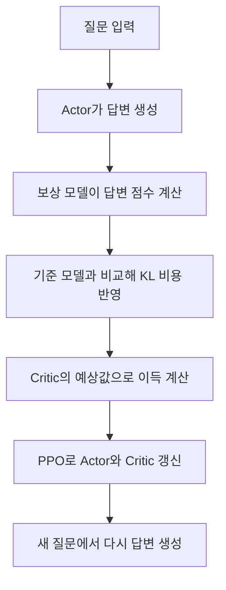

## 1. 보상으로 생성 모델을 조정하는 이유

- SFT는 미리 준비한 좋은 답변을 따라 배우는 방법이다.
- 실제로 생성한 답변 중에는 더 나은 답도 있고, 덜 적절한 답도 있다.
- **생성한 답변을 평가한 뒤, 좋은 평가를 받은 선택을 더 자주 하도록 모델을 조정할 수 있다.**
- RLHF(사람의 피드백을 이용한 강화학습)는 사람의 선호를 학습한 보상 등을 이용해 모델을 조정하는 방식이다.
- 여기서는 InstructGPT에서 사용한 SFT → 보상 모델 → PPO의 흐름을 살펴본다.

---

## 2. 언어 생성의 상태·행동·보상

- Reinforcement learning(강화학습)은 행동의 결과로 받은 보상을 이용해 다음 행동의 선택 방식을 학습한다.
- 언어 생성에서는 지금까지 읽고 쓴 토큰들이 현재 상태다.
- 다음 토큰을 고르는 것이 행동이다.
- 어떤 토큰을 얼마나 자주 고를지 정하는 확률 분포를 Policy(정책)라고 한다.
- 답변이 완성되면 보상 모델이 질문과 답변을 읽고 선호 점수를 준다.
- 높은 보상을 받은 답변의 토큰 선택을 학습에 반영한다.

---

## 3. Actor·Critic·보상 모델·기준 모델의 역할

| 역할 | 무엇을 계산하는가 |
| --- | --- |
| Actor(생성 모델) | 다음 토큰의 확률을 계산하고 답변을 만든다. PPO에서 갱신한다. |
| Reward model(보상 모델) | 완성된 답변의 선호 점수를 계산한다. PPO 동안 고정한다. |
| Reference model(기준 모델) | 같은 문맥에서 기준이 되는 토큰 확률을 계산한다. PPO 동안 고정한다. |
| Critic(가치 예측 모델) | 지금까지의 문맥에서 앞으로 받을 보상을 예측한다. PPO에서 갱신한다. |

- Actor는 SFT 모델에서 출발한다.
- Reference model은 보통 SFT 모델의 가중치를 고정해 사용한다.
- Critic은 보상 모델의 가중치에서 초기화할 수 있다. 이후에는 현재 상태의 예상 보상을 맞히는 별도의 학습을 한다.
- RM의 역할은 완성된 답변 평가이고, Critic의 역할은 생성 도중의 예상 보상 계산이다.

---

## 4. 기준 정책과 KL 비용

- 보상 점수만 최대화하면 보상 모델이 좋아하는 표현에 답변이 지나치게 치우칠 수 있다.
- 기준 모델이 갖고 있던 언어 생성 방식에서 얼마나 달라졌는지 비용으로 반영한다.
- 이 차이를 재는 데 KL divergence(KL 발산)를 사용한다.
- KL은 같은 문맥에서 두 모델의 토큰 확률 분포를 비교한다.

```text
학습에 사용할 보상
= 답변의 선호 점수
  − 기준 모델과의 차이에 대한 비용
```

- Actor가 생성한 **같은 답변 토큰열**을 Reference model에도 읽힌다.
- Reference model은 그 답변의 각 토큰에 기준 모델이라면 어느 정도의 확률을 줄지 다시 계산한다.
- 실전 학습에서는 생성한 토큰들의 로그 확률 차이로 KL 비용을 추정할 수 있다.
- 비용의 강도를 정하는 계수를 크게 하면 기준 분포에서 벗어나는 데 더 큰 비용을 준다.

### torch 모듈의 log·sum 함수와 KL 계산

- 보상만 높이려는 학습이 기준 모델의 생성 방식에서 크게 벗어나지 않도록 분포 차이에 비용을 줄 수 있다. 아래에서는 현재 확률 분포와 기준 분포의 KL 값을 보상에서 뺀다.

**코드 예시**

```python
import torch

policy = torch.tensor([0.8, 0.2])
reference = torch.tensor([0.5, 0.5])

kl = torch.sum(policy * torch.log(policy / reference))
reward = 2.0 - 0.5 * kl
```

**코드 해설**

- `policy / reference`로 후보별 확률 비율을 구하고 로그를 취한다. 현재 확률을 곱해 합친 값이 KL이며, 다음 줄은 그 값의 0.5배를 원래 보상 2에서 뺀다.

- 후보가 두 개인 한 위치의 확률 분포를 가정한 예다.
- `torch.log()`는 자연로그를 계산하고, `torch.sum()`은 후보별 값을 더한다.
- KL은 약 0.1927이고, 조정한 보상은 약 1.9036이다.
- 두 분포가 같으면 이 KL은 0이다.
- 여기서는 후보 전체의 확률로 정확한 KL을 계산했다. 생성 토큰을 이용하는 추정식과 계산 범위를 구분한다.

---

## 5. Critic과 Advantage의 의미

- 보상 2점을 받았다고 해도, 평소 1점을 기대한 상태와 3점을 기대한 상태는 다르게 해석할 수 있다.
- Advantage(기대 대비 이득)는 실제로 얻은 결과가 예상보다 얼마나 좋았는지 나타낸다.
- 양수이면 해당 선택의 확률을 높이는 방향으로, 음수이면 낮추는 방향으로 학습한다.
- 가장 단순한 한 단계 예에서는 `얻은 보상 − Critic의 예상값`으로 생각할 수 있다.
- 문장처럼 여러 토큰을 생성하는 경우에는 뒤에 받을 보상까지 반영해 토큰별 값을 계산한다.

```text
얻은 보상 2.0 − 예상값 1.2 = 이득 0.8
```

- Critic도 실제 학습 결과에 맞게 예상값을 수정한다.
- 이를 통해 질문이나 생성 위치에 따라 보상이 달라지는 영향을 일부 조절할 수 있다.

---

## 6. PPO의 확률 비율과 Clipping

- Proximal policy optimization, PPO(정책이 급격히 변하는 것을 줄이는 강화학습 방법)는 생성 결과를 이용해 정책을 갱신한다.
- 한 묶음의 답변을 만들 당시 토큰 확률을 저장해 둔다. 이를 이전 정책의 확률이라고 하자.
- 갱신 중인 현재 정책이 같은 토큰에 주는 확률을 이전 확률로 나눈다.
- 비율이 1이면 같고, 1.4이면 현재 확률이 이전 확률의 1.4배다.
- PPO의 clipping(값 제한)은 목표식에서 과도한 확률 변화가 더 큰 이득으로 계산되는 것을 줄인다.

### torch 모듈의 clamp·minimum 함수와 PPO 목표식

- PPO는 좋은 선택의 확률을 키우되 한 번의 갱신으로 과도하게 바뀌는 유인을 줄인다. 이전 정책과의 확률 비율을 제한한 목표와 원래 목표를 비교해 더 보수적인 값을 사용한다.

**코드 예시**

```python
import torch

ratio = torch.tensor([1.4, 0.6])
advantage = torch.tensor([1.0, -1.0])

clipped = torch.clamp(ratio, 0.8, 1.2)
objective = torch.minimum(
    ratio * advantage,
    clipped * advantage,
)
loss = -objective.mean()
```

**코드 해설**

- `clamp()`가 만든 비율은 `[1.2, 0.8]`이다. 이를 Advantage와 곱하면 `[1.2, -0.8]`, 원래 비율로 계산하면 `[1.4, -0.6]`이다.
- `minimum()`이 위치별 작은 값을 골라 `[1.2, -0.8]`을 만들고, 평균 0.2에 음수를 붙여 손실 -0.2를 얻는다. 음수 손실도 정해진 목표식을 최소화하는 계산에 사용할 수 있다.

- `torch.clamp()`는 여기서 비율을 0.8과 1.2 사이로 제한한 값을 만든다.
- `torch.minimum()`은 두 목표값 중 더 작은 쪽을 위치별로 고른다.
- 첫 번째 선택은 이득이 양수다. 비율을 1.4까지 키워도 이 목표값은 1.2까지만 반영된다.
- 두 번째 선택은 이득이 음수다. 비율을 0.6까지 줄여도 이 목표값은 -0.8이다.
- 이 예시가 제한하는 대상은 목표식에 반영할 비율이다. 실제 모델은 이 목표식의 기울기로 가중치를 갱신한다.
- 큰 목표값을 얻는 방향을 손실 최소화로 표현하려고 마지막에 음수를 붙인다.

---

## 7. 이전 정책과 기준 모델의 비교 목적

| 비교 대상 | 사용 목적 |
| --- | --- |
| 답변을 생성할 당시의 이전 정책 | PPO 갱신 중 확률이 얼마나 달라지는지 비율을 계산한다. |
| 고정된 Reference model | SFT에서 출발한 기준 분포와의 차이를 KL 비용으로 계산한다. |

- 이전 정책의 확률은 새 답변 묶음을 생성할 때마다 다시 기록한다.
- Reference model은 PPO가 진행되는 동안 같은 기준을 유지한다.
- PPO의 clipping과 KL 비용은 서로 다른 비교를 수행한다.

---

## 8. 질문부터 보상 계산과 가중치 갱신까지의 흐름



- 보상 모델과 기준 모델은 고정된 평가 기준을 제공한다.
- Actor와 Critic은 새로 생성한 데이터와 계산한 신호로 갱신한다.
- 학습 뒤에는 새로운 질문으로 답변의 관련성, 정확성, 반복 여부 등을 확인한다.
- **SFT는 좋은 답을 보여 주고, RM은 답변 선호를 점수로 만들고, PPO는 그 점수를 사용해 생성 모델을 조정한다.**

---

<!-- assignment-history:11-llmtrend -->

## 관련 문서

- <https://arxiv.org/abs/2203.02155>
- <https://arxiv.org/abs/1707.06347>
