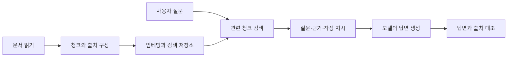

회사 규정에 답하는 챗봇을 만들면, 모델이 사내 문서를 읽고 현재 규정에 맞게 답해야 합니다. 규정집 전체를 질문마다 붙이면 입력이 길어지고, 정작 필요한 조항이 다른 내용에 묻힐 수 있습니다. **질문에 필요한 부분을 찾아 모델에게 읽히는 방법**이 RAG입니다.

## 학습 목표와 흐름

먼저 문서를 검색할 수 있게 준비하는 과정을 배웁니다. 이어서 질문과 관련된 문서를 고르고, 그 본문을 모델의 입력에 넣어 답변을 만드는 과정을 연결합니다. 마지막에는 LangChain에서 이 과정의 입력과 출력이 어떻게 이어지는지 확인합니다.

## 자습

### 1. 질문에 맞는 자료를 찾아 답하는 과정

사용자가 “남은 연차를 다음 해로 넘길 수 있나요?”라고 물었다면, 필요한 것은 연차 이월의 한도와 승인 조건입니다. 검색기는 규정집에서 해당 조항을 고르고, 생성 모델은 그 조항을 읽어 질문에 맞는 답변을 씁니다. 이처럼 검색한 자료로 답변 생성을 보완하는 방식을 Retrieval-Augmented Generation, RAG(검색 증강 생성)라고 합니다.

이때 모델에는 세 가지가 전달됩니다. **사용자의 질문, 검색한 근거, 답변 작성 지시**입니다. 근거가 “최대 5일, 부서장 승인 필요”라면 답변에는 한도와 승인 조건이 함께 들어가야 합니다. 필요한 규정이 없으면 어떤 내용을 확인할 수 없는지도 알려 줄 수 있어야 합니다.

RAG는 요청에 넣는 자료를 바꾸는 방식입니다. Prompt(프롬프트)는 이번 요청의 지시와 예시를 정하고, Fine-tuning(미세조정)은 학습으로 모델의 가중치를 바꿉니다. 최신 규정은 검색으로 전달하고, 반복되는 답변 형식은 미세조정으로 익히게 하는 식으로 함께 사용할 수 있습니다.

### 2. 문서를 검색하기 좋은 단위로 준비하는 방법

휴가·출장·보안 규정이 한 파일에 섞여 있으면 질문과 관련된 부분을 정확히 고르기 어렵습니다. 그래서 파일을 읽은 뒤 제목, 조항, 문단을 살피며 작은 검색 단위인 Chunk(청크)로 나눕니다. PDF에서는 본문을 추출할 때 표의 행과 열, 두 단으로 배치된 글의 읽기 순서도 함께 확인해야 합니다.

청크를 짧게 만들면 주제가 또렷해집니다. 다만 “다음 조건에 한한다”의 조건이 다음 조각으로 떨어지면 답에 필요한 문맥이 끊깁니다. 큰 청크는 주변 조건을 담기 쉽지만 다른 주제까지 함께 가져올 수 있습니다. **질문에 필요한 사실과 그 사실의 적용 조건을 함께 읽을 수 있는 크기**가 기준입니다.

문서 구조를 따라 나누거나, 문단부터 시도한 뒤 긴 부분을 줄·공백 단위로 더 나누는 방법을 사용할 수 있습니다. 이웃한 청크에 일부 내용을 겹쳐 두는 Overlap(겹침)은 경계에 걸린 문맥을 잇습니다. 이때 청크 길이가 글자 수인지 토큰 수인지도 정해야 합니다.

청크에는 본문과 함께 문서 이름, 페이지, 조항, 판본을 보관합니다. 이런 부가 정보를 Metadata(메타데이터)라고 합니다. 검색 결과를 답변의 출처로 제시하거나, 바뀐 문서의 청크만 교체할 때 사용합니다.

### 3. 표현이 다른 질문과 문서를 연결하는 임베딩

사용자는 “다음 해로 넘기기”라고 묻고 문서는 “연차 이월”이라고 표현할 수 있습니다. 이 두 표현을 연결하려면 문장의 의미를 비교할 방법이 필요합니다. Embedding(임베딩) 모델은 문장을 일정한 길이의 숫자 벡터로 바꾸고, 의미가 관련된 질문과 문서가 가까워지도록 학습됩니다.

문서 벡터는 미리 만들어 검색 저장소에 넣습니다. 질문이 들어오면 질문 벡터를 만들어 저장된 문서 벡터와 비교합니다. 질문과 문서는 서로 대응하는 모델과 입력 규칙을 사용해야 합니다. 모델에 따라 질문에는 `query:`, 문서에는 `passage:` 같은 접두어를 붙이기도 합니다.

벡터 비교에는 Cosine similarity(코사인 유사도)를 사용할 수 있습니다. 두 벡터의 내적을 각 벡터 길이의 곱으로 나누어 방향이 얼마나 비슷한지 구합니다.

$$
\mathrm{cosine}(q,d)=\frac{q\cdot d}{\lVert q\rVert\lVert d\rVert}
$$

여기서 $q$는 질문 벡터, $d$는 문서 벡터입니다. 예를 들어 $(1,0)$과 $(0.8,0.6)$은 길이가 각각 1이고 내적이 0.8이므로 유사도가 0.8입니다. 이 점수는 검색 순서를 정하는 데 사용합니다. 실제로 답을 뒷받침하는지는 선택된 본문을 읽어 확인합니다.

### 4. 검색 결과를 모델이 읽을 입력으로 만드는 방법

관련 청크를 찾은 다음에는 본문을 꺼내 질문과 함께 전달해야 합니다. 벡터 저장소는 청크의 벡터와 본문·출처를 연결해 보관하고, Retriever(검색기)는 질문에 맞는 문서 목록을 반환합니다. 생성 모델이 읽는 근거는 이 목록에서 꺼낸 본문입니다.

문서 준비와 질문 처리를 나누면 같은 자료로 여러 질문에 답할 수 있습니다.

검색 결과가 많아지면 모든 본문을 넣기 전에 입력 길이를 확인합니다. 핵심 근거와 예외 조건을 우선하고, 중복된 본문을 정리합니다. 문서를 수정하거나 삭제했다면 저장소도 갱신해 다음 질문에 적용 중인 판본이 검색되도록 합니다.

### 5. LangChain에서 각 단계의 입력과 출력을 연결하는 방법

RAG를 코드로 만들 때는 문서 목록, 본문 문자열, 채팅 메시지처럼 서로 다른 자료형이 오갑니다. LangChain은 검색기·프롬프트·모델 등의 구성 요소를 공통된 호출 방식으로 연결합니다. 먼저 **앞 단계가 돌려준 값이 다음 단계에 어떤 형태로 들어가는지**를 보면 전체 흐름을 이해하기 쉽습니다.

| 단계 | 입력 | 출력 |
|---|---|---|
| 검색 | 질문 문자열 | 본문·출처가 담긴 문서 목록 |
| 근거 구성 | 문서 목록 | 출처를 붙여 모은 본문 |
| 프롬프트 구성 | 질문과 근거 | 역할이 구분된 채팅 메시지 |
| 모델 호출 | 채팅 메시지 | 모델 응답 메시지 |
| 출력 처리 | 응답 메시지 | 화면에 사용할 답변 문자열 |

채팅 메시지는 역할을 가집니다. System(시스템)은 답변 규칙, Human(사용자)은 질문, AI는 모델 응답, Tool(도구)은 실행 결과를 담습니다. 모델의 응답에는 텍스트와 함께 도구 호출 요청이 포함될 수도 있습니다.

LangChain의 Runnable(실행 가능한 구성 요소)은 `invoke()`로 입력 하나를 처리합니다. `batch()`는 입력 목록, `stream()`은 결과 조각, `ainvoke()`는 비동기 호출에 사용합니다. Runnable 사이의 `|`는 왼쪽 출력을 오른쪽 입력으로 넘기는 순차 연결입니다. 따라서 `prompt | model | parser`는 메시지 구성, 모델 호출, 출력 처리의 순서입니다.

### 6. 답변이 틀렸을 때 원인을 찾는 순서

규정의 이월 한도가 틀렸다면 먼저 원문에서 숫자를 제대로 읽었는지 확인합니다. 다음에는 필요한 조항이 검색됐는지, 검색한 조항이 실제 모델 입력에 포함됐는지, 모델이 한도와 승인 조건을 제대로 설명했는지 차례로 봅니다.

이렇게 나누면 표 추출 오류를 프롬프트로 고치거나, 검색 누락을 모델 변경으로 해결하려는 시행착오를 줄일 수 있습니다. 다음 강의에서는 필요한 근거를 더 잘 찾기 위해 검색 방법과 질문 표현을 조정합니다.

## 이해 확인

> [!question]- 문서 벡터를 찾은 뒤 생성 모델에는 무엇을 전달하나요?
> 선택한 청크의 본문과 출처를 질문·작성 지시와 함께 전달합니다. 벡터는 관련 청크를 고르는 데 사용합니다.

> [!question]- 승인 조건이 답변에서 빠졌다면 어느 단계를 확인하나요?
> 원문 추출, 청크 경계, 검색 결과, 실제 입력, 생성 답변 순서로 조건이 빠진 위치를 찾습니다.

> [!question]- 규정을 수정한 뒤 기존 검색 저장소에는 어떤 처리가 필요한가요?
> 수정된 문서의 청크와 벡터를 갱신하고, 적용 대상에서 빠진 이전 판본이 검색되지 않도록 정리합니다.
