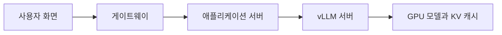

D57의 핵심은 **“LLM에 여러 질문이 들어올 때, GPU 메모리를 효율적으로 쓰면서 빠르게 답하는 방법”**입니다. 이를 위해 사용하는 도구가 vLLM입니다.

챗봇에 질문을 보내면 모델은 답을 한 번에 완성하지 않고 Token(토큰)을 하나씩 생성합니다. “오늘 날씨가 좋습니다”라는 답도 작은 단위로 나누어 순서대로 만듭니다. 이 과정에서 모델의 가중치를 반복해서 읽고 계산합니다. 질문이 하나일 때는 단순하게 처리할 수 있지만, 여러 사람이 동시에 질문하면 요청을 어떤 순서로 계산하고 메모리를 얼마나 배정할지가 중요해집니다.

**vLLM은 모델 실행, 요청 묶기, 생성에 필요한 메모리 관리를 맡는 Inference engine(추론 엔진)**입니다. D56에서 준비한 양자화 모델을 여러 사용자에게 제공하는 단계로 연결해 주는 도구라고 이해하면 됩니다.

먼저 모델이 답하는 과정을 두 단계로 나누어 보겠습니다. **Prefill(입력 처리)**에서는 질문 전체를 읽고 계산합니다. **Decode(토큰 생성)**에서는 그 계산을 바탕으로 답을 한 토큰씩 이어 만듭니다. 질문이나 참고 문서가 길면 입력 처리에 시간이 들고, 답이 길면 토큰 생성 단계가 오래 이어집니다.

이때 이전 토큰에서 계산한 일부 값을 저장해 다시 사용하는 것이 **KV cache(키·값 캐시)**입니다. 다음 토큰을 만들 때 앞부분을 매번 처음부터 계산하는 비용을 줄여 줍니다. 대신 GPU 메모리가 필요합니다. 입력과 답이 길어질수록, 동시에 처리하는 요청이 많아질수록 필요한 KV 캐시도 커집니다. GPU에는 모델 가중치와 요청별 KV 캐시, 실행 중 사용하는 임시 공간이 함께 들어갑니다.

vLLM의 중요한 기능 하나는 **Continuous batching(연속 배칭)**입니다. Batch(배치)는 여러 요청을 묶어 함께 계산하는 것입니다. A·B·C 세 요청을 처리하는 중 A의 짧은 답이 먼저 끝났다고 해 보겠습니다. 연속 배칭은 다음 계산 단계에 대기 중인 D를 넣어 B·C·D를 함께 처리합니다. 요청마다 끝나는 시간이 달라도 빈자리를 계속 채우므로 GPU를 더 효율적으로 사용하고 전체 처리량을 높일 수 있습니다.

다른 핵심은 PagedAttention입니다. 요청별 KV 캐시를 작은 Block(블록)으로 나누어 보관하고, 각 요청이 사용하는 블록의 위치를 기록합니다. 요청이 길어지면 필요한 블록을 추가하고, 완료되면 다른 요청이 그 공간을 사용합니다. 예를 들어 블록 하나가 16토큰을 담는다면 17토큰에는 블록 두 개가 필요합니다. 요청마다 최대 길이만큼 공간을 미리 확보하는 방식보다 실제 길이에 맞춰 메모리를 배정하기 쉽습니다.

이 원리를 이해하면 vLLM의 세 가지 주요 설정도 연결됩니다.

| 설정 | 쉽게 풀어쓴 의미 |
| --- | --- |
| gpu\_memory\_utilization | 전체 GPU 메모리 중 이 vLLM이 사용할 예산의 비율입니다. 가중치·실행 공간·KV 캐시에 쓰입니다. |
| max\_model\_len | 요청 하나에서 입력과 생성 답을 합한 최대 토큰 수입니다. |
| max\_num\_seqs | 엔진이 한 계산 단계에서 처리할 최대 시퀀스 수입니다. 기본적인 단일 답변 요청에서는 동시 처리 요청 수와 연결됩니다. |

예를 들어 max_model_len=4096이면 질문과 답을 합쳐 4,096토큰 안에 들어와야 합니다. 질문이 3,500토큰이면 답에 쓸 수 있는 공간은 그만큼 줄어듭니다. 한편 max_tokens=128 같은 생성 옵션은 이번 답을 최대 128토큰까지 만들겠다는 뜻입니다. 전체 길이 상한과 답의 길이 상한을 구분하면 됩니다.

양자화와 KV 캐시도 연결해서 보아야 합니다. 4비트 양자화는 모델 가중치의 메모리를 줄입니다. 줄어든 공간을 KV 캐시에 더 사용할 수 있습니다. KV 캐시의 자료형은 별도로 정해집니다. D57의 32B 예시에서는 가중치는 AWQ 4비트이고, KV 캐시는 16비트 조건으로 계산합니다.

마지막으로 서버가 좋아졌는지는 **Throughput(처리량)**과 **Latency(지연 시간)**를 함께 측정합니다. 처리량은 “1초에 질문이나 토큰을 얼마나 많이 처리했는가”, 지연 시간은 “사용자가 답을 받기까지 얼마나 기다렸는가”입니다. 스트리밍에서는 첫 답 조각까지 걸린 시간도 중요합니다. 동시 요청 수를 늘리면 전체 처리량이 증가하면서 개별 응답 시간도 길어질 수 있으므로, 실제 질문으로 측정해야 합니다.

따라서 D57에서 최종적으로 정할 것은 **“우리 모델과 질문 길이에서, 응답 시간 목표를 지키며 몇 개의 요청을 동시에 받을 것인가”**입니다. KV 용량으로 메모리에 담을 수 있는 요청 수를 계산하고, 부하 실험으로 목표 시간 안에 답하는 요청 수를 확인합니다. 그 결과를 바탕으로 vLLM 설정을 고르고 기존 챗봇의 생성 함수를 vLLM 서버 호출로 연결하는 것이 이번 수업의 흐름입니다.

챗봇에 질문 하나를 보내면 빠르게 답하는데, 여러 사람이 함께 사용하면 대기 시간이 길어질 수 있습니다. GPU에 모델을 올린 뒤에는 **들어온 요청을 어떻게 묶어 계산하고, 각 요청이 사용하는 메모리를 어떻게 나눌지**도 중요해집니다.

vLLM은 LLM의 추론과 서빙을 담당하는 실행 도구입니다. 생성 중인 요청들을 함께 계산하고, 먼저 끝난 요청의 자리에 다음 요청을 넣습니다. 이전 토큰의 계산 결과를 보관하는 메모리도 작은 블록으로 관리합니다.

여기서는 **Continuous batching(연속 배칭)**과 **PagedAttention**의 원리를 배웁니다. 이어서 요청 길이·메모리·동시 처리 수를 설정하고, 기존 챗봇을 vLLM 서버에 연결하는 방법을 익힙니다. D56에서 준비한 양자화 모델이 여러 사용자에게 답하는 서비스로 이어지는 과정입니다.

## 학습 목표와 흐름

| 배울 내용 | 이해할 내용 |
|---|---|
| 요청을 묶는 이유 | 가중치를 읽는 비용을 여러 요청이 함께 사용하는 과정 |
| 연속 배칭 | 생성 길이가 다른 요청들의 빈자리를 채우는 방법 |
| KV cache(키·값 캐시) | 요청 길이와 동시 요청 수에 따라 메모리가 증가하는 이유 |
| PagedAttention | 흩어진 캐시 블록을 연결해 읽고 필요한 만큼 할당하는 방법 |
| 서버 구성과 설정 | 모델 실행·요청 관리의 역할과 메모리·길이·배치 상한의 관계 |
| 성능 비교 | 답변 품질·전체 처리량·개별 응답 시간을 함께 읽는 방법 |

## 자습

### 1. 여러 요청을 함께 계산하는 이유

사용자가 많아진 챗봇에서는 기다리는 요청들을 처리할 방법이 필요합니다. LLM은 답변을 한 토큰씩 생성하며, 다음 토큰을 계산할 때 모델의 여러 층을 통과합니다. 이 과정에서 GPU 메모리에 있는 가중치를 읽습니다.

요청 하나의 다음 토큰만 계산하면, 가중치를 읽는 양에 비해 계산할 입력이 적습니다. 이런 Decode(토큰 생성) 구간에서는 GPU의 계산 능력과 함께 Memory bandwidth(메모리 대역폭), 즉 초당 읽고 쓸 수 있는 데이터 양이 속도에 크게 작용합니다.

여러 요청의 다음 토큰을 한 Batch(배치)로 계산하면 같은 가중치를 여러 입력에 사용합니다. 요청 A·B·C가 서로 다른 답을 만들더라도 각 층의 가중치는 공통입니다. **가중치를 읽는 비용을 여러 요청이 나누어 쓰면서 GPU 전체의 처리량을 높입니다.**

간단한 계산 예를 보겠습니다. 요청 네 개가 각각 100토큰을 만들고, 한 요청의 생성 스텝에 10ms가 걸린다고 가정합니다. 순서대로 처리하면 총 400스텝, 약 4초가 필요합니다. 네 요청을 묶은 한 스텝이 12ms라면, 100스텝에 총 400토큰을 만들어 약 1.2초가 걸립니다. 입력 처리와 통신 시간은 생략한 예입니다.

이때 서버 전체의 생성량은 초당 100토큰에서 약 333토큰으로 늘고, 각 요청의 생성 속도는 초당 100토큰에서 약 83토큰으로 바뀝니다. **전체 처리량과 요청 하나의 생성 속도를 따로 보는 이유**가 여기에 있습니다.

| 지표 | 계산하거나 측정하는 대상 | 사용하는 상황 |
|---|---|---|
| Throughput(처리량) | 측정 시간 동안 완료한 요청 수 또는 생성한 토큰 수 | GPU 한 대가 감당하는 전체 작업량 확인 |
| Latency(지연 시간) | 한 요청을 보낸 때부터 응답을 받은 때까지의 시간 | 사용자 대기 시간 확인 |
| 요청별 생성 속도 | 한 요청의 Decode 구간에서 생성한 토큰 수/시간 | 답변이 화면에 이어지는 속도 확인 |

앞단 서버의 작업자 수를 늘리면 더 많은 요청을 추론 함수에 전달할 수 있습니다. 그 요청들을 하나의 배치로 묶는 일은 추론 엔진의 스케줄러가 담당합니다. 따라서 작업자 수와 GPU의 배치 처리 방식을 함께 연결해야 합니다.

### 2. 길이가 다른 답변을 처리하는 연속 배칭

요청을 묶었더라도 답변이 끝나는 시점은 제각각입니다. 짧은 용어 설명은 먼저 끝나고, 긴 문서 요약은 계속 생성합니다. 이때 먼저 끝난 요청의 자리에 대기 중인 요청을 넣으면 GPU가 더 많은 유효 토큰을 계산할 수 있습니다.

Static batching(정적 배칭)은 함께 시작한 요청 묶음의 처리가 끝난 뒤 다음 묶음을 시작합니다. 연속 배칭은 **생성 스텝마다 배치에 들어갈 요청을 다시 정합니다.** 끝난 요청을 내보내고, 남은 자리와 메모리에 맞춰 새 요청을 받아들입니다.

슬롯이 두 개이고, 요청 A·B·C·D가 모두 처음부터 기다린다고 가정합니다. 각 요청은 2·6·2·2개의 토큰을 생성하며, 한 스텝에 요청마다 토큰 하나를 만듭니다.

| 생성 스텝 | 정적 배칭 | 연속 배칭 |
|---|---|---|
| 1~2 | A·B 처리 | A·B 처리 |
| 3~4 | B 처리, A의 자리는 다음 묶음까지 비어 있음 | B·C 처리 |
| 5~6 | B 처리 | B·D 처리 |
| 7~8 | C·D 처리 | 모든 요청 완료 |

같은 슬롯 두 개로 전체 완료에 필요한 스텝이 8에서 6으로 줄었습니다. 새 요청이 들어갈 때에는 입력을 처리하는 단계도 필요합니다. 실제 스케줄러는 다음 절의 Prefill과 Decode를 함께 배치에 넣습니다.

### 3. 입력 처리와 토큰 생성을 배치에 넣는 과정

새 질문이 들어오면 모델은 질문 전체를 읽고 다음 토큰을 예측할 준비를 합니다. 이미 답변을 생성 중인 요청은 앞서 계산한 내용을 이용해 다음 토큰을 이어 만듭니다. 두 작업은 필요한 계산량이 다릅니다.

**Prefill(입력 처리)**에서는 입력 토큰들을 계산해 각 층의 키와 값을 저장하고 첫 출력 토큰을 예측할 정보를 만듭니다. **Decode(토큰 생성)**에서는 저장된 키와 값을 다시 사용하면서 다음 토큰을 생성합니다.

Scheduler(스케줄러)는 실행 중인 요청과 기다리는 요청을 관리합니다. 배치를 구성할 때는 세 가지 여유를 확인합니다.

| 확인할 여유 | 의미 |
|---|---|
| Sequence(시퀀스) 수 | 한 스텝에 처리할 시퀀스가 `max_num_seqs` 안에 들어가는지 |
| 토큰 수 | 이번 스텝의 입력·생성 계산이 `max_num_batched_tokens` 안에 들어가는지 |
| KV 블록 | 요청의 이전 토큰 정보를 보관할 공간이 있는지 |

여기서는 요청마다 답 하나를 생성하므로 요청 하나를 시퀀스 하나로 셉니다. `max_num_batched_tokens`는 **한 번의 스텝에서 계산할 토큰 수**이고, 요청 전체의 길이는 뒤에서 설명할 `max_model_len`으로 정합니다.

긴 문서의 Prefill을 한꺼번에 처리하면 함께 실행 중인 답변의 다음 토큰도 기다리게 됩니다. Chunked prefill(입력 분할 처리)은 긴 입력을 여러 스텝으로 나누어 Decode와 함께 처리합니다. vLLM V1은 이 구성을 사용할 때 Decode를 우선 배정하고 남는 토큰 예산에 Prefill을 넣습니다. [vLLM 스케줄링과 최적화](https://docs.vllm.ai/en/stable/configuration/optimization/)

사용자가 느끼는 첫 응답 시간은 TTFT(Time to first token, 첫 토큰 도착 시간)입니다. 요청이 큐에서 기다리는 시간, 입력을 처리하는 시간, 첫 토큰을 전송하는 시간이 영향을 줍니다. 입력이 짧아도 대기열이 길면 TTFT가 길어집니다.

생성이 진행되면서 KV 블록이 부족해질 수도 있습니다. 이때 일부 요청을 잠시 멈추고 공간을 회수하는 처리가 Preemption(선점)입니다. V1의 재계산 방식에서는 해당 요청을 다시 실행할 때 필요한 KV를 재계산합니다. 선점 횟수가 계속 늘면 동시 실행 수와 요청 길이, KV 메모리 예산을 살펴봅니다. [vLLM 선점 설명](https://docs.vllm.ai/en/stable/configuration/optimization/#preemption)

### 4. 요청이 길어질수록 KV 캐시가 커지는 이유

모델이 다음 토큰을 만들려면 앞에 있는 토큰들의 정보를 참조해야 합니다. 앞선 토큰의 Key(키)와 Value(값)를 층마다 저장해 두면 같은 정보를 반복해서 계산하는 일을 줄일 수 있습니다. 이 저장 공간이 KV 캐시입니다.

가중치는 여러 요청이 함께 사용하지만, 서로 다른 요청의 토큰 이력은 각각 보관합니다. 질문이 길거나 답변을 오래 생성할수록 저장할 토큰이 늘고, 동시에 실행하는 요청이 많을수록 전체 캐시도 커집니다.

Qwen2.5처럼 각 층에 일정한 수의 KV 헤드를 두는 모델에서는 토큰 하나의 KV 저장량을 다음처럼 계산할 수 있습니다. GPU 한 장에서 전체 층의 KV를 보관하고, 키와 값의 자료형이 같다는 조건입니다.

$$m_{\mathrm{token}}=2\times L\times H_{\mathrm{KV}}\times d\times b$$

| 기호 | 뜻 |
|---|---|
| $2$ | 키와 값 두 종류 |
| $L$ | 모델의 층 수 |
| $H_{\mathrm{KV}}$ | 층마다 저장하는 KV 헤드 수 |
| $d$ | 헤드 하나의 차원 |
| $b$ | KV 원소 하나의 바이트 수. FP16·BF16이면 2 |

Qwen2.5-32B는 64층, KV 헤드 8개, 헤드 차원 128을 사용합니다. KV를 16비트로 저장하면 다음과 같습니다.

$$2\times64\times8\times128\times2=262{,}144\text{ bytes}=256\text{ KiB}$$

Qwen2.5-7B는 28층, KV 헤드 4개, 헤드 차원 128이므로 토큰당 56KiB입니다. 여기서 헤드 차원은 `hidden_size / num_attention_heads`로 구하고, 캐시 개수에는 `num_key_value_heads`를 사용합니다. [32B 모델 설정](https://huggingface.co/Qwen/Qwen2.5-32B-Instruct-AWQ/blob/main/config.json), [7B 모델 설정](https://huggingface.co/Qwen/Qwen2.5-7B-Instruct/blob/main/config.json)

32B에서 입력과 답을 합쳐 300토큰을 저장하면 요청 하나의 KV는 약 75MiB입니다. 같은 길이의 요청 30개는 약 2.20GiB를 사용합니다. 이 값은 블록 끝의 빈 공간과 관리용 메모리를 제외한 계산입니다. 단위는 $1\text{ KiB}=1024\text{ bytes}$, $1\text{ MiB}=1024\text{ KiB}$입니다.

가중치를 AWQ로 4비트로 바꾼 경우에도 KV를 FP16으로 저장하면 위 계산의 $b$는 2입니다. **가중치 정밀도와 KV 캐시 정밀도는 각각 별도로 정합니다.**

### 5. PagedAttention의 블록 할당과 공유

요청이 시작될 때 최종 답변 길이를 정확히 알기는 어렵습니다. 최대 길이만큼 메모리를 미리 잡으면 실제로 짧은 답을 만드는 요청에도 큰 공간이 예약됩니다. 예를 들어 32B의 4,096토큰 분량은 1GiB인데, 실제로 300토큰만 저장하면 약 75MiB를 사용합니다.

vLLM은 KV 공간을 일정한 토큰 수를 담는 Block(블록)으로 나눕니다. 엔진이 확보한 전체 KV 공간에서 요청마다 필요한 블록을 배정하고, 생성이 길어지면 블록을 더 배정합니다.

블록당 16토큰을 담는 예를 보겠습니다. 35토큰을 보관하려면 블록 세 개, 즉 48토큰 분량이 필요합니다. 앞의 두 블록은 가득 차고 마지막 블록은 3칸을 사용합니다. 마지막 블록의 빈 공간은 13토큰 분량입니다.

요청의 첫 번째·두 번째·세 번째 블록이 GPU 메모리에서도 나란히 있을 필요는 없습니다. **Block table(블록 테이블)**이 요청 안의 논리적인 순서와 실제 메모리 블록의 위치를 연결합니다.

| 요청 안의 논리 블록 | 보관하는 토큰 위치 | 배정된 물리 블록 예 |
|---|---|---|
| 0 | 0~15 | 7 |
| 1 | 16~31 | 21 |
| 2 | 32~34 | 4 |

PagedAttention은 이 대응표를 이용해 흩어진 블록에서 키와 값을 읽고 Attention(어텐션)을 계산합니다. 요청별로 큰 연속 공간을 확보할 필요가 줄고, 블록을 다른 요청에 다시 배정하기 쉬워집니다. [PagedAttention 공식 소개](https://vllm.ai/blog/2023-06-20-vllm)

블록당 16토큰인 이 예에서는 요청 끝의 미사용 공간이 최대 15토큰 분량입니다. 계산할 때에는 실제 엔진의 `block_size`를 사용합니다.

여러 질문이 같은 시스템 메시지와 문서로 시작한다면, 공통 앞부분의 KV를 재사용할 수도 있습니다. Prefix caching(접두사 캐싱)은 앞에서부터 동일한 토큰으로 구성된 캐시 블록을 재사용해 Prefill 계산을 줄입니다. 공유 중인 블록은 참조를 유지하고, 재사용할 캐시는 공간 관리 정책에 따라 보관하거나 회수합니다.

따라서 메모리는 두 수준에서 읽습니다. 엔진이 GPU에서 확보한 **전체 KV 공간**과, 그 안에서 현재 요청·재사용 캐시에 배정한 **블록**입니다. 요청이 끝나 비워진 공간도 다음 요청을 위해 엔진이 계속 보유할 수 있습니다.

### 6. KV 용량을 실제 요청 수로 바꾸는 방법

서버를 시작한 뒤에는 어느 정도 길이의 요청을 함께 처리할 공간이 있는지 확인해야 합니다. 이때 기동 로그의 전체 KV 토큰 수를 요청 길이에 맞춰 계산합니다.

32B 모델에서 KV 공간이 20GiB이고, 토큰당 256KiB, 블록당 16토큰이라고 가정하겠습니다. 블록 하나는 4MiB이므로 총 5,120개 블록, 81,920토큰 분량을 확보합니다.

길이가 $T$인 요청에 필요한 블록 수는 다음과 같습니다. $B$는 블록당 토큰 수이며 $\lceil\ \rceil$는 올림입니다.

$$n_{\mathrm{blocks}}=\left\lceil\frac{T}{B}\right\rceil$$

입력과 답이 합쳐서 300토큰이면 $\lceil300/16\rceil=19$개 블록, 즉 304토큰 분량을 배정합니다. 같은 길이의 요청이 사용하는 메모리만 세면 다음 결과가 나옵니다.

$$\left\lfloor\frac{5120}{19}\right\rfloor=269\text{개 요청}$$

$\lfloor\ \rfloor$는 내림입니다. 270번째 요청까지 같은 블록 수를 배정하기에는 공간이 부족하다는 뜻입니다.

최대 요청 길이가 32,768토큰으로 설정되어 있다면 기동 로그에는 다음과 같은 배수가 표시될 수 있습니다. 아래 숫자는 앞의 가정으로 만든 예시입니다.

```text
GPU KV cache size: 81,920 tokens
Maximum concurrency for 32,768 tokens per request: 2.50x
```

`2.50x`의 분모는 32,768토큰입니다. 실제 요청의 입력과 답이 합쳐서 1,400토큰이면 요청당 88블록, 1,408토큰 분량으로 계산합니다. 같은 캐시에는 58개 요청 분량이 들어갑니다.

이 계산은 **정해진 요청 길이를 저장할 메모리 용량**을 알려 줍니다. 서비스에서 받을 동시 요청 수를 정할 때는 긴 요청의 길이 분포와 응답 시간도 측정합니다. SLO(Service level objective, 서비스 수준 목표)가 “첫 토큰 2초 이내”라면, 해당 조건을 만족하는 부하까지 함께 확인합니다.

### 7. 일괄 추론과 온라인 서버의 역할

준비된 문서 목록을 한꺼번에 요약하는 작업과 사용자가 수시로 질문하는 챗봇은 요청이 들어오는 방식이 다릅니다. vLLM은 두 상황에 맞는 진입점을 제공합니다.

| 방식 | 사용하는 상황 | 입력과 반환 |
|---|---|---|
| `LLM` 객체의 `chat()` | 미리 모은 질문·문서의 일괄 처리 | 대화 목록을 넘기고 완료된 결과 목록을 반환받음 |
| `vllm serve` | 여러 클라이언트가 계속 요청하는 서비스 | HTTP 요청을 받고 요청별 응답이나 스트림을 반환 |

대화형 모델에는 사용자·시스템·이전 답변의 역할을 구분한 메시지를 전달합니다. Chat template(대화 형식)은 이 메시지들을 모델이 학습할 때 사용한 구분자와 순서로 변환합니다. `LLM.chat()`은 모델의 토크나이저와 대화 형식을 사용해 입력을 준비합니다. [vLLM 대화 입력](https://docs.vllm.ai/en/stable/examples/basic/offline_inference/)

기존 챗봇과 연결할 때에는 사용자에게 제공하는 API와 모델 추론을 담당하는 API의 역할을 나눕니다.



게이트웨이는 사용자에게 허용할 요청 수와 라우팅을 관리합니다. 애플리케이션 서버는 인증·입력 검사·검색 문서·대화 이력을 처리하고, vLLM은 전달받은 메시지의 토큰 생성을 담당합니다.

예를 들어 기존 `generate_reply()`가 문자열 답변을 반환했다면, 함수 안에서 vLLM을 호출하고 응답의 텍스트를 꺼내 같은 형태로 돌려줄 수 있습니다. 화면이 사용하는 `response`, `turn_count` 등의 응답 필드는 애플리케이션 서버가 계속 구성합니다.

앞단 작업자가 두 개이고 각 작업자가 답변 완료까지 기다리는 구조라면 vLLM에도 두 요청씩 전달됩니다. 요청을 충분히 전달할 수 있는 앞단 동시성과 vLLM의 실행 상한을 함께 정합니다. 엔진의 준비 상태도 앞단의 Readiness(요청 수신 준비 상태)에 반영해, 모델이 준비된 서버로 요청을 보냅니다.

### 8. 메모리·요청 길이·배치 상한의 관계

같은 모델과 GPU라도 긴 문서 요약 서비스와 짧은 질의응답 서비스는 필요한 설정이 다릅니다. 먼저 받을 입력과 답변의 길이를 정한 뒤, 사용할 메모리와 동시 처리 범위를 연결합니다.

| Python 설정 | CLI 옵션 | 정하는 내용 |
|---|---|---|
| `gpu_memory_utilization` | `--gpu-memory-utilization` | GPU 전체 메모리 중 엔진이 사용할 비율 |
| `max_model_len` | `--max-model-len` | 한 요청의 입력과 생성 결과를 합친 최대 길이 |
| `max_num_seqs` | `--max-num-seqs` | 한 스텝에서 처리할 시퀀스 수 상한 |

`gpu_memory_utilization=0.8`이면 총 40GiB인 GPU에서 약 32GiB를 엔진의 메모리 예산으로 잡습니다. 이 예산에는 가중치, 실행에 필요한 공간, KV 캐시가 들어갑니다. `kv_cache_memory_bytes`로 캐시 크기를 따로 지정하지 않은 구성을 기준으로 합니다. [vLLM 엔진 설정](https://docs.vllm.ai/en/stable/configuration/engine_args/)

다른 프로세스가 15GiB를 사용해 25GiB만 남았다면 32GiB 예산을 확보하기 어렵습니다. 먼저 GPU에서 실제로 사용 가능한 공간을 확인하고, 그 안에 가중치와 작업 공간·KV 캐시가 들어가도록 비율을 정합니다.

`max_model_len`을 정할 때는 시스템 메시지, 대화 이력, 검색 문서, 질문을 모두 입력 길이에 포함합니다. 이 전체 입력의 최대가 3,000토큰이고 답변 상한이 500토큰이면 4,096토큰 설정으로 두 구간을 담을 수 있습니다. 이 값은 요청이 사용할 수 있는 길이의 상한입니다. KV 블록은 실제 입력과 생성 진행에 맞춰 배정합니다.

`max_num_seqs`를 늘리면 같은 스텝에 참여할 요청 수가 늘어납니다. 그만큼 스텝의 계산량과 KV 사용량도 늘기 때문에, 처리량과 요청별 지연을 함께 측정하며 값을 정합니다.

가령 상한이 16인 서버에서 `Running: 16`, `Waiting: 14`, KV 사용률 11%가 관찰되었다면 시퀀스 상한에 도달한 상태입니다. 상한을 조정할 때에는 동일한 입력·부하에서 지연 시간을 비교합니다. KV가 가득 차고 선점이 증가한다면 요청 길이·동시 실행 수·메모리 예산을 먼저 살펴봅니다.

**기동 직후 GPU 메모리와 요청 실행 중의 캐시 사용률도 함께 읽습니다.** vLLM은 첫 요청 전에 모델을 로드하고 실행용 메모리를 측정하며 KV 공간을 확보합니다. CUDA graph(쿠다 그래프)는 반복할 GPU 연산 순서를 준비해 실행 시 호출 부담을 줄입니다. 그래서 기동 시간이 걸리고, 요청이 없어도 `nvidia-smi`에 상당한 메모리 점유가 보일 수 있습니다.

### 9. 양자화 모델의 서빙 결과를 비교하는 기준

D56에서 가중치를 줄이면 GPU에 모델을 올린 뒤 KV 캐시로 사용할 공간을 더 확보할 수 있습니다. D57에서는 이 공간을 실제로 몇 개의 요청이 쓰며, 요청들이 얼마나 빨리 끝나는지까지 확인합니다.

32B 4비트와 7B 16비트를 비교한다면 가중치 메모리뿐 아니라 토큰당 KV도 함께 봅니다. 앞의 조건에서 KV는 각각 256KiB와 56KiB이므로, 같은 길이의 요청 하나가 차지하는 캐시 용량은 32B 쪽이 약 4.57배입니다. 각 모델의 정답 수와 응답 시간까지 연결해야 서비스에 맞는 후보를 고를 수 있습니다.

추론 엔진을 바꾸면 사용할 Kernel(연산 커널)과 계산 순서도 달라질 수 있습니다. 비교 순서를 다음처럼 잡으면 무엇을 바꿨을 때 결과가 달라졌는지 읽기 쉽습니다.

| 비교 | 그대로 두는 조건 | 확인할 변화 |
|---|---|---|
| Transformers 7B 16비트 ↔ vLLM 7B 16비트 | 모델·정밀도·질문·생성 설정 | 엔진 변경에 따른 품질·속도 |
| vLLM 7B 16비트 ↔ vLLM 7B 4비트 | 엔진·기반 모델·질문·생성 설정 | 양자화에 따른 품질·메모리·속도 |
| vLLM 7B ↔ vLLM 32B | 평가 질문·채점 기준·사용 조건 | 모델 선택에 따른 품질과 자원 비용 |

정답 수가 같아도 서로 다른 문항을 맞힐 수 있습니다. Flip(정오답 변화)을 맞음→틀림, 틀림→맞음으로 나누어 기록하면 중요한 질문에서 어떤 변화가 있었는지 확인할 수 있습니다.

처리량은 측정 구간을 함께 정의합니다. 질문 30개를 동시에 보내고 모두 받는 데 10초가 걸렸다면 요청 처리량은 초당 3개입니다. 그 구간에 실제로 생성한 토큰이 총 3,000개라면 출력 토큰 처리량은 초당 300토큰입니다. 출력 상한과 실제 출력 길이를 구분해서 계산합니다.

전체 완료 시간 옆에는 요청별 지연과 실패 수를 적습니다. 처음 연결할 때는 최대 지연을 확인하고, 반복적인 부하 평가에서는 p95(95백분위 지연)처럼 느린 요청의 분포도 확인할 수 있습니다. 이렇게 정답·전체 작업량·사용자 대기를 함께 읽습니다.

## 관련 문서

- <https://docs.vllm.ai/en/stable/configuration/optimization/>
- <https://docs.vllm.ai/en/stable/configuration/engine_args/>
- <https://docs.vllm.ai/en/stable/examples/basic/offline_inference/>
- <https://docs.vllm.ai/en/stable/serving/online_serving/>
