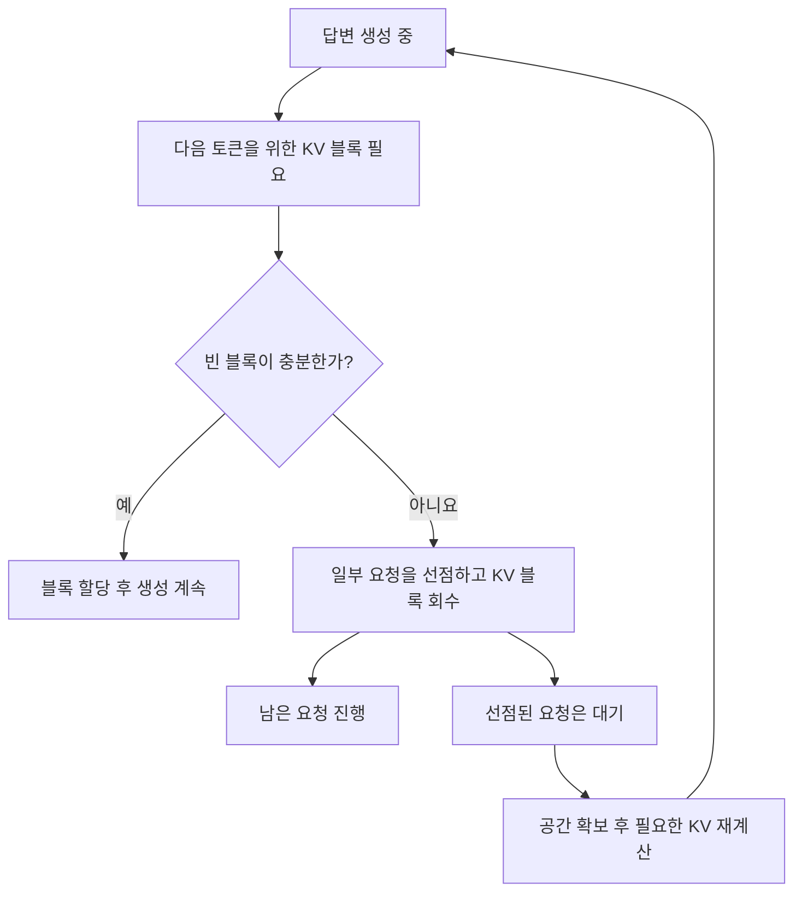

## 학습 목표와 흐름

| 순서 | 배울 내용 | 판단할 수 있는 것 |
|---|---|---|
| 1 | 첫 응답 시간·토큰 간격·처리량 | 사용자가 느끼는 속도와 서버 전체 작업량 |
| 2 | 배칭·동시 요청 수·응답 시간 목표 | 동시 요청을 어디까지 늘릴지 |
| 3 | 선점·청크 분할 프리필 | 캐시 부족과 긴 입력 때문에 느려지는 과정 |
| 4 | 프리픽스 캐시 | 반복되는 입력의 계산을 어떻게 재사용할지 |
| 5 | KV 캐시 양자화 | 같은 메모리에 더 많은 토큰을 담는 방법 |
| 6 | 다중 LoRA 서빙·부하 테스트 | 여러 어댑터를 제공하고 운영 용량을 정하는 방법 |

## 자습

### 1. 첫 응답 시간과 답변이 이어지는 속도

사용자는 질문을 보낸 뒤 화면에 첫 글자가 나타날 때까지 기다립니다. 첫 글자가 나타나면 답변 생성이 끝날 때까지 화면에 차례로 표시되는 답변 내용을 읽습니다. 첫 글자가 나타나기 전의 대기 시간과 답변이 이어지는 동안의 토큰 간격을 나누어 측정하면, 어느 단계에서 응답이 느려지는지 찾기 쉽습니다.

**TTFT(Time To First Token, 첫 토큰 도착 시간)**는 요청을 보낸 때부터 첫 출력 토큰을 받을 때까지의 시간입니다. 요청이 대기열에서 기다리는 시간, 모델이 입력 토큰을 처리하는 시간, 서버가 응답을 전송하는 시간이 TTFT에 영향을 줍니다. 화면에 첫 글자가 늦게 나타나면 TTFT를 확인합니다.

**ITL(Inter-Token Latency, 토큰 사이 지연 시간)**은 출력 토큰과 다음 출력 토큰 사이의 시간입니다. 첫 토큰 이후의 출력 토큰이 얼마나 일정한 간격으로 도착하는지 보여 줍니다.

요청을 보낸 시점을 0초라고 하고, 출력 토큰 네 개가 다음 시각에 도착했다고 가정하겠습니다.

| 사건 | 도착 시각 | 계산 |
|---|---:|---|
| 첫 토큰 | 0.80초 | TTFT = 0.80초 |
| 두 번째 토큰 | 0.85초 | ITL = 0.05초 = 50ms |
| 세 번째 토큰 | 0.90초 | ITL = 0.05초 = 50ms |
| 네 번째 토큰 | 1.10초 | ITL = 0.20초 = 200ms |

첫 토큰 이후의 평균 간격은 `(50 + 50 + 200) / 3 = 100ms`입니다. 이처럼 한 요청에서 첫 토큰 이후의 토큰 사이 간격을 평균낸 값이 **TPOT(Time Per Output Token, 출력 토큰당 평균 시간)**입니다. 마지막 토큰 도착 시각을 $t_N$, 첫 토큰 시각을 $t_1$, 출력 토큰 수를 $N$이라 하면 다음과 같습니다.

$$\mathrm{TPOT}=\frac{t_N-t_1}{N-1}\qquad(N>1)$$

위 예시에서는 토큰 사이 간격의 평균이 100ms이고, 가장 긴 간격은 200ms입니다. 답변 생성이 중간중간 멈추는 현상을 살피려면, 각 토큰 사이 간격이 얼마나 길었는지 분포도 함께 확인합니다.

실제 Streaming(스트리밍) 응답은 여러 토큰을 하나의 Chunk(전송 조각)에 담을 수 있습니다. 클라이언트는 요청을 보낸 뒤 첫 내용 조각을 받을 때까지의 시간을 첫 응답 시간으로 측정합니다. 조각 사이 간격은 클라이언트가 각 전송 조각을 받은 시각의 차이입니다. **토큰 단위 측정과 전송 조각 단위 측정은 기록할 때 단위를 함께 적습니다.** 내용이 없는 시작 메시지와 종료 메시지는 출력 토큰으로 세지 않습니다.

### 2. 동시 요청을 늘리면 전체 처리량이 증가하는 이유

서버 운영자는 같은 GPU로 더 많은 질문에 답하고 싶습니다. 서버가 일정 시간 동안 얼마나 많은 토큰을 생성하는지 보여 주는 지표가 **Throughput(처리량)**입니다. 측정 구간에서 서버 전체가 생성한 출력 토큰 수를 측정 시간으로 나누면 초당 출력 토큰 수를 얻습니다.

$$\text{출력 처리량}=\frac{\text{측정 구간에서 생성한 전체 출력 토큰 수}}{\text{측정 시간(초)}}$$

예를 들어 10초 동안 요청 20개가 각각 100토큰을 생성했다면, 출력 처리량은 `2,000 / 10 = 200토큰/초`입니다. 요청 처리량은 `20 / 10 = 2요청/초`입니다. 개별 요청의 생성 속도는 해당 요청이 답변을 생성하는 데 걸린 시간과 실제 생성한 토큰 수로 따로 계산합니다.

LLM은 Decode(토큰 생성) 중에 가중치를 읽고 다음 토큰을 계산합니다. 여러 요청을 한 Batch(배치)로 묶으면 같은 가중치를 여러 입력에 사용합니다. 가중치를 읽는 비용을 함께 쓰기 때문에 작은 배치 구간에서는 요청 수를 늘릴 때 전체 처리량이 크게 증가할 수 있습니다.

계산 원리만 보는 예로, 요청 하나의 다음 토큰을 만드는 데 10ms가 걸린다고 하겠습니다. 요청 8개를 묶은 스텝도 10ms라면, 그 스텝에서 총 8토큰이 나오므로 전체 처리량은 100토큰/초에서 800토큰/초로 늘어납니다. 각 요청은 여전히 약 10ms마다 토큰 하나를 받습니다.

배치가 더 커지면 GPU가 요청별 KV 캐시를 읽는 양과 다음 토큰을 계산하는 작업량도 증가합니다. 한 계산 스텝을 마치는 데 걸리는 시간이 길어지고, 새 요청은 실행 차례를 기다립니다. 처리량 증가가 둔화되기 시작하는 구간을 **Knee(무릎 지점)**라고 합니다.

여기서 서로 다른 세 가지 수를 구분하면 설정을 이해하기 쉽습니다.

| 이름 | 무엇을 세는가 | 예 |
|---|---|---|
| 클라이언트 동시 요청 수 | 보냈지만 아직 끝나지 않은 요청 | 부하 도구가 32개를 유지 |
| 엔진의 실행 배치 크기 | 현재 스텝에서 함께 계산하는 요청 | 이번 스텝에 16개 계산 |
| 대기 요청 수 | 실행 자원이나 차례를 기다리는 요청 | 남은 요청들이 큐에서 대기 |

`max_num_seqs`는 한 스텝에서 처리할 Sequence(시퀀스) 수의 상한입니다. 답 하나를 만드는 기본 요청에서는 시퀀스 하나가 요청 하나에 대응합니다. **클라이언트가 보내는 수, 엔진이 함께 실행하는 수, 대기열에서 허용하는 수는 각각 정합니다.**

### 3. 응답 시간 목표를 만족하는 운영점

대화형 서비스에서는 사용자가 기다릴 수 있는 시간을 먼저 정합니다. **SLO(Service Level Objective, 서비스 수준 목표)**는 “요청의 99%에서 첫 토큰이 2초 안에 나온다”와 같은 운영 목표입니다.

이때 사용하는 **p99(99백분위수)**는 지연 시간을 작은 순서로 놓았을 때 99%가 그 이하에 들어가는 경계값입니다. p50은 가운데 값입니다. p50과 p99의 차이가 크면 일부 요청의 기다림이 길다는 뜻입니다. 표본이 적으면 p99는 가장 느린 몇 건에 크게 좌우되므로 요청 수도 함께 기록합니다.

아래는 운영점 선택을 위한 **가상 측정값**입니다. 목표는 `p99 TTFT ≤ 2초`입니다.

| 동시 요청 수 | 출력 처리량 | p99 TTFT | 목표 충족 |
|---:|---:|---:|---|
| 4 | 380토큰/초 | 0.4초 | 충족 |
| 8 | 720토큰/초 | 0.6초 | 충족 |
| 16 | 1,150토큰/초 | 1.1초 | 충족 |
| 32 | 1,240토큰/초 | 2.8초 | 초과 |
| 64 | 1,260토큰/초 | 6.5초 | 초과 |

16개에서 32개로 늘리면 처리량은 약 7.8% 증가하고, p99 TTFT는 약 2.55배가 됩니다. 이 표에서는 **측정한 후보 중 16개가 목표를 지키는 최대 동시 요청 수**입니다. 16개 부근을 운영 후보로 정하고, ITL 목표와 메모리 사용량도 함께 확인합니다.

한밤중에 문서 수천 개를 처리하는 Batch processing(일괄 처리)에서는 전체 완료 시간과 처리량의 비중이 큽니다. 화면 앞에서 기다리는 챗봇에서는 TTFT와 ITL의 비중이 큽니다. 같은 GPU라도 서비스 목적에 맞춰 운영점을 고릅니다.

### 4. KV 캐시가 부족할 때 발생하는 선점

서버는 요청 처리를 시작할 때 입력 토큰의 KV를 저장합니다. 답변 토큰을 생성할 때마다 해당 토큰의 KV도 추가로 저장하므로, 요청 하나가 사용하는 KV 캐시 공간은 계속 늘어납니다. 따라서 서버가 처음에 요청들을 받아들인 뒤에도 생성 도중에 메모리 부족이 발생할 수 있습니다.

입력 500토큰, 출력 최대 1,000토큰인 요청 40개를 계산해 보겠습니다. 공통 캐시 공유와 블록 끝의 빈 공간을 제외하면 입력 단계에는 `500 × 40 = 20,000토큰`의 저장 공간이 필요합니다. 각 답이 최대 길이에 가까워지면 `(500 + 1,000) × 40 = 60,000토큰`이 필요합니다.

KV 공간이 40,000토큰 분량이라면, 생성 중에 새 블록을 배정할 공간이 부족해집니다. 이때 Scheduler(스케줄러)가 일부 실행 요청을 잠시 멈추고 KV 블록을 회수하는 동작이 **Preemption(선점)**입니다.



vLLM V1의 기본 선점 방식은 **Recompute(재계산)**입니다. 중단했던 요청을 다시 처리할 차례가 되면, vLLM은 입력과 이미 생성한 토큰 이력을 이용해 해당 요청의 KV를 재계산하고 답변 생성을 이어갑니다. 사용자는 중단된 답변의 다음 토큰을 계속 기다리고, 서버는 이미 계산했던 KV를 다시 계산해야 합니다. [vLLM 선점 설명](https://docs.vllm.ai/en/v0.30.0/configuration/optimization/#preemption)

선점이 잦으면 p99 지연이 길어지고, 같은 GPU 시간에 처리하는 유효 작업량이 줄어듭니다. 오류 건수와 함께 **캐시 사용률·선점 증가량·대기 요청 수**를 보는 이유입니다.

| 관측할 값 | 의미 | 연결해서 볼 현상 |
|---|---|---|
| `vllm:kv_cache_usage_perc` | KV 캐시 사용 비율. 1이면 100% | 새 블록을 할당할 여유 |
| `vllm:num_preemptions_total` | 누적 선점 횟수 | 측정 구간에 선점이 얼마나 증가했는지 |
| `vllm:num_requests_waiting` | 대기 중인 요청 수 | 첫 응답 전 기다림 |

선점이 반복되면 함께 실행하는 요청 수를 줄이거나, 사용할 KV 메모리를 늘리거나, 요청의 실제 입력·출력 길이를 줄입니다. `max_model_len`은 요청 하나의 입력 토큰 수와 출력 토큰 수를 합한 총길이의 상한입니다. 상한을 낮추면 지나치게 긴 요청을 제한할 수 있습니다. **요청의 실제 입력·출력 길이가 같다면, 서버가 해당 요청을 위해 KV 캐시에 저장할 토큰 수도 그대로입니다.**

`gpu_memory_utilization`은 가중치·실행 공간·캐시를 포함한 GPU 메모리 예산 비율입니다. 사용 가능한 메모리 안에서 이 예산을 늘리면 KV 공간을 더 확보할 수 있습니다. 서버에 들어오는 요청 수는 서버 앞단의 대기열과 요청 제한 설정으로 관리합니다.

### 5. 긴 입력을 나누어 처리하는 청크 분할 프리필

서버가 여러 요청의 답변을 생성하는 중에 긴 문서를 입력받으면, 모델이 새 문서의 입력 토큰을 처리하느라 기존 답변의 다음 토큰을 늦게 생성할 수 있습니다. 긴 입력을 처리하는 계산을 여러 스텝으로 나누면, 각 스텝에서 기존 요청의 답변 토큰 생성과 새 입력의 일부 처리를 함께 진행할 수 있습니다.

**Prefill(입력 처리)**은 입력 토큰의 정보를 계산하는 단계이고, **Chunked prefill(청크 분할 입력 처리)**은 그 작업을 잘라서 진행하는 방식입니다. vLLM V1은 이 기능을 사용할 때 답변을 생성 중인 요청의 Decode 계산에 토큰 예산을 먼저 배정하고, 남은 예산으로 새 입력의 Prefill 계산을 진행합니다. [vLLM 청크 분할 프리필](https://docs.vllm.ai/en/v0.30.0/configuration/optimization/#chunked-prefill)

이번 스텝의 토큰 예산 `max_num_batched_tokens`가 2,048이고, 생성 중인 요청 8개가 각각 다음 토큰 하나를 계산한다고 하겠습니다.

$$\text{입력 처리에 남은 예산}=2{,}048-8=2{,}040\text{ 토큰}$$

새 입력이 6,000토큰이면 `2,040 → 2,040 → 1,920`처럼 세 스텝으로 나눌 수 있습니다. 이 예시는 세 스텝 동안 같은 8개 요청에서 답변 토큰을 계속 생성하고, 캐시 공간과 시퀀스 슬롯이 충분하다고 가정한 계산입니다.

| 토큰 예산 | 한 스텝의 변화 | 주로 살필 값 |
|---|---|---|
| 작게 설정 | 긴 입력을 더 잘게 나누고 Decode를 자주 진행 | 기존 요청의 ITL, 긴 입력의 TTFT |
| 크게 설정 | 입력을 한 번에 더 많이 계산 | 긴 입력의 TTFT, 다른 요청의 ITL, 작업 메모리 |

`max_num_seqs`는 함께 계산할 **시퀀스 수**, `max_num_batched_tokens`는 한 스텝에서 계산할 **토큰 수**, `max_model_len`은 요청 하나의 **입력과 출력의 총길이**입니다. 세 설정은 세는 대상이 다릅니다.

### 6. 같은 문서의 계산을 재사용하는 프리픽스 캐시

여러 사용자가 같은 사내 규정을 놓고 서로 다른 질문을 한다면, 서버는 규정에 해당하는 KV를 재사용해 질문마다 규정의 모든 토큰을 다시 처리하는 계산 비용을 줄일 수 있습니다. **Prefix caching(접두부 캐싱)**은 입력의 시작 부분이 같을 때 이미 계산한 KV 블록을 재사용하는 기능입니다.

다음 두 입력에서 시스템 지시문과 규정이 같은 토큰으로 시작하면 공통 부분을 재사용할 수 있습니다.

```text
요청 A: [공통 시스템 지시문][공통 사내 규정][연차 신청 방법은?]
요청 B: [공통 시스템 지시문][공통 사내 규정][출장비 한도는?]
```

모델은 공통 시스템 지시문과 규정의 KV를 재사용하면서 각 질문에 대한 답을 새로 생성합니다. 공통 입력의 KV를 다시 계산하는 Prefill 작업이 줄어들어 입력 처리 시간을 절약할 수 있습니다. 긴 문서를 계속 참조하며 답을 생성하는 Decode에서는 그 문서의 KV를 읽는 작업이 계속 필요합니다.

#### 6-1) 앞부분이 같아야 하는 이유

모델이 계산한 KV에는 해당 토큰 앞의 문맥도 반영됩니다. 같은 “출장비”라는 단어라도 앞에 어떤 내용이 있었는지가 중요합니다. vLLM은 블록을 구분하는 Hash(해시)에 **앞 블록의 해시·현재 블록의 토큰 ID·어댑터 등 추가 정보**를 함께 넣습니다.

따라서 앞쪽 블록이 달라지면 그 뒤 블록들의 식별 정보도 달라집니다. 시스템 지시문 앞에 매번 다른 시각을 넣으면 뒤의 긴 규정까지 다시 계산하게 됩니다. 프롬프트에서는 공통 지시문과 규정을 앞에 둡니다. 요청마다 달라지는 시각이나 개별 질문은 해당 정보의 역할과 의미가 달라지지 않도록 뒤쪽에 배치합니다. [vLLM 프리픽스 캐시 구조](https://docs.vllm.ai/en/v0.30.0/design/prefix_caching/)

여기서는 블록 하나가 16토큰이라고 가정합니다. 공통 시작 부분이 1,003토큰이고 전체 입력이 1,200토큰이라면, 꽉 찬 공통 블록은 `1,003 // 16 = 62개`입니다. 기존 블록이 캐시에 남아 있을 때 재사용 후보는 `62 × 16 = 992토큰`이고, 이 요청의 예상 적중 비율은 약 `992 / 1,200 = 82.7%`입니다.

서버는 첫 요청을 처리하면서 공통 입력의 KV를 캐시에 저장합니다. 이후 같은 입력으로 시작하는 요청을 처리할 때 저장된 KV 블록을 재사용합니다. 또한 프롬프트 전체가 일치할 때도 다음 출력 예측에 필요한 마지막 위치의 계산이 필요합니다. 블록 크기와 실제 재사용 토큰 수는 엔진 설정과 지표로 확인합니다.

#### 6-2) 한 실험의 캐시 적중률

프롬프트 순서를 바꿨을 때 캐시 재사용이 얼마나 늘었는지 확인하려면, 실험 중 캐시 조회 대상 토큰 가운데 KV를 재사용한 토큰의 비율을 계산합니다. 실험 후의 누적 조회 토큰 수와 누적 재사용 토큰 수에서 각각 실험 전 값을 빼면, 실험 구간의 조회 토큰 수와 재사용 토큰 수를 얻습니다.

$$\text{캐시 적중률}=\frac{\text{실험 후 hits}-\text{실험 전 hits}}{\text{실험 후 queries}-\text{실험 전 queries}}$$

`queries`는 캐시 조회 대상 토큰 수, `hits`는 재사용한 토큰 수입니다. vLLM의 `/metrics`에서는 `vllm:prefix_cache_queries_total`, `vllm:prefix_cache_hits_total`로 확인할 수 있습니다.

| 누적 카운터 | 실험 전 | 실험 후 | 증가량 |
|---|---:|---:|---:|
| 조회 토큰 수 | 12,000 | 16,000 | 4,000 |
| 재사용 토큰 수 | 3,000 | 6,600 | 3,600 |

이 실험의 적중률은 `3,600 / 4,000 = 90%`입니다. 실험 후의 누적값으로 계산한 `6,600 / 16,000 = 41.25%`는 서버 시작 이후 전체 구간의 비율입니다. 같은 서버가 재시작 없이 동작한 구간에서 증가량을 구하며, 다른 사용자의 요청이 섞이면 그 요청도 서버 지표에 포함됩니다.

캐시 적중률과 TTFT를 함께 비교하면, 입력의 KV 재사용이 늘었는지와 사용자가 첫 응답을 받기까지의 시간이 줄었는지 확인할 수 있습니다. 적중률이 높아졌는데 TTFT가 여전히 길다면, 요청이 대기열에서 기다리는 시간과 캐시를 재사용하지 못한 입력 토큰의 처리 시간을 확인합니다.

#### 6-3) 캐시가 유지되는 조건과 공유 범위

완료된 요청의 KV 블록은 다른 요청이 재사용할 수 있도록 남아 있다가, 새 공간이 필요하면 교체됩니다. 오래 사용하지 않은 블록부터 공간을 내주는 방식이 **LRU(Least Recently Used, 최근에 가장 덜 사용한 항목 우선 교체)**입니다. 요청이 많아지면 재사용 전에 블록이 교체될 수 있으므로 캐시 적중률에는 동시 부하도 영향을 줍니다.

부서별로 KV 재사용 범위를 나눌 때는 `cache_salt`라는 요청 필드를 사용합니다. 같은 토큰과 같은 salt(솔트)를 사용하는 요청끼리 캐시를 공유합니다. 서버 앞단이 부서나 사용자별로 `cache_salt` 값을 정해 요청에 붙이면, 응답 시간 차이로 다른 사용자의 캐시 존재를 알아내기 어렵게 할 수 있습니다.

LoRA 어댑터 ID도 캐시 식별에 사용됩니다. 같은 규정을 입력하더라도 어댑터가 다르면 계산 결과가 달라지므로 각 어댑터에 맞는 KV를 사용합니다.

### 7. KV 캐시의 메모리와 양자화

긴 문서나 많은 동시 요청 때문에 KV 공간이 부족하면, 먼저 토큰 하나를 저장하는 데 필요한 메모리를 계산합니다. 이 계산을 바탕으로 요청 길이·동시 요청 수·저장 정밀도를 바꿀 때 전체 KV 메모리 사용량이 얼마나 달라지는지 비교할 수 있습니다.

각 층에 같은 수의 KV 헤드를 사용하는 모델을 GPU 한 장에서 실행한다고 하겠습니다. 키와 값을 같은 자료형으로 저장하면 토큰당 메모리는 다음과 같습니다.

$$m_{\mathrm{token}}=2\times L\times H_{\mathrm{KV}}\times d\times b$$

| 기호 | 의미 |
|---|---|
| $2$ | Key(키)와 Value(값) 두 종류 |
| $L$ | 모델의 층 수 |
| $H_{\mathrm{KV}}$ | 층마다 저장하는 KV 헤드 수 |
| $d$ | 헤드 하나의 차원 |
| $b$ | 원소 하나의 바이트 수. FP16이면 2 |

Qwen2.5-1.5B-Instruct는 28층, KV 헤드 2개를 사용합니다. 헤드 차원은 `hidden_size / num_attention_heads = 1,536 / 12 = 128`입니다. [Qwen 모델 설정](https://huggingface.co/Qwen/Qwen2.5-1.5B-Instruct/blob/main/config.json)

FP16(16비트 부동소수점)으로 KV를 저장하면 다음과 같습니다.

$$2\times28\times2\times128\times2=28{,}672\text{ bytes}=28\text{ KiB}$$

입력 토큰과 생성한 답변 토큰을 합해 4,096토큰의 KV를 저장하면 요청 하나에 `28KiB × 4,096 = 112MiB`가 필요합니다. 이는 약 117.44MB입니다. MiB는 $2^{20}$바이트, MB는 $10^6$바이트를 기준으로 합니다.

같은 길이의 요청 16개는 `112 × 16 = 1,792MiB = 1.75GiB`를 사용합니다. 이 계산에는 캐시 공유·블록 끝의 빈 공간·관리용 공간을 넣지 않았습니다. 이렇게 계산한 KV 메모리 사용량을 vLLM이 실제로 확보한 KV 캐시 용량과 비교합니다.

#### 7-1) 가중치 양자화와 KV 캐시 양자화

GPU 메모리에는 여러 요청이 함께 쓰는 모델 가중치와, 요청별 토큰의 Key와 Value를 담는 KV 캐시가 들어갑니다. 가중치의 저장 공간을 줄이는지, KV 캐시의 저장 공간을 줄이는지에 따라 메모리를 절약하는 대상이 달라집니다.

| 방법 | 줄이는 데이터 | 메모리에 미치는 영향 |
|---|---|---|
| Weight quantization(가중치 양자화) | 모델의 학습된 가중치 | 모델 한 벌의 저장량 감소 |
| KV cache quantization(KV 캐시 양자화) | 입력·생성 과정에서 저장한 키와 값 | 토큰당 캐시 저장량 감소 |

KV의 원소를 2바이트에서 1바이트로 줄이면 데이터 부분은 절반이 됩니다. 같은 KV 메모리 예산으로 약 두 배의 토큰에 해당하는 KV를 저장할 수 있습니다. 전체 GPU 메모리 사용량을 구할 때는 가중치·실행 공간·KV 캐시가 차지하는 메모리를 각각 계산합니다.

`kv_cache_dtype`는 KV 저장 자료형을 고르는 설정입니다. `auto`는 모델 자료형을 따릅니다. 예를 들어 모델을 `float16`으로 실행하면 KV도 FP16이 됩니다.

#### 7-2) 양자화 스케일이 차지하는 공간

양자화한 수를 다시 계산에 사용하려면 Scale(배율) 정보도 필요합니다. 토큰·헤드마다 배율을 저장하는 방식에서는 KV 데이터에 더해 배율을 저장할 공간도 필요합니다. 따라서 전체 저장량은 FP16 대비 절반이나 4분의 1로 줄인 데이터 크기보다 배율 저장 공간만큼 더 큽니다.

헤드 차원이 128이고, K와 V 각각에 32비트 배율 하나를 붙인다고 하겠습니다. 아래 표는 토큰 하나를 모델의 한 층, 한 KV 헤드에 저장할 때 K·V 데이터와 배율이 차지하는 공간을 비교합니다.

| 저장 방식 | K와 V 데이터 | 배율 | 합계 | FP16 대비 |
|---|---:|---:|---:|---:|
| FP16 | `2 × 128 × 2 = 512B` | 0B | 512B | 100% |
| INT8, 토큰·헤드별 배율 | `2 × 128 × 1 = 256B` | 8B | 264B | 51.56% |
| INT4, 토큰·헤드별 배율 | `2 × 128 × 0.5 = 128B` | 8B | 136B | 26.56% |

위 표는 vLLM 0.30.0의 `TRITON_ATTN`에서 사용하는 `int8_per_token_head`, `int4_per_token_head` 형식의 데이터와 배율 저장 구조를 나타냅니다. 토큰별로 배율을 따로 정하면 값이 큰 한 토큰이 다른 토큰들의 양자화 간격에 미치는 영향을 줄일 수 있습니다. [캐시 저장 구조](https://github.com/vllm-project/vllm/blob/v0.30.0/vllm/v1/attention/backends/triton_attn.py)

같은 버전의 `TRITON_ATTN`은 FP8 KV에 Compute capability(연산 기능 수준) 8.9 이상을 요구합니다. T4에서 이 조합은 시작 단계에서 거절됩니다. `int8_per_token_head`와 `int4_per_token_head` 형식의 T4 실제 실행 결과는 미확인입니다.

캐시 정밀도를 선택할 때는 vLLM 버전·모델·질문을 동일하게 유지하고, `kv_cache_dtype`를 `auto`로 설정한 서버와 후보 자료형으로 설정한 서버의 측정값을 비교합니다. 확인할 값은 **기동 로그의 KV 토큰 용량, 선점 횟수, 응답 시간, 답변 품질**입니다. 긴 문서를 다루는 서비스라면 실제 서비스와 같은 길이의 문서를 입력하고, 캐시 정밀도를 바꾼 뒤에도 정답을 유지하는지와 답변에서 핵심 내용이 빠지는지 확인합니다.

답변 품질에서는 기준 설정이 맞히고 변경 설정이 틀린 문항을 Flip(정답에서 오답으로 바뀐 문항)으로 따로 볼 수 있습니다. 엔진을 바꾸는 실험과 KV 자료형을 바꾸는 실험을 따로 수행하면, 어떤 변경이 답변 품질에 영향을 줬는지 찾기 쉽습니다.

> [!info]- 더 알아보기: 배치 크기와 W4A16·W8A8
> **W4A16**은 가중치 4비트·활성값 16비트, **W8A8**은 가중치와 활성값 모두 8비트인 구성을 뜻합니다. 작은 배치에서 가중치를 읽는 시간이 큰 비중을 차지하면, W4A16은 GPU 메모리에서 읽어야 하는 가중치의 양을 줄여 처리 시간을 단축하는 데 도움이 됩니다.
>
> 배치가 커져 전체 실행 시간에서 곱셈 연산이 차지하는 비중이 커지면, GPU의 8비트 연산 능력을 사용하는 W8A8도 비교 대상이 됩니다. 두 방식을 비교할 때는 GPU가 읽는 가중치의 양, 실제 계산 정밀도, 역양자화에 걸리는 시간을 함께 확인합니다. 같은 동시 요청 수에서 측정한 처리량·지연 시간·답변 품질을 바탕으로 사용할 방식을 고릅니다.

### 8. 베이스 모델 하나로 여러 LoRA 어댑터 제공

인사팀은 인사 회의록 양식을, 재무팀은 재무 보고 양식을 사용한다고 하겠습니다. 각 업무용 LoRA 어댑터를 같은 베이스 모델로 학습했다면, 서버는 베이스 가중치 한 벌에 업무별 작은 어댑터를 연결해 두 업무를 함께 제공할 수 있습니다.

**LoRA(Low-Rank Adaptation, 저랭크 적응)**는 원래 가중치에 작은 행렬 두 개로 만든 보정값을 더하는 방법입니다. 선형 계층에서 입력을 열벡터 $x$로 표기하면 계산은 다음과 같습니다.

$$y=Wx+sB(Ax)$$

$W$는 공유하는 베이스 가중치, $A$와 $B$는 학습한 어댑터 행렬, $s$는 보정값의 크기를 조절하는 배율입니다. 중간 차원인 $r$을 Rank(랭크)라고 합니다. 부서마다 $A$와 $B$를 다르게 선택하면 같은 $W$를 사용하면서 업무별 보정을 적용할 수 있습니다.

```text
인사팀 요청 → 공유 베이스 계산 + 인사 어댑터 보정 → 인사팀 답변
재무팀 요청 → 공유 베이스 계산 + 재무 어댑터 보정 → 재무팀 답변
총무팀 요청 → 공유 베이스 계산 + 총무 어댑터 보정 → 총무팀 답변
```

vLLM에서는 어댑터를 이름과 경로로 등록하고 요청의 `model` 필드로 선택합니다. 예를 들어 `"model": "hr_adapter"`는 등록된 인사 어댑터를 사용하라는 뜻입니다. 서로 다른 어댑터를 선택한 요청도 설정에 맞춰 같은 배치에 들어갈 수 있습니다. [vLLM LoRA 서빙](https://docs.vllm.ai/en/v0.30.0/features/lora/)

| 설정 | 역할 | 세 부서 예시 |
|---|---|---|
| `enable_lora` | LoRA 사용 활성화 | 활성화 |
| `lora_modules` | 어댑터 이름과 파일 경로 등록 | 인사·재무·총무 어댑터 등록 |
| `max_loras` | 한 배치에 들어갈 서로 다른 어댑터 수의 상한 | 세 종류를 함께 처리하려면 3 |
| `max_cpu_loras` | CPU 메모리에 보관할 어댑터 수 | 등록·사용할 수에 맞춤 |
| `max_lora_rank` | 수용할 최대 랭크 | 모두 r=16이면 16 |

`max_loras=1`에서도 같은 어댑터를 쓰는 여러 요청은 함께 계산할 수 있습니다. 다른 어댑터를 요구하는 요청은 다음 배치를 기다립니다. 어댑터 슬롯과 최대 랭크를 크게 잡으면 GPU 메모리를 더 사용하고 KV 공간에도 영향을 줍니다.

어댑터를 연결할 때는 학습에 쓴 베이스 모델의 이름·버전, `r`, 어댑터를 적용한 대상 계층을 확인합니다. `adapter_config.json`의 `base_model_name_or_path`에서 해당 어댑터가 어떤 베이스 모델로 학습되었는지 확인할 수 있습니다. `Qwen2.5-1.5B`와 `Qwen2.5-1.5B-Instruct`처럼 크기가 같아도 학습한 베이스가 다르면 출력이 달라집니다.

vLLM 0.30.0의 로더는 허용 랭크 초과, `modules_to_save`, DoRA, `bias` 학습 등 지원 조건을 검사합니다. QLoRA로 학습할 때의 양자화 베이스와 서빙할 때의 베이스 정밀도도 함께 기록하고, 동일한 평가 문항으로 서빙 응답을 확인합니다. [어댑터 설정 검사](https://github.com/vllm-project/vllm/blob/v0.30.0/vllm/lora/peft_helper.py)

vLLM은 서버 실행 중 LoRA 어댑터를 추가하거나 제거하는 기능도 제공합니다. 개발 환경에서는 `VLLM_ALLOW_RUNTIME_LORA_UPDATING`과 로드·언로드 API를 사용합니다. 운영 환경에서 어댑터를 교체할 때는 새 어댑터를 넣은 서버의 응답을 먼저 검증하고, 검증이 끝나면 사용자 요청을 새 서버로 보내는 Blue-green deployment(블루·그린 배포) 방식을 사용할 수 있습니다.

### 9. 부하를 보내는 방식과 측정값의 의미

서버가 감당할 요청 수를 알아보려면 실제로 여러 요청을 보내는 **Load test(부하 테스트)**를 사용합니다. 이때 “완료되지 않은 요청을 동시에 몇 개 유지하는가”와 “서버에 새로운 요청이 초당 몇 개 도착하는가”에 따라 부하를 주는 방식이 달라집니다.

| 부하 방식 | 요청을 보내는 규칙 | 알아볼 내용 |
|---|---|---|
| 동시 요청 수 고정 | N개를 유지하고, 하나가 끝나면 새 요청 하나를 보냄 | 동시 요청 수별 처리량·지연 곡선 |
| 요청률 고정 | 초당 R개의 도착률을 목표로 요청을 보냄 | 피크 시간대의 대기열·과부하 |

동시 요청 수를 고정하면 응답이 느려질수록 다음 요청을 보내는 시점도 늦어집니다. 실제 서비스에서는 기존 요청이 끝나기를 기다리지 않고 다른 사용자의 새 요청이 도착합니다. 따라서 피크 시간대의 요청을 서버가 감당하는지 확인하려면, 초당 요청 도착률을 고정한 부하 테스트도 수행합니다.

예를 들어 1초에 5개가 들어오는데 서버가 3개를 끝낸다면, 완료 속도가 유지되는 동안 대기 중인 요청은 초당 약 2개씩 늘어납니다. 10초 후에는 약 20개가 추가로 쌓입니다. 클라이언트 동시성 상한까지 함께 걸면, 상한에 도달한 이후의 실제 전송률도 기록합니다.

vLLM에 포함된 `vllm bench serve`는 서버에 요청을 보내 성능을 측정하는 CLI(명령줄 도구)입니다. `--max-concurrency`는 동시 요청 수 상한, `--request-rate`는 요청률, `--num-prompts`는 총 요청 수를 지정합니다. 이 옵션에 지정한 값과 실제 전송한 요청 수를 함께 기록하면, 같은 부하 조건에서 얻은 성능 측정값을 비교하기 쉬워집니다.

#### 9-1) 성능표를 읽는 순서

성능표에서는 요청이 제대로 끝났는지부터 확인합니다. 예를 들어 요청 1,000개 중 37개가 실패했다면 실패율은 3.7%이고, 성공한 요청의 지연 분포와 함께 보고합니다.

1. **성공·실패 수**: 어떤 요청이 측정에 포함되었는지 확인합니다.
2. **실제 입력·출력 토큰 수**: 같은 길이의 작업을 비교하는지 확인합니다. 생성 길이 상한과 실제 생성 길이를 함께 적습니다.
3. **p50·p99 TTFT**: 보통의 요청과 응답이 느린 요청에서 첫 토큰을 받기까지 걸린 시간을 확인합니다.
4. **ITL·TPOT**: 출력 토큰 사이의 간격과 요청별 평균 토큰 간격을 확인합니다.
5. **출력 토큰/초·요청/초**: 서버 전체 처리량을 봅니다.
6. **Goodput(목표를 만족한 유효 처리량)**: 응답 시간 목표를 통과한 요청 수를 측정 시간으로 나눕니다.

10초 동안 요청 20개를 완료했는데 SLO를 통과한 요청이 15개라면, 전체 요청 처리량은 2요청/초이고 Goodput은 1.5요청/초입니다. Goodput은 사용자가 원하는 응답 속도를 지키면서 서버가 초당 완료한 요청 수를 보여 줍니다.

실험 전에는 Warm-up(예열)을 하고, 모델·GPU·입출력 길이·요청 수·캐시 조건을 맞춥니다. 새 질문을 처음 처리할 때의 측정값과 공통 문서의 KV가 이미 캐시에 있을 때의 측정값은 캐시 조건을 구분해 기록합니다. 클라이언트 지연과 서버 내부의 대기·선점 지표를 함께 보면 느려진 원인을 찾기 쉽습니다.

| 함께 나타난 현상 | 먼저 확인할 부분 |
|---|---|
| 대기 요청 증가 + TTFT 증가 | 들어오는 요청률과 서버의 완료 속도 |
| KV 사용률 포화 + 선점 증가 | 실행 중인 요청의 길이·수와 KV 공간 |
| 긴 입력 유입 시 ITL 증가 | Prefill 토큰 예산과 분할 처리 |
| 캐시 적중률 증가 + TTFT 감소 | 공통 입력 재사용의 효과 |
| 서버 지표는 안정적인데 클라이언트만 지연 | 부하 도구의 CPU 사용·전송·네트워크 |

### 10. 메모리 계산에서 실제 운영 용량까지

서비스가 받을 요청 수를 정할 때는 이론 계산, 엔진이 확보한 공간, 응답 시간 측정을 차례로 연결합니다. 각 값이 무엇을 뜻하는지 알면 서로 다른 수치가 나와도 이유를 설명할 수 있습니다.

| 단계 | 얻는 값 | 의미 |
|---|---|---|
| 메모리 계산 | KV 메모리 예산 ÷ 요청당 KV 사용량 | 가정한 길이에서 담을 수 있는 요청 수 추정 |
| 엔진 기동 로그 | `GPU KV cache size`, `Maximum concurrency` | 실제 확보한 KV 용량과 지정 길이 기준 수용량 |
| 부하 테스트 | SLO를 만족한 동시 요청 수 | 원하는 응답 속도로 처리한 수 |

가상 예로 계산에서는 80개, 엔진의 KV 용량에서는 60개, 부하 테스트에서는 16개가 나왔다고 하겠습니다. **이 측정 조건에서 운영 후보는 16개**입니다. 메모리에 들어가는 요청이 많아도 한 스텝의 계산 시간과 큐 대기가 응답 속도를 정하기 때문입니다.

메모리 계산으로 추정한 요청 수와 엔진의 KV 용량으로 구한 요청 수가 다르면, 실행 버퍼·CUDA graph(쿠다 그래프)·LoRA 슬롯이 GPU 메모리에서 차지하는 공간을 확인합니다. 엔진의 KV 용량으로 구한 요청 수와 SLO를 만족한 동시 요청 수가 다르면, 계산 스텝에 걸리는 시간과 요청이 대기열에서 기다리는 시간을 확인합니다. 로그의 `Maximum concurrency`는 지정된 요청 길이를 기준으로 계산한 KV 용량 배수이며, 실제 서비스의 응답 시간은 부하 테스트에서 얻습니다.

최종 기록에는 모델·버전·GPU, 입력과 출력 길이, 캐시 조건, SLO, 주요 설정, 세 단계의 수치를 함께 남깁니다. 질문 길이가 바뀌거나 어댑터가 추가되면 바뀐 조건으로 용량을 다시 확인합니다.

## 이해 확인

각 질문에 먼저 스스로 답한 뒤, 해당 질문 아래의 설명을 펼쳐 자신의 답과 비교합니다.

> [!question]- 1. 동시 요청 수를 늘렸더니 전체 토큰/초와 p99 TTFT가 함께 늘었습니다. 어떤 변화인가요?
> 서버 전체가 처리하는 양은 늘었고, 일부 사용자가 첫 응답을 받기까지 기다리는 시간도 길어졌습니다. 목표 TTFT와 ITL을 만족하는 후보 중에서 운영점을 정합니다.

> [!question]- 2. `max_num_seqs=16`과 “16명이 접속할 수 있다”는 어떤 차이가 있나요?
> `max_num_seqs`는 한 계산 스텝에서 처리할 시퀀스 수의 상한입니다. 한 스텝에서 처리하지 못한 추가 요청은 서버나 서버 앞단의 대기열에서 기다릴 수 있습니다. 접속한 사용자 수, 현재 계산 중인 시퀀스 수, 대기 중인 요청 수를 구분해 확인합니다.

> [!question]- 3. 입력은 모두 메모리에 들어갔는데 생성 도중 선점이 발생하는 이유는 무엇인가요?
> 답변 토큰을 생성할 때마다 해당 토큰의 KV를 추가로 저장해야 하기 때문입니다. 처음 입력 20,000토큰을 저장할 수 있어도 입력과 답을 합친 60,000토큰을 담을 공간이 부족할 수 있습니다.

> [!question]- 4. 선점된 요청은 다시 실행될 때 무엇을 계산하나요?
> vLLM은 입력과 이미 생성한 토큰 이력을 이용해 중단된 요청의 KV를 재계산합니다. KV를 복구한 뒤 해당 요청의 답변 생성을 이어갑니다. 사용자의 응답 시간에는 선점 후 기다린 시간과 KV를 재계산한 시간이 추가됩니다.

> [!question]- 5. 스텝 토큰 예산이 2,048이고 Decode 요청 8개가 각각 한 토큰을 계산하면 Prefill 예산은 얼마인가요?
> 단순 예산 계산으로 2,040토큰입니다. 실제 배정에는 빈 KV 블록과 시퀀스 슬롯도 필요합니다.

> [!question]- 6. 공통 규정 앞에 매번 다른 시각을 넣으면 캐시 재사용이 줄어드는 이유는 무엇인가요?
> 블록 해시에 앞선 문맥이 연결되기 때문입니다. 앞쪽 토큰이 달라지면 뒤 블록의 해시도 달라집니다. 공통 지시문·문서를 앞에 두고, 매번 바뀌는 값은 의미를 유지하면서 뒤에 둡니다.

> [!question]- 7. 누적 hits가 3,000→6,600, queries가 12,000→16,000이면 이번 실험의 적중률은 얼마인가요?
> 증가량으로 계산한 `3,600 / 4,000 = 90%`입니다. 서버 재시작이 없고 같은 측정 구간을 사용한 조건입니다.

> [!question]- 8. 가중치를 4비트로 저장하고 KV를 FP16으로 저장하면 KV 식의 바이트 수는 얼마인가요?
> KV 원소 하나는 2바이트입니다. 가중치와 KV의 자료형을 각각 설정합니다.

> [!question]- 9. 부서별 어댑터가 세 개인데 `max_loras=1`이면 어떤 요청이 다음 배치를 기다리나요?
> 한 배치에 들어간 어댑터와 다른 어댑터를 요구하는 요청이 차례를 기다립니다. 같은 어댑터를 사용하는 여러 요청은 함께 계산할 수 있습니다.

> [!question]- 10. 메모리 계산 80개, 엔진 용량 60개, SLO 통과 16개라면 어떤 수를 운영 후보로 사용하나요?
> 같은 요청 길이와 측정 조건에서는 16개를 사용합니다. 세 수치를 함께 기록하면 메모리 추정과 실제 응답 속도의 차이도 설명할 수 있습니다.
