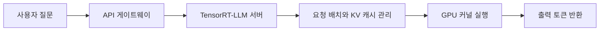

## 학습 목표와 흐름

D57의 연속 배칭과 D58의 KV cache(키·값 캐시) 관리가 여러 요청을 처리하는 기본 구조였습니다. 이번에는 그 구조 안에서 연산을 실행하는 방법과 성능을 비교하는 기준을 살펴봅니다.

| 학습 내용 | 이해할 관계 | 사용하는 상황 |
|---|---|---|
| 실행 엔진과 백엔드 | 모델 파일 → 계산 준비 → 요청 처리 | 기존 서버를 다른 엔진으로 교체할 때 |
| 엔진 빌드 | GPU·정밀도·최대 길이와 실행 파일의 관계 | 빌드한 엔진을 다른 서버에 배포할 때 |
| 커널 융합·CUDA 그래프 | 메모리 왕복과 CPU의 실행 준비 비용 | 작은 GPU 연산이 반복될 때 |
| 인플라이트 배칭 | 요청 수·토큰 예산과 대기 시간 | 생성 중인 요청과 새 요청을 함께 처리할 때 |
| GPU와 양자화 | 저장 비트 수·계산 형식·지원 하드웨어 | FP8과 W4A16 중 실행 구성을 고를 때 |
| 벤치마크와 엔진 선택 | 측정 조건·응답 목표·운영 비용 | 성능표를 읽고 교체 여부를 결정할 때 |

---

## 자습

### 1. TensorRT-LLM의 역할과 요청 흐름

여러 사용자가 같은 모델에 질문하면 서버는 모델을 GPU에 올려 두고, 기다리는 요청을 모아 계산하며, 완성되는 답변을 각 사용자에게 돌려줍니다. 이 일을 맡는 도구가 Inference engine(추론 엔진)입니다. TensorRT-LLM은 NVIDIA GPU에서 LLM을 실행하도록 만든 추론·서빙 도구입니다.

요청은 다음 흐름으로 처리됩니다.

서버는 `/v1/chat/completions` 같은 OpenAI 호환 API(응용 프로그램 인터페이스)로 요청을 받습니다. 게이트웨이는 모델 서버의 주소로 요청을 보내므로, 서버 주소를 바꾸는 방식으로 vLLM과 TensorRT-LLM을 연결해 비교할 수 있습니다. 모델 이름과 생성 설정, 응답 형식도 함께 맞춥니다.

이름이 비슷한 도구들은 맡은 일을 구분하면 이해하기 쉽습니다.

| 이름 | 역할 |
|---|---|
| TensorRT | 모델의 연산을 대상 GPU에 맞게 최적화하고 실행 엔진을 만드는 도구 |
| TensorRT-LLM | LLM의 모델 실행, 요청 배칭, KV 캐시 관리, 최적화 커널을 제공하는 도구 |
| `trtllm-serve` | TensorRT-LLM으로 모델 서버를 시작하는 명령 |
| Triton Inference Server | 여러 모델과 전후처리 단계를 운영하는 서버. TensorRT-LLM을 백엔드로 연결할 수 있음 |

Backend(백엔드)는 서버 내부에서 모델을 실제로 실행하는 방식입니다. TensorRT-LLM 1.2.1에서는 PyTorch 백엔드가 기본이며, Hugging Face의 모델 체크포인트를 직접 불러옵니다. 별도로 빌드한 TensorRT 엔진을 사용하는 방식도 이 버전에 존재합니다. 두 방식을 구분해 두면 과거의 엔진 빌드 설명과 PyTorch 기반 실행 흐름을 함께 이해할 수 있습니다.

### 2. 엔진 빌드와 서버 준비 시간

같은 모델을 같은 GPU에서 오래 운영하면 반복해서 수행할 계산의 실행 방법을 미리 골라 둘 수 있습니다. Engine build(엔진 빌드)는 모델의 연산 구조를 분석하고 대상 GPU에서 사용할 커널과 실행 구성을 정해 파일로 저장하는 과정입니다.

이때 커널은 GPU에서 특정 연산을 수행하는 프로그램입니다. 행렬 곱셈이나 정규화를 구현하는 방법이 여러 개라면 빌더는 사용할 수 있는 후보를 비교합니다. 연속된 연산을 합치고, 미리 계산할 수 있는 값을 처리하며, 선택한 구성을 엔진 파일에 담습니다.

| 실행 방식 | 요청을 받기 전 준비 | 운영할 때 관리하는 항목 |
|---|---|---|
| TensorRT 엔진 백엔드 | 체크포인트 변환 → 엔진 빌드 → 엔진 로드 | 엔진 파일, 대상 GPU, TensorRT 버전, 빌드 한도 |
| PyTorch 백엔드 | 체크포인트 로드 → 자동 조정·필요한 컴파일·CUDA 그래프 준비 | 체크포인트, 엔진 버전, 실행 설정, 준비 시간 |

빌드한 엔진에는 대상 GPU와 라이브러리 버전, 정밀도, 처리할 요청의 한도가 연결됩니다. 예를 들어 최대 시퀀스 길이를 4,096토큰으로 정했다면 입력과 출력에 필요한 길이를 그 범위 안에서 계획합니다. 8,192토큰까지 처리하도록 바꾸려면 그 길이에 맞는 엔진을 다시 준비합니다. A100용으로 만든 엔진을 L4에 배포할 때도 L4에 맞는 빌드와 검증이 필요합니다.

미리 빌드하면 배포 서버에서 수행할 준비 작업을 줄이고 검증한 엔진 파일을 재사용할 수 있습니다. GPU 세대나 모델을 바꾸는 일이 잦으면 엔진 파일을 다시 만들고 관리하는 일이 늘어납니다.

PyTorch 백엔드는 모델을 직접 로드한 뒤 실행 설정을 조정합니다. Autotuning(자동 조정)은 연산에 맞는 빠른 실행 설정을 찾는 작업이고, `torch.compile`은 PyTorch의 컴파일 함수입니다. CUDA 그래프 준비도 기동 과정에 포함될 수 있습니다.

그래서 배포 속도를 볼 때는 **프로세스 시작부터 실제 요청을 받을 준비가 끝날 때까지의 시간**을 따로 잽니다. 이 시간을 `ready_s`로 기록하면, 서버 한 대를 교체하는 동안 나머지 서버가 얼마나 오래 부하를 받아야 하는지 판단할 수 있습니다.

### 3. 커널 융합과 CUDA 그래프가 줄이는 비용

LLM은 토큰 하나를 만들 때도 여러 층의 행렬 곱셈, 정규화, 활성 함수를 실행합니다. 계산 사이마다 CPU가 커널 실행을 준비하고 GPU 메모리에 중간값을 저장하면 그 시간도 전체 응답 시간에 더해집니다.

**Kernel fusion(커널 융합)**은 이어지는 연산을 하나의 커널에 묶습니다. 예를 들어 활성 함수로 값을 바꾼 뒤 다른 값과 곱하는 두 연산을 합치면, 중간값을 GPU의 전역 메모리에 썼다가 다시 읽는 일을 줄일 수 있습니다.

개념을 확인하기 위해 크기가 같은 중간 결과의 저장량을 $M$바이트라고 두겠습니다. 두 커널이 그 결과를 전역 메모리로 주고받으면 쓰기 $M$바이트와 읽기 $M$바이트가 필요합니다.

$$
\text{중간 결과의 메모리 이동량}=M+M=2M
$$

이 값이 8MB라면 중간 결과를 전달하는 데 16MB를 이동합니다. 융합한 커널 안에서 중간값을 바로 사용하면 이 왕복을 줄입니다. 반복 횟수가 많은 Decode(디코드, 다음 토큰을 만드는 단계)에서 작은 비용이 계속 누적되는 이유도 여기 있습니다.

**CUDA Graph(쿠다 그래프)**는 커널들의 실행 순서와 의존 관계를 Capture(캡처)해 두고 다시 실행합니다. CPU가 매번 커널 여러 개를 개별적으로 준비하는 비용을 줄입니다.

| 기법 | 묶는 대상 | 줄이는 비용 |
|---|---|---|
| 커널 융합 | 여러 연산 | 중간값의 메모리 왕복, 커널 실행 횟수 |
| CUDA 그래프 | 커널들의 실행 순서 | CPU가 반복해서 수행하는 실행 준비 |

CUDA 그래프는 준비한 입력 크기에 맞춰 재사용합니다. 배치 크기 4와 8의 그래프를 준비했고 요청이 6개라면, 패딩을 사용하는 구성에서는 8개 크기에 맞춰 실행합니다. 이 예에서 사용하지 않는 자리는 $8-6=2$개이고 전체 자리의 25%입니다.

크기 6의 그래프도 준비하면 이 패딩을 줄일 수 있습니다. 준비하는 크기가 많아질수록 그래프를 만드는 시간과 메모리 사용량도 늘어납니다. 이 메모리는 KV 캐시와 함께 GPU 자원을 나눠 씁니다.

Prefill(프리필, 입력 토큰들을 처리하는 단계)은 긴 입력을 한꺼번에 계산합니다. 입력이 길면 큰 행렬 곱셈의 계산량이 커집니다. 디코드에서는 토큰을 만들 때마다 가중치와 캐시를 읽고 작은 계산을 반복합니다. 두 구간의 응답 시간을 따로 살피면 어떤 최적화가 필요한지 찾기 쉽습니다.

### 4. 인플라이트 배칭과 토큰 예산

여러 요청의 출력 길이가 다르면 어떤 요청은 빨리 끝나고 다른 요청은 계속 답변을 만듭니다. 끝난 요청의 자리에 새 요청을 넣어 GPU를 계속 사용하는 방식이 In-flight batching(인플라이트 배칭)입니다. D57의 Continuous batching(연속 배칭)과 같은 개념입니다.

한 번의 계산에 넣을 작업은 요청 수와 토큰 수로 제한합니다.

| 설정 | 제한하는 대상 | 작은 예 |
|---|---|---|
| `max_batch_size` | 한 스텝에 함께 처리하는 요청 수 | 최대 요청 4개 |
| `max_num_tokens` | 한 스텝에 계산할 토큰 수 | 총 12토큰 |
| `max_seq_len` | 요청 하나의 최대 시퀀스 길이 | 입력과 출력을 합쳐 최대 4,096토큰 |

토큰 예산이 12이고, 입력이 각각 5토큰인 요청 네 개가 기다린다고 가정하겠습니다. 입력을 통째로 처리하는 첫 스텝에는 두 요청을 넣어 $5+5=10$토큰을 계산합니다. 남은 예산은 2토큰입니다.

다음 스텝에서는 앞의 두 요청이 디코드에 들어가 각각 1토큰을 계산합니다. 여기에 새 요청 두 개의 입력을 넣으면 $1+1+5+5=12$토큰이 되어 예산을 채웁니다.

Chunked prefill(청크 분할 프리필)을 사용하면 긴 입력을 여러 스텝으로 나눕니다. 첫 스텝의 남은 2토큰으로 세 번째 요청의 입력 일부를 먼저 처리할 수 있습니다. 긴 입력을 처리하는 일과 이미 답변을 생성 중인 요청을 번갈아 배치하기 쉬워집니다.

이미 진행 중인 디코드에 우선순위를 주면 답변의 출력 간격을 고르게 유지하기 좋습니다. 새 요청은 사용할 예산이 생길 때까지 기다립니다. 스케줄링 설정은 **첫 응답을 기다리는 시간과 생성 중의 출력 간격**에 각각 영향을 줍니다.

### 5. GPU와 양자화 형식의 관계

모델을 더 적은 메모리로 실행하거나 한 번에 더 많은 요청을 처리하려면 가중치·활성값·KV 캐시 중 어떤 값을 줄일지 정합니다. 각 값의 역할과 GPU가 지원하는 연산 형식을 함께 확인합니다.

- **W4A16**은 Weight(가중치)를 4비트로 저장하고 Activation(활성값)을 16비트로 사용하는 구성입니다. 가중치를 읽어 오는 양이 줄어듭니다.
- **FP8**은 8비트 부동소수점 형식입니다. 가중치와 활성값을 FP8로 계산하는 구성은 이를 지원하는 GPU의 연산 장치를 활용합니다.
- **FP8 KV 캐시**는 이전 토큰의 K·V를 8비트로 저장합니다. 가중치와 활성값의 계산 정밀도와 별도로 설정하는 항목입니다.

아래는 TensorRT-LLM **1.2.1**에서 해당 GPU 계열이 지원하는 형식입니다. W4A16 열은 AWQ·GPTQ, FP8 계산 열은 텐서 단위 FP8을 뜻합니다.

| GPU 예 | W4A16 | FP8 가중치·활성값 | FP8 KV 캐시 | NVFP4 |
|---|---|---|---|---|
| A100 · Ampere | 지원 | 미지원 | 지원 | 미지원 |
| L4 · Ada Lovelace | 지원 | 지원 | 지원 | 미지원 |
| H100 · Hopper | 지원 | 지원 | 지원 | 미지원 |
| B200 · Blackwell SM100 | 지원 | 지원 | 지원 | 지원 |

T4는 이 버전의 공식 GPU 지원 목록에 없습니다. A100에서 FP8 KV 캐시를 사용할 수 있는 것은 값을 8비트로 **저장**하는 기능과 FP8 행렬 곱셈 기능이 별개이기 때문입니다. 실제 모델을 선택할 때는 GPU 표와 모델 구조별 지원 표를 함께 확인합니다. [NVIDIA 양자화 지원 표](https://github.com/NVIDIA/TensorRT-LLM/blob/v1.2.1/docs/source/features/quantization.md)

동시 요청이 적고 가중치를 읽는 시간이 큰 경우에는 W4A16의 메모리 절감 효과를 살펴봅니다. 지원 GPU에서 여러 요청을 크게 묶어 계산한다면 FP8의 계산 효율을 비교할 수 있습니다. 두 경우 모두 같은 질문으로 답변 품질을 확인합니다.

양자화 파일을 고를 때는 **알고리즘 → 저장 형식 → 실행 커널 → 서빙 엔진**의 연결을 봅니다. TensorRT-LLM은 ModelOpt로 만든 양자화 체크포인트를 실행하는 경로를 제공합니다. 파일을 만든 도구와 모델 버전도 남겨 두면 실행 구성을 다시 준비하기 쉽습니다.

### 6. 첫 응답, 출력 간격, 처리량의 의미

채팅 사용자는 첫 글자가 나올 때까지 기다리고, 이후에는 문장이 이어지는 속도를 느낍니다. 서버 운영자는 여러 사용자의 요청을 합쳐 얼마나 처리했는지도 봅니다. 이 경험들을 서로 다른 지표로 측정합니다.

요청을 보낸 시각을 $t_0$, 첫 출력 토큰을 받은 시각을 $t_1$, 마지막 출력 토큰을 받은 시각을 $t_N$이라고 두겠습니다. 출력 토큰 수는 $N$입니다.

**TTFT — Time to first token(첫 토큰 지연)**은 요청부터 첫 출력까지 걸린 시간입니다.

$$
TTFT=t_1-t_0
$$

여기에는 통신, 서버의 대기, 입력 프리필 등이 포함됩니다. 문서가 길어졌거나 요청 대기열이 늘어났을 때 TTFT가 커질 수 있습니다.

**TPOT — Time per output token(출력 토큰당 평균 시간)**은 첫 토큰 이후의 생성 구간을 출력 간격 수로 나눈 값입니다. 출력이 두 토큰 이상일 때 계산합니다.

$$
TPOT=\frac{t_N-t_1}{N-1}
$$

**ITL — Inter-token latency(토큰 사이 지연)**은 이웃한 토큰이 도착한 시각의 차이입니다. 각 토큰의 도착 시각이 있어야 개별 간격을 계산할 수 있습니다.

$$
ITL_i=t_i-t_{i-1}\qquad(i=2,\ldots,N)
$$

예를 들어 요청 시각이 0초이고 다섯 토큰의 도착 시각이 `0.40, 0.42, 0.44, 0.54, 0.56`초라면 다음 값이 나옵니다.

| 지표 | 계산 | 의미 |
|---|---|---|
| TTFT | $0.40-0=0.40$초 | 첫 출력을 0.40초 기다림 |
| 개별 ITL | 0.02, 0.02, 0.10, 0.02초 | 네 번째 토큰 직전에 0.10초 간격이 생김 |
| TPOT | $(0.56-0.40)/4=0.04$초 | 첫 토큰 이후 간격의 평균은 0.04초 |
| 마지막 토큰까지의 지연 | $0.56-0=0.56$초 | 다섯 번째 토큰까지 0.56초 걸림 |

이 예에서는 TPOT가 0.04초이고 가장 긴 ITL은 0.10초입니다. **요청마다 계산한 TPOT의 p99와 모든 토큰 간격을 모아 계산한 ITL의 p99는 집계 대상이 다릅니다.** 결과표에 사용한 지표 이름과 계산 방법을 적어 둡니다.

Streaming(스트리밍) 응답은 여러 토큰을 한 Chunk(청크)에 담아 보낼 수 있습니다. 청크 도착 시각으로 측정했다면 청크 간격으로 기록하고, 출력 토큰 수는 서버의 토큰 사용량이나 같은 토크나이저로 확인합니다. 첫 응답에서 역할 정보만 들어 있는 빈 청크는 첫 내용 토큰과 구분합니다.

**Output throughput(출력 처리량)**은 측정 구간 전체에서 성공적으로 생성한 출력 토큰 수를 그 구간의 실제 경과 시간으로 나눕니다.

$$
\text{출력 처리량}=\frac{\sum_{i=1}^{R}N_i}{T}
$$

$R$은 성공한 요청 수, $N_i$는 각 요청의 출력 토큰 수, $T$는 벤치마크 전체 경과 시간입니다. 요청 10개가 각각 128토큰을 만들고 전체 시험이 4초 걸렸다면 $1,280/4=320$토큰/초입니다. 요청을 동시에 처리하므로 전체 경과 시간을 사용합니다.

### 7. 비교할 조건과 측정 방법

엔진을 바꾼 효과를 확인하려면 두 엔진에 같은 일을 맡깁니다. 모델 파일과 GPU뿐 아니라 질문의 길이, 생성 설정, 요청을 보내는 속도도 계산량과 대기 시간을 바꿉니다.

| 비교 조건 | 같게 두거나 기록할 값 | 응답에 미치는 영향 |
|---|---|---|
| 모델 | 저장소 이름, Revision(파일 버전), 토크나이저, 채팅 템플릿 | 입력 토큰과 모델 계산 |
| 하드웨어 | GPU 종류·개수, 실행 환경 | 계산 성능과 메모리 용량 |
| 정밀도 | 가중치·활성값·KV 캐시 형식 | 저장량·계산량·답변 품질 |
| 생성 설정 | 온도, `top_p`, 반복 패널티, 시드, 출력 길이 | 생성 경로와 답변 길이 |
| 입력 | 같은 질문 파일, 길이 분포, 공통 접두부 비율 | 프리필 계산량과 캐시 적중 |
| 부하 | 동시 요청 수 또는 초당 요청 수, 전체 요청 수 | 배칭과 대기열 |
| 서버 설정 | 토큰 예산, 청크 분할, 캐시 설정 | 스케줄링과 메모리 사용 |
| 측정 | 같은 클라이언트, 예열, 시간의 시작·종료 기준 | 결과에 포함되는 구간 |

#### 7-1) 입력·출력 길이와 캐시 상태

짧은 문의와 문서를 붙인 질문은 입력 길이가 다릅니다. 서비스에서 짧은 질문이 70%, 긴 질문이 30%라면 시험 질문도 그 비율에 맞추고 실제 토큰 길이를 기록합니다.

처리 속도를 비교할 때는 출력 길이를 예를 들어 128토큰으로 맞춥니다. `max_tokens`는 출력의 상한이고, EOS(종료 토큰)에 따라 답변이 먼저 끝날 수 있습니다. 고정 길이 시험에서는 `ignore_eos` 같은 지원 옵션과 실제 생성 토큰 수를 확인합니다. 답변 품질 시험에서는 정상적인 종료 조건으로 답을 생성합니다.

Prefix caching(프리픽스 캐싱)은 공통 입력의 KV를 재사용합니다. 계산 자체를 비교하려면 두 서버의 캐시 상태를 맞추고 질문 반복 여부를 통제합니다. 문서 재사용이 많은 서비스의 성능을 보려면 같은 반복 비율을 두 엔진에 적용합니다.

#### 7-2) 메모리 비율과 실제 KV 용량

동시에 담을 요청 수를 비교할 때는 실제 KV 캐시 용량을 봅니다. 설정에 적는 메모리 비율은 기준이 다를 수 있습니다.

| 설정 | 비율을 적용하는 대상 |
|---|---|
| vLLM의 `gpu_memory_utilization` | 전체 GPU 메모리 중 해당 서버가 사용할 예산 |
| TensorRT-LLM의 `kv_cache_free_gpu_memory_fraction` | 모델 로드 후 여유 메모리 중 KV 캐시에 사용할 비율 |

GPU 메모리가 24GB이고, 모델과 그 밖의 작업에 6GB가 필요하다고 단순화해 보겠습니다. vLLM의 서버 예산을 90%로 잡으면 $24\times0.9-6=15.6$GB가 남습니다. 여유 메모리의 90%를 KV에 배정하면 $(24-6)\times0.9=16.2$GB입니다. 비율의 분모가 달라지는 계산 예시입니다.

실제 용량을 정할 때는 커널 작업 공간과 그래프 메모리도 반영합니다. 기동 로그의 KV 토큰 수나 블록 수를 확인하고, 블록당 토큰 수와 KV 자료형도 함께 기록합니다.

#### 7-3) 예열과 부하 곡선

서버를 막 시작한 뒤에는 컴파일이나 그래프 준비 작업이 응답에 포함될 수 있습니다. Warm-up(예열) 요청을 먼저 보내 준비를 마친 뒤 본 측정을 시작합니다. 예열 요청 수와 준비 시간도 따로 기록합니다.

Concurrency(동시 요청 수)를 1, 2, 4, 8, 16, 32처럼 늘리면 처리량이 증가하다가 대기가 빠르게 늘어나는 구간을 찾을 수 있습니다. 고정 동시성 시험은 요청 하나가 끝날 때 새 요청을 넣어 진행 중인 요청 수를 유지합니다. 초당 도착 요청 수를 정하는 시험은 정해 둔 속도로 요청을 보냅니다. 비교할 두 엔진에는 같은 부하 방식을 적용합니다.

각 단계에서 충분한 요청을 보내고 p50(중앙값)과 p99(99백분위수)를 함께 계산합니다. p50은 정렬한 측정값의 가운데이고 p99는 느린 쪽 끝부분을 보여줍니다. 전체 요청 수와 반복 시험 수를 같이 남기면 p99를 만든 표본의 크기도 알 수 있습니다.

클라이언트에서 시간을 측정하면 통신과 서버 대기까지 포함한 사용자 경험을 봅니다. 엔진 내부에서 바로 계산하는 오프라인 시험은 모델 실행 성능을 봅니다. 비교표에는 측정 위치를 명시합니다. `vllm bench serve`는 OpenAI 호환 서버를 대상으로 부하를 주는 명령이며, `ttft`, `tpot`, `itl`의 백분위수를 각각 기록할 수 있습니다. [vLLM 0.30.0 측정 옵션](https://docs.vllm.ai/en/v0.30.0/cli/bench/serve/)

### 8. 응답 목표와 운영 비용으로 엔진 선택

서비스에 필요한 속도는 SLO — Service level objective(서비스 수준 목표)로 정합니다. 대화형 서비스라면 첫 응답과 이후 출력 간격을 함께 정할 수 있습니다. 예를 들어 TTFT p99 2초 이하, ITL p99 0.1초 이하, 요청 실패 0건을 시험 통과 기준으로 둡니다.

다음 표는 같은 GPU·모델·정밀도·질문 파일로 측정했다고 **가정한 학습용 수치**입니다.

| 엔진 | 동시 요청 | TTFT p99 | ITL p99 | 실패 | 목표 충족 |
|---|---:|---:|---:|---:|---|
| A | 16 | 1.4초 | 0.08초 | 0 | 충족 |
| A | 32 | 2.6초 | 0.11초 | 0 | 초과 |
| B | 16 | 1.2초 | 0.06초 | 0 | 충족 |
| B | 32 | 1.8초 | 0.08초 | 0 | 충족 |
| B | 64 | 4.0초 | 0.16초 | 0 | 초과 |

시험한 동시 요청 수 가운데 목표를 만족한 최댓값은 A가 16, B가 32입니다. 이 표에서 B는 목표 시간을 지키며 처리한 동시 요청 수가 두 배입니다. 피크 부하가 24개라면 B의 32개 결과가 도입 검토에 필요한 근거가 됩니다.

함께 볼 항목은 답변 품질과 운영 작업입니다. 같은 평가 질문으로 정답 수와 답이 달라진 문항을 확인합니다. 정답에서 오답으로 바뀐 수와 오답에서 정답으로 바뀐 수를 나누어 보면 어떤 답변이 달라졌는지 드러납니다.

운영 비용에는 엔진별 컨테이너와 의존성 관리, 서버 준비 시간, 설정·로그·모니터링 학습, 버전 변경 시 재검증이 포함됩니다. 모델과 GPU가 오래 고정되고 요청이 많으면 튜닝한 성능을 오래 활용할 수 있습니다. 모델을 자주 바꾸는 서비스는 새 모델의 지원 여부와 준비 시간도 큰 비중으로 봅니다.

엔진 선택은 **GPU·모델 지원 → 서비스 목표 → 현재 엔진 측정 → 동일 조건의 후보 측정 → 품질·운영 비용** 순서로 판단합니다. 현재 엔진이 피크 부하에서 목표를 만족하면 그 구성을 유지할 근거가 있습니다. 후보 엔진을 적용할 때는 일부 요청부터 보내고 기존 서버로 되돌릴 경로를 유지합니다.

## 이해 확인

1. 커널 융합과 CUDA 그래프는 각각 무엇을 묶나요?

커널 융합은 여러 연산을 한 커널에 묶어 중간값의 메모리 왕복과 커널 실행 횟수를 줄입니다. CUDA 그래프는 커널들의 실행 순서와 의존 관계를 캡처해 CPU가 반복해서 준비하는 비용을 줄입니다.

2. 입력이 5토큰인 요청 네 개와 토큰 예산 12가 있으면 첫 스텝은 어떻게 구성되나요?

입력을 통째로 프리필하면 두 요청의 10토큰을 처리하고 2토큰의 예산이 남습니다. 청크 분할 프리필을 사용하면 남은 예산으로 세 번째 요청의 입력 2토큰을 먼저 처리할 수 있습니다. 다음 스텝의 구성에는 이미 생성 중인 요청의 디코드 토큰도 포함합니다.

3. A100의 FP8 KV 캐시 지원과 FP8 계산 지원은 어떻게 다른가요?

FP8 KV 캐시는 이전 토큰의 K·V를 저장하는 형식입니다. FP8 가중치·활성값 연산은 GPU가 해당 형식으로 행렬 곱셈을 수행하는 기능입니다. TensorRT-LLM 1.2.1의 지원 표에서 A100은 FP8 KV 캐시를 지원하고 FP8 가중치·활성값 연산은 미지원입니다.

4. 첫 토큰·마지막 토큰 시각과 출력 토큰 수로 어떤 지표를 계산하나요?

요청을 보낸 시각까지 있으면 TTFT, TPOT, 마지막 토큰까지 걸린 시간을 계산합니다. 개별 ITL을 구하려면 이웃한 토큰 각각의 도착 시각이 필요합니다. TPOT p99는 요청별 평균값을 모은 백분위수이고, ITL p99는 개별 간격을 모은 백분위수입니다.

5. 두 엔진의 메모리 비율을 0.9로 맞춘 뒤 무엇을 확인하나요?

각 비율의 기준과 실제 KV 용량을 확인합니다. vLLM의 서버 메모리 예산은 전체 GPU 메모리를 기준으로 하고, TensorRT-LLM의 KV 메모리 비율은 모델 로드 후 여유 메모리를 기준으로 합니다. 기동 로그나 지표에서 KV 토큰 수·블록 수·자료형을 기록합니다.

6. FP16 vLLM과 FP8 TensorRT-LLM의 처리량을 비교했다면 다음 실험은 어떻게 구성하나요?

엔진을 바꾼 효과를 확인하는 실험에서는 두 엔진의 정밀도를 맞춥니다. GPU·모델 버전·질문 파일·출력 길이·생성 설정·부하·예열도 맞추고 같은 측정기로 응답 지연과 처리량을 기록합니다. 실제 배포할 FP16·FP8 구성의 비교에는 각 정밀도를 표에 적고 답변 품질을 함께 평가합니다.

7. 후보 엔진의 처리량이 높을 때 어떤 값으로 교체를 판단하나요?

서비스의 피크 부하에서 TTFT와 출력 간격 목표를 만족하는지 확인합니다. 그때 처리한 동시 요청 수와 실패 수, 답변 품질을 확인하고 서버 준비 시간과 추가 운영 작업을 함께 비교합니다. 적용할 때는 일부 요청부터 보내고 기존 서버로 돌아갈 수 있게 준비합니다.

