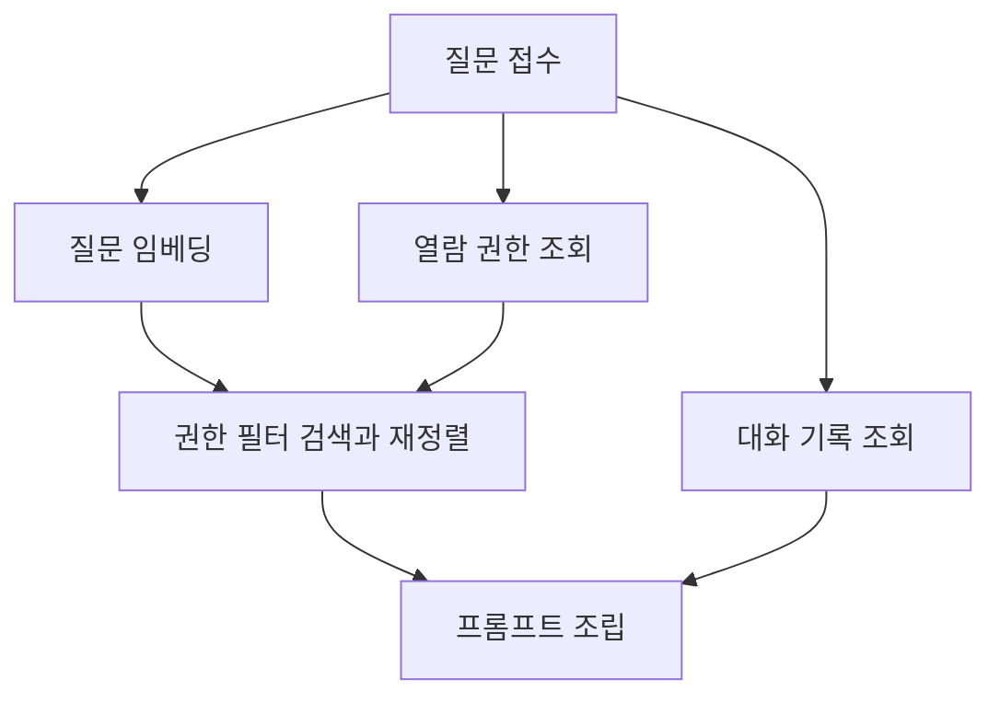

**느린 구간 찾기부터 캐시, 문서 선별, 모델 선택까지**

이 강의의 목표는 **RAG가 답을 만드는 전체 과정을 측정하고, 정확도와 접근 권한을 유지하면서 불필요한 계산과 기다림을 줄이는 것**이다. 모델을 빠르게 실행하는 기술에 더해, 모델에 넣는 문서의 양과 요청을 처리하는 순서까지 조절한다.

기본 순서는 **기준 결과 측정 → 설정 하나 변경 → 시간·근거·답변·권한 비교 → 유지 또는 복구**다. 어떤 기술을 썼는지보다, 어느 구간을 얼마나 줄였고 어떤 답을 잃었는지 설명하는 것이 중요하다. [강의 원문][lecture]

> 범위: D60 이론 강의의 본문과 심화 개념. A4 약 8장에 해당하는 설명을 8개 단원으로 구성했다. 마크다운의 실제 인쇄 쪽수는 글꼴·여백·표 배치에 따라 달라진다. 아래 계산 예시는 원리를 설명하기 위한 가정이며, 별도 실습의 실행 결과는 포함하지 않는다.

## 1. RAG는 어디에서 시간이 걸리는가

### 1.1 질문에서 답변까지의 여섯 구간

RAG는 질문과 관련된 문서를 찾고, 그 문서를 생성 모델의 입력에 넣어 답하게 하는 구성이다. 생성 모델이 빨라도 검색이나 재정렬에서 오래 걸리면 사용자가 기다리는 시간은 길어진다. 따라서 전체를 다음처럼 나누어 측정한다. [강의 1장][lecture]

| 구간 | 실제로 하는 일 | 시간이 늘어나는 주요 이유 | 먼저 살펴볼 설정 |
|---|---|---|---|
| 질문 임베딩 | 질문의 의미를 나타내는 숫자 벡터를 만듦 | 임베딩 모델 크기, 입력 길이, 요청 집중 | 임베딩 캐시, 배치 크기 |
| 문서 검색 | 벡터DB에서 관련 문서 후보를 찾음 | 문서 수, 인덱스 탐색 범위, 필터 | 검색 후보 수, 탐색 설정 |
| 재정렬 | 후보와 질문의 관련성을 다시 계산해 순위를 정함 | 후보 수와 후보 문서의 길이 | 재정렬할 후보 수 |
| 프롬프트 조립 | 규칙·문서·대화·질문을 모델 입력으로 구성 | 외부 정보 조회, 긴 대화 처리 | 조립 과정, 입력 순서 |
| 생성 요청 후 첫 텍스트까지 | 생성 서버의 응답을 기다리고 입력을 처리 | 서버 대기, 입력 토큰 수, 통신 | 입력량, 프리픽스 캐시, 대기열 |
| 이후 답변 생성 | 첫 출력 이후 마지막 출력까지 생성 | 출력 토큰 수, 모델·엔진 성능 | 답변 길이 상한, 모델 선택 |

캐시를 추가하면 캐시 조회 시간도 따로 기록한다. 마지막 두 구간은 생성 모델 호출을 기준으로 나눈 것이다. 사용자가 RAG에 질문한 순간부터 첫 글자를 받기까지 잰 값에는 앞의 검색 단계들도 들어간다.

순서대로 처리하는 기본 구성에서는 구간별 시간을 더하면 전체 시간에 가까워진다. 서로 겹쳐 실행하는 구간이 있으면 겹친 시간을 중복해서 더하지 않고, 요청 시작부터 종료까지의 시간도 직접 측정한다.

### 1.2 입력을 처리하는 프리필과 답을 만드는 디코드

**프리필(prefill)**은 모델이 입력 토큰을 처리해 이후 생성에 사용할 계산 결과를 만드는 단계다. 입력에는 질문뿐 아니라 시스템 규칙, 검색 문서, 대화 기록도 포함된다. **KV 캐시**는 다음 토큰을 생성할 때 재사용할 이전 토큰들의 일부 중간 계산 결과를 저장한 메모리다. 입력이 길어지면 처리할 양과 KV 캐시 메모리가 늘어난다.

**디코드(decode)**는 앞의 입력과 지금까지 생성한 토큰을 바탕으로 다음 토큰을 계속 만드는 단계다. 답이 길수록 반복 생성 횟수가 늘어난다. 그래서 입력 문서를 줄이는 방법은 주로 프리필에, 답변 길이를 제한하는 방법은 주로 디코드에 영향을 준다.

답변 길이를 줄일 때는 생성 상한과 답변 형식을 함께 조절한다. 예를 들어 핵심 답과 필요한 근거를 먼저 쓰도록 요청하고, 출력 토큰 상한을 둔다. 상한에 걸려 문장이 잘리거나 필수 근거가 빠지는지도 평가한다.

### 1.3 TTFT는 시작점과 끝점을 적어야 한다

TTFT(Time To First Token)는 첫 토큰까지의 시간이다. 정확히 비교하려면 무엇을 시작점으로 삼았는지 확인해야 한다.

| 측정값 | 시작점 → 끝점 | 포함되는 작업 |
|---|---|---|
| 사용자가 느끼는 첫 응답 시간 | RAG 요청 전송 → 첫 답변 텍스트 수신 | 앞단 처리, 검색, 생성 서버 대기·계산, 통신 |
| 생성 API 호출의 첫 응답 시간 | 생성 API 요청 전송 → 첫 텍스트 수신 | 생성 서버 대기·계산과 통신 |
| vLLM 0.30.0의 요청별 `time_to_first_token_ms` | 요청 스케줄 시점 → 첫 출력 토큰 생성 | 공식 문서가 정한 서버 내부 구간 |

vLLM 0.30.0은 요청별 `queue_time_ms`를 별도로 제공한다. 따라서 직접 잰 첫 응답 시간과 서버의 TTFT 필드를 비교할 때는 대기·통신·앞단 처리의 포함 범위를 맞춘다. 요청별 지표는 `--enable-per-request-metrics`로 활성화하며, 스트리밍 응답에서는 `stream_options={"include_usage": True}` 등으로 마지막 사용량 청크를 받아야 지표를 확인할 수 있다. [vLLM 요청별 지표][request-metrics]

스트리밍의 첫 데이터가 역할 정보만 담고 있을 수 있으므로, 사용자 체감 시간을 잴 때는 **실제 답변 텍스트가 처음 나온 시점**을 기록한다. 생성 서버가 나누어 보내도 중간 프록시가 모아서 전달하면 사용자에게는 답변이 늦게 한꺼번에 나타날 수 있다.

## 2. 무엇이 개선됐는지 공정하게 확인하기

### 2.1 평균과 p50·p95·p99를 함께 이해하기

평균은 전체 시간의 합을 요청 수로 나눈 값이다. p50·p95·p99는 요청을 빠른 순으로 정렬했을 때 각각 50%·95%·99% 위치에 해당하는 시간이다. [강의 1장][lecture]

| 지표 | 읽는 방법 | 확인하는 목적 |
|---|---|---|
| p50, 중앙값 | 약 절반의 요청이 이 시간 안에 끝남 | 보통 요청의 처리 속도 |
| p95 | 약 95%의 요청이 이 시간 안에 끝남 | 상대적으로 느린 요청의 상태 |
| p99 | 약 99%의 요청이 이 시간 안에 끝남 | 드물게 매우 느려지는 요청의 상태 |

대부분 빨라도 일부 요청이 오래 걸릴 수 있다. 특히 캐시 미적중, 모델 전환, 재시도, 서버 대기가 겹친 요청이 느려지기 쉽다. 평균과 p50이 줄었어도 p95가 늘었다면 어떤 경로에서 기다림이 늘었는지 확인한다.

20문항 정도의 작은 평가에서는 느린 한두 건이 p95를 크게 바꾼다. 이때는 p50과 개별 요청 기록을 중심으로 비교하고, 서비스의 p95·p99는 충분한 요청이 쌓인 부하 테스트나 운영 기록에서 판단한다. **전체 응답 시간의 p95는 각 요청의 전체 시간으로 계산한다. 구간별 p95를 더한 값과는 구분한다.**

### 2.2 기준선을 만들고 한 가지씩 바꾸기

**기준선(baseline)**은 개선 전 설정으로 얻은 비교 기준이다. 먼저 같은 질문 세트로 구간별 시간, 검색 문서, 실제 답변, 정답 여부를 저장한다. 이후 청크 수나 캐시 설정 중 하나만 바꾸고 같은 질문을 다시 실행한다.

비교 조건은 가능한 한 맞춘다. 같은 GPU와 모델·정밀도·버전을 사용하고, 예열 여부와 동시 요청 수를 기록한다. 다른 작업이 GPU를 함께 쓰는지도 확인한다. 입력·출력 토큰 수를 남겨야 빨라진 이유가 모델 처리 개선인지 답이 짧아진 효과인지 구분할 수 있다.

캐시 실험에서는 **모델 예열**과 **캐시 채우기**를 구분한다. 모델 준비를 끝낸 뒤에도 캐시를 비운 첫 실행과 캐시가 채워진 반복 실행은 서로 다른 조건이다. 같은 질문만 반복해 얻은 높은 적중률은, 새로운 질문이 많이 들어오는 실제 서비스와 따로 해석한다.

질문 세트에는 단순 조회, 계산, 여러 문서 결합, 자료 없음, 권한 제한을 섞는다. 실제 모델 실행과 응답 시간을 인위적으로 흉내 낸 mock 실행도 결과표에서 구분한다. 반복 측정의 흔들림보다 작은 차이는 추가 실행으로 확인한다.

### 2.3 정답률과 함께 flip을 확인하기

이 강의에서 **flip은 기준선에서는 맞았는데 설정 변경 후 틀린 문항**을 가리킨다. 속도를 높이는 과정에서 잃은 정답을 찾는 지표다.

| 기준선 | 변경 후 | 해석 |
|---|---|---|
| 정답 | 정답 | 기존 정답 유지 |
| 정답 | 오답 | 잃은 정답, 이 강의의 flip |
| 오답 | 정답 | 새로 얻은 정답 |
| 오답 | 오답 | 계속 해결하지 못한 문항 |

정답률이 같아도 한 문항을 새로 맞히고 다른 문항을 잃었을 수 있다. 그래서 flip 문항의 질문, 근거 문서, 답변을 함께 본다. 정답 문서가 빠졌는지, 문서 순서가 바뀌었는지, 작은 모델로 잘못 보냈는지에 따라 수정할 설정이 달라진다.

권한 밖 문서나 답변이 노출됐는지는 별도로 확인한다. 답의 내용이 사실이어도 그 사용자가 열람할 수 없는 정보라면 접근 제어에 실패한 요청이다.

## 3. 캐시는 무엇을 저장하고 무엇을 줄이는가

### 3.1 캐시 네 종류의 차이

캐시는 이전에 구한 결과를 저장했다가 조건이 맞을 때 재사용하는 기능이다. **캐시 키(key)**는 저장된 결과를 찾는 식별값이다. 질문이 같더라도 모델·문서·권한 조건이 달라졌다면 같은 결과를 재사용해도 되는지 먼저 판단해야 한다. [강의 2장][lecture]

| 종류 | 저장하는 결과 | 줄이는 작업 | 키에 반영할 대표 조건 |
|---|---|---|---|
| 임베딩 캐시 | 텍스트를 변환한 벡터 | 같은 텍스트의 임베딩 계산 | 텍스트, 모델·버전, 질문·문서 구분 |
| 검색 결과 캐시 | 검색 문서 ID와 순위 등 | 문서 검색, 저장 범위에 따라 재정렬 | 질문, 열람 범위, 인덱스·검색 설정 |
| 답변 캐시 | 완성된 답변 | 검색·재정렬·답변 생성 | 질문, 열람 범위, 문서와 답변 조건 |
| 프리픽스 캐시 | 입력 앞부분의 KV 계산 결과 | 공통 입력의 프리필 계산 | 앞에서부터 같은 토큰과 엔진의 공유 조건 |

검색 결과 캐시가 재정렬까지 마친 목록을 저장하면 재정렬도 생략할 수 있다. 검색 직후의 후보만 저장했다면 재정렬은 다시 수행한다. 답변 캐시가 적중해도 현재 권한 확인과 캐시 조회 같은 처리는 남는다.

### 3.2 임베딩 캐시와 검색 결과 캐시

임베딩 모델을 바꾸면 같은 문장도 다른 벡터로 표현될 수 있다. 벡터 차원이 같더라도 이전 모델의 벡터와 새 모델의 벡터를 섞으면 검색 결과가 어긋날 수 있다. 그래서 모델 이름과 버전을 캐시 키에 넣는다. 질문과 문서에 서로 다른 처리 규칙을 적용한다면 그 구분도 키에 포함한다.

질문 임베딩이 전체 시간에서 차지하는 비중이 작으면 이 캐시의 체감 효과는 작다. 반면 많은 문서를 다시 색인할 때 바뀌지 않은 문서의 벡터를 재사용하면 반복 계산을 크게 줄일 수 있다.

검색 결과 캐시는 같은 검색 질의·열람 범위에서 같은 문서를 다시 찾는 일을 줄인다. 사용자 정보가 답 생성에만 쓰이고 검색 질의·필터에는 영향을 주지 않는다면, 답은 새로 생성하면서 검색 결과를 공유할 수 있다. 대화 맥락으로 검색어를 다시 작성하는 구성에서는 실제 검색 질의를 기준으로 키를 만든다. 후보 수, 탐색 범위, 재정렬 모델을 바꾸었다면 키의 설정도 갱신한다.

문서 ID를 저장하고 본문은 현재 버전에서 읽는 방식은 오래된 본문을 그대로 반환할 위험을 줄인다. 다만 문서 변경 후 순위나 관련성 자체가 달라질 수 있으므로 인덱스 버전 확인도 필요하다.

### 3.3 완전 일치 답변 캐시

완전 일치 캐시는 같은 질문과 같은 답변 조건에 대해 저장된 답을 돌려준다. 생성 모델을 다시 실행하는 비용까지 줄일 수 있어, 반복 질문이 많은 서비스에서 효과가 크다.

글자만 같다고 조건까지 같은 것은 아니다. 사용자의 열람 범위, 대화 맥락, 문서 버전, 현재 날짜가 답을 바꿀 수 있다. 생성 모델이나 시스템 규칙의 변경도 반영해야 한다. 답을 결정하는 조건을 키에 포함하거나, 공유가 어려운 개인화 응답은 캐시 대상에서 제외한다.

질문의 공백이나 문장부호를 정리할 때도 의미가 유지되는 범위에서 수행한다. 숫자·기호·부정 표현을 과하게 정리하면 서로 다른 질문이 하나의 키로 합쳐질 수 있다.

저장할 답의 조건도 정한다. 생성 실패, 시간 초과로 잘린 답, 일시적인 검색 실패로 나온 답을 정상 답과 똑같이 저장하면 같은 실패가 반복 전달된다. 특히 문서가 실제로 있는데 잠깐 찾지 못해 나온 “근거 없음” 응답을 오래 재사용하지 않도록 한다.

### 3.4 요청 적중률과 토큰 적중률

일반 캐시의 적중률은 `적중한 캐시 조회 수 ÷ 전체 캐시 조회 수`다. 서비스 전체 요청을 분모로 삼았다면 “전체 요청 중 캐시로 처리한 비율”이라고 명시한다. 캐시 조회를 하지 않은 요청이 있으면 두 비율이 달라진다.

프리픽스 캐시에서는 `재사용한 입력 토큰 수의 합 ÷ 전체 입력 토큰 수의 합`을 본다. 가령 총 10,000개의 입력 토큰 중 6,000개를 재사용했다면 토큰 적중률은 60%다. 이는 설명용 계산 예시다.

요청마다 입력 길이가 다르므로 요청별 적중률을 단순 평균한 값과 전체 토큰 기준 비율은 달라질 수 있다. vLLM의 `prefix_cache_hits`와 `prefix_cache_queries` 역시 토큰 단위이며, 운영 구간을 비교할 때는 같은 기간의 증가량을 사용한다. [vLLM 운영 지표][production-metrics]

적중률과 함께 적중·미적중 각각의 처리 시간도 본다. 미적중 요청에는 캐시 조회 비용이 더해지므로, 반복 질문이 드물거나 조회가 비싼 구성에서는 전체 효과가 작아질 수 있다.

## 4. 캐시의 정확도와 접근 권한 지키기

### 4.1 시맨틱 캐시는 비슷한 질문에도 답을 재사용한다

시맨틱 캐시(semantic cache)는 질문의 벡터를 비교하고, 유사도가 정한 기준 이상이면 기존 답을 재사용한다. 이 기준을 **임계값**이라고 한다. 표현이 달라도 같은 내용을 묻는 질문을 재사용할 수 있는 대신, 질문이 비슷해도 답이 다른 경우를 구별해야 한다. [강의 2장][lecture]

예를 들어 “본인 결혼 휴가”와 “자녀 결혼 휴가”는 함께 등장하는 단어가 많지만 적용 규정은 다를 수 있다. 이런 질문에 기존 답을 잘못 연결하는 일을 **오탐(false positive)**이라고 한다. 저장된 답이 원래 질문에는 정확해도 새 질문에는 틀릴 수 있다.

임계값을 높이면 일반적으로 재사용되는 질문은 줄어든다. 그러나 유사도 점수의 크기만으로 답이 같음을 보장할 수는 없다. 임베딩 모델과 질문 분포가 바뀌면 점수 분포도 바뀌므로, 다른 서비스의 임계값을 그대로 가져오기보다 자기 질문 세트로 판단한다.

검증에는 두 종류의 질문 쌍이 필요하다. **표현은 달라도 답이 같은 쌍**과 **표현은 비슷하지만 답이 다른 쌍**이다. 두 집단의 점수가 많이 겹친다면 해당 질문 유형은 시맨틱 캐시 대상에서 제외하거나 추가 판별을 붙이는 편이 낫다.

강의가 인용한 AWS 평가에서는 임계값 0.75에서 적중률 90.3%, 캐시 응답 정확도 91.2%였다. 0.99에서는 적중률이 23.5%로 줄었지만 정확도는 92.1%였다. 특정 모델·데이터 조합의 결과이며, 높은 임계값만으로 오답 문제가 해소되지 않는 사례로 읽으면 된다. [AWS 평가 조건과 결과][semantic-benchmark]

### 4.2 검수한 답을 넣어도 질문 연결은 검증한다

담당자가 확인한 질문·답변만 미리 저장하면, 생성 모델이 만든 잘못된 답이 캐시에 쌓이는 경로를 줄일 수 있다. 여기에 새 질문을 올바른 답에 연결했는지 검사하는 과정이 더 필요하다.

숫자·금액·기한, 사용자별 권리, 앞선 대화에 의존하는 질문은 작은 조건 차이가 답을 바꾸기 쉽다. 이런 유형은 완전 일치 캐시나 일반 RAG 경로를 우선 검토한다. 절차가 일정한 안내처럼 적용 범위를 명확히 정할 수 있는 질문부터 제한적으로 시험한다.

### 4.3 권한은 캐시를 읽을 때도 적용한다

RAG 검색에 부서별 권한 필터가 있어도, 답변 캐시가 질문만 보고 답을 반환하면 검색을 거치지 않고 다른 권한의 답이 전달될 수 있다. 따라서 검색 결과와 답변 캐시는 **현재 열람 범위 안에서 재사용할 수 있도록** 나눈다.

열람 범위가 같은 사용자끼리 공유하면 재사용 효과를 얻을 수 있다. 이름·개인 기록·대화 맥락에 따라 답이 달라지는 응답은 사용자 단위로 구분하거나 저장하지 않는다. 권한 변경을 빠르게 반영해야 하는 서비스에서는 권한 조회 결과의 유효기간과 변경 시 무효화 방식도 함께 정한다.

프리픽스 캐시에는 응답 시간 차이로 다른 요청의 입력을 추측하는 타이밍 부채널 위험도 있다. vLLM의 `cache_salt`는 같은 솔트의 요청끼리만 프리픽스를 공유하도록 범위를 나눈다. 공유를 허용할 신뢰 범위에 맞춰 적용하며, 문서 접근 권한 검사는 별도로 유지한다. [vLLM 캐시 공유 범위][prefix-design]

### 4.4 문서가 바뀌면 이전 캐시를 무효화한다

캐시 무효화(invalidation)는 더 이상 유효하지 않은 저장 결과를 다시 사용하지 않도록 처리하는 일이다. 검색 인덱스를 새로 만들었더라도 이전 답변 캐시가 적중하면 옛 규정으로 답할 수 있다.

| 방법 | 동작 | 장점과 고려할 점 |
|---|---|---|
| TTL, 유효기간 | 정해진 시간이 지나면 만료 | 단순하지만 만료 전까지 옛 결과가 남을 수 있음 |
| 버전을 키에 포함 | 새 인덱스 버전으로 조회 | 일괄 전환이 쉽고, 변경 직후에는 캐시를 다시 채워야 함 |
| 근거 문서별 무효화 | 바뀐 문서에 의존한 캐시만 제거 | 다른 캐시는 유지하지만 문서와 답의 연결을 관리해야 함 |

버전 방식에서는 현재 버전이 바뀌면 이전 키로 저장한 항목에 적중하지 않게 한다. 옛 항목은 TTL이나 정리 작업으로 제거할 수 있다. 규정을 이전 내용으로 되돌릴 때도 새 버전을 부여하면, 과거에 저장된 다른 조건의 결과가 섞이는 일을 줄일 수 있다.

## 5. 프롬프트 순서로 프리픽스 캐시 활용하기

### 5.1 공통된 앞부분의 계산을 재사용한다

프리픽스(prefix)는 입력의 앞부분이다. 프리픽스 캐시는 이전 요청과 **앞에서부터 같은 토큰이 이어지는 구간**의 KV 계산 결과를 재사용한다. 답변은 현재 질문에 맞춰 새로 생성한다. [강의 3장][lecture]

vLLM은 KV를 블록 단위로 관리하고, 블록을 구분할 때 현재 토큰뿐 아니라 이전 블록의 해시도 반영한다. 해시는 내용을 식별하는 값이다. 앞의 입력이 바뀌면 뒤 블록의 식별값도 달라지므로, 앞부분에서 처음 달라지는 위치가 재사용 범위를 결정한다. 실제 재사용은 완성된 블록 단위로 이루어진다. 블록 크기는 환경과 설정에 따라 달라질 수 있다. [vLLM 프리픽스 설계][prefix-design]

프리픽스 캐시가 직접 줄이는 것은 공통 입력의 프리필 계산이다. 출력이 아주 길어 디코드가 대부분을 차지하는 요청에서는 전체 시간 감소가 작을 수 있다. 긴 공통 규칙이나 도구 정의가 반복될 때는 줄일 계산량이 커지고, 요청이 몰릴 때는 절약한 연산이 대기 완화에도 도움이 될 수 있다.

### 5.2 자주 바뀌는 내용을 뒤로 배치하기

프롬프트를 구성할 때는 각 부분이 얼마나 자주 달라지는지 살펴본다.

| 내용 | 권장 배치와 이유 |
|---|---|
| 답변 규칙, 고정 도구 정의 | 앞에 두어 여러 요청이 공통으로 재사용 |
| 검색된 문서 | 고정 영역 다음에 배치하고 문서 표현 형식을 일정하게 유지 |
| 대화 기록 | 여러 턴이 이어지면 이전 기록의 토큰열이 유지되도록 관리 |
| 날짜, 사용자별 조건 | 필요한 정보만 넣고 공통 영역 뒤에 배치 |
| 현재 질문 | 공통 문서나 규칙 뒤에 배치하는 구성을 검토 |

요청마다 달라지는 시각이나 요청 ID를 맨 앞에 넣으면 그 지점부터 공통 구간이 짧아진다. 모델이 판단하는 데 필요하지 않은 요청 ID는 로그에서 관리한다. 날짜가 필요한 질문에는 날짜를 넣되, 필요한 시간 단위와 위치를 선택한다.

대화형 서비스에서는 유지되는 대화 기록을 매번 달라지는 검색 문서보다 앞에 놓는 구성을 검토할 수 있다. 다만 이전 기록의 중간을 삭제하거나 요약해 바꾸면 그 위치 뒤의 재사용 범위가 줄어든다. 과거 문서를 계속 누적해 입력이 커지는 문제도 함께 살펴본다.

### 5.3 문서의 순서를 고정할 때 확인할 것

같은 문서 세트를 검색해도 관련성 점수가 조금 달라지면 순서가 바뀔 수 있다. 문서 ID처럼 고정된 기준으로 정렬하고 제목·줄바꿈·필드 순서를 일정하게 만들면 같은 입력이 다시 나올 가능성을 높일 수 있다.

동시에 답변 품질도 확인한다. 중요한 근거가 프롬프트 중간으로 이동하면 모델이 그 내용을 덜 활용할 수 있다. 강의에서 말하는 **중간 소실(Lost in the Middle)**과 연결되는 문제다. 번호순·점수순을 같은 질문으로 비교해 캐시 적중 토큰, 첫 응답 시간, 정답과 flip을 함께 본다.

질문마다 전혀 다른 문서를 찾는 서비스라면 문서 순서를 고정해서 얻는 재사용 이익이 작을 수 있다. 적중률이 낮을 때도 프롬프트 변화만 보지 말고, 첫 실행인지, 저장 공간 부족으로 캐시가 제거됐는지, 다른 서버로 분산됐는지, 공유 범위가 나뉘었는지 함께 확인한다.

## 6. 필요한 근거를 남기면서 입력 줄이기

### 6.1 검색 후보 수와 최종 청크 수를 구분하기

**청크(chunk)**는 검색과 입력을 위해 문서를 나눈 조각이다. 후보 문서의 수와 모델에 실제로 넣는 문서의 수는 별도로 조절한다. [강의 4장][lecture]

| 설정 | 무엇을 조절하는가 | 늘렸을 때 주로 커지는 비용 |
|---|---|---|
| 검색 후보 수 | 벡터 검색이 재정렬기에 넘길 개수 | 재정렬 계산량 |
| 최종 청크 수 | 재정렬 후 생성 모델에 넣을 개수 | 입력 토큰, 프리필, KV 메모리 |
| 청크 길이 | 문서 한 조각의 크기 | 재정렬과 생성 모델의 입력량 |
| 인덱스 탐색 범위 | 검색 과정에서 살펴볼 후보 범위 | 검색 시간 |

예를 들어 검색으로 20개를 가져온 뒤 재정렬해 4개를 넣는다면, 후보 수는 20이고 최종 청크 수는 4다. 이는 설정을 구분하기 위한 예시이며, 적절한 개수는 데이터와 질문으로 정한다.

검색은 넓게 후보를 찾고 재정렬은 필요한 근거를 추려서, 생성 모델에는 답에 필요한 문서를 전달하는 방식이다. 후보 수를 늘려도 근거를 더 찾지 못하는 지점에서는 추가 비용만 늘 수 있다. 반대로 후보 단계에서 놓친 문서는 뒤의 재정렬이 되살릴 수 없으므로 두 설정을 구분해 비교한다.

청크 길이를 바꾸면 조항의 분할 방식과 검색 인덱스까지 달라진다. 우선 기존 인덱스에서 최종 청크 수를 조절하고, 근거가 자주 잘리는 문제가 확인되면 청크 길이와 분할 방식을 검토한다. 재정렬 모델을 생성 모델과 같은 GPU에 올리는 경우에는 그 메모리만큼 생성용 여유도 줄어든다.

### 6.2 검색 성공과 근거 재현율을 나누어 보기

문서를 줄인 뒤에는 첫 응답 시간보다 먼저 **정답을 만들 근거가 남았는지** 확인한다. 여기에는 두 가지 질문이 있다.

- **Hit@k:** 상위 k개에 정답 근거가 하나라도 들어 있는가? 여러 질문에서 이 조건을 만족한 비율을 집계한다.
- **Recall@k:** 그 질문의 전체 정답 근거 중 상위 k개에서 얼마나 찾았는가? `찾은 정답 근거 수 ÷ 전체 정답 근거 수`로 계산한다.

정답 근거가 하나인 질문에서는 두 값이 같을 수 있다. 필요한 근거가 3개인데 2개를 찾았다면, 설명용 계산에서 Hit는 1이고 Recall은 2/3이다. 강의의 “근거 문서가 포함된 질문 비율”은 이 구분에서 Hit@k에 가깝다. [Hit 정의][hit-rate] · [Recall 정의][recall]

원칙과 예외를 함께 읽어야 하거나 여러 조항을 계산해야 하는 질문에서는 근거 하나를 찾았다는 사실만으로 충분하지 않다. 필요한 근거 전체와 최종 답변을 확인하고, 기존 정답이 틀린 답으로 바뀌었는지 살핀다.

### 6.3 점수로 문서를 거르고 근거가 없을 때 처리하기

재정렬 점수가 일정 기준 이상인 청크만 넣을 수도 있다. 유효한 근거가 하나도 없으면 모델 생성을 생략하고, 자료 확인이나 질문 구체화를 안내하는 경로로 보낸다.

이때 검색 모델마다 점수의 범위가 다르므로 임계값은 평가 질문으로 정한다. 단순하고 명확한 질문에만 맞추면 실제의 모호한 질문에서 근거를 지나치게 제외할 수 있다. 문서에 답이 있는데 “근거 없음”으로 처리한 문항도 오류로 집계한다.

조회 가능한 근거가 없다는 안내는 문서의 실제 부재와 사용자의 권한 제한을 고려해 설계한다. 사용자가 볼 수 없는 문서의 존재나 내용을 답변으로 노출하지 않으면서 다음 행동을 안내한다.

### 6.4 압축의 비용까지 전체에 포함하기

문서를 줄이는 다른 방법은 핵심 문장을 선택하거나 요약 모델로 압축하는 것이다. 문장 선택은 필요한 문장만 남기며, 요약은 새 문장으로 내용을 다시 작성한다.

요약 모델을 질문마다 호출하면 그 시간과 자원 사용이 추가된다. 최적화 효과를 볼 때는 **압축에 추가한 비용과 줄어든 입력 처리 비용을 함께** 비교한다. 특히 디코드가 이미 대부분을 차지한다면 입력 압축의 전체 효과가 작을 수 있다.

색인할 때 미리 요약하면 요청 중 요약 시간을 줄일 수 있다. 대신 숫자·기한·예외 조건이 빠졌는지 확인하고 원문을 찾을 수 있도록 연결을 남긴다. 압축 후에는 입력 토큰 감소, 전체 시간, 근거 보존, flip을 함께 평가한다.

## 7. 배칭, 병렬 처리, 모델 라우팅과 폴백

### 7.1 배칭은 여러 입력을 모아서 계산한다

임베딩 배칭은 여러 질문을 모아 한 번에 모델에 넣는 방식이다. 작은 입력 하나로 GPU를 충분히 사용하지 못할 때 처리량을 높일 수 있다. **처리량**은 일정 시간에 처리한 요청이나 토큰의 양이다. [강의 5장][lecture]

배치를 모으는 동안은 요청이 기다린다. 그래서 배치 크기의 상한과 기다릴 시간의 상한을 함께 두고, 먼저 도달한 조건에 따라 계산한다. 요청이 드문 상황에서는 모을 입력이 적어 대기만 늘 수 있다. 임베딩이 실제 병목인지, 처리량을 늘리는 대신 개별 지연이 얼마나 늘었는지 확인한다.

### 7.2 병렬 처리는 서로 독립적인 작업을 함께 시작한다

현재 질문을 그대로 임베딩하는 구성에서는 질문 임베딩, 권한 조회, 대화 기록 조회를 함께 시작할 수 있다. 동시에 시작하면 외부 시스템을 기다리는 시간이 겹친다. 검색은 임베딩 벡터와 권한 정보가 준비된 뒤, 권한 필터를 적용해 수행한다. 대화 기록을 이용해 검색 질문을 다시 만드는 구성에서는 기록 조회와 질문 재작성 뒤에 임베딩한다. 아래 그림은 현재 질문을 그대로 사용하는 경우다.

앞의 결과를 기다려야 하는 작업들이 이어져 전체 완료 시간을 결정하는 경로를 **임계 경로**라고 한다. 이 경로의 긴 작업을 줄여야 전체 시간을 효과적으로 줄일 수 있다. 같은 GPU의 연산 자원을 놓고 경쟁하는 작업은 동시에 실행해도 기대만큼 빨라지지 않을 수 있다.

권한을 확인하기 전에 전체 문서에서 검색하고 뒤늦게 거르면, 상위 후보에 권한 밖 문서가 섞여 필요한 근거가 밀려날 수 있다. 따라서 권한 조회는 임베딩과 겹쳐 처리하되 검색의 권한 필터는 유지한다. 재정렬 완료 후 최종 근거를 확정하고 생성을 시작하면 불필요한 재생성도 줄일 수 있다.

### 7.3 라우팅은 질문에 맞는 첫 처리 모델을 고른다

**라우팅(routing)**은 질문을 어느 모델로 보낼지 결정하는 일이다. 단순 조회는 작은 모델로, 계산이나 여러 조건의 비교는 더 큰 모델로 보내는 구성을 검토할 수 있다.

먼저 같은 질문 세트를 두 모델에 실행해 어느 유형에서 품질 차이가 나는지 확인한다. 그 결과로 단어 규칙, 작은 분류기, 별도의 판단 모델 중 적절한 방식을 선택한다. 판단 모델을 쓰면 그 호출 시간과 GPU 사용량도 전체 비용에 포함한다.

질문의 단어만으로 난이도를 분류하면 쉬운 질문을 큰 모델로 보내거나 어려운 질문을 작은 모델로 보낼 수 있다. 후자가 중요한 오답으로 이어지는 서비스에서는 판단이 불확실한 질문을 더 잘 처리하는 모델 쪽으로 보내도록 설계한다. 작은 모델이 실제로 빨랐는지도 측정한다.

기록에는 선택한 모델, 선택 이유, 처리 시간, 정답 여부를 남긴다. 질문 대부분이 복잡하거나 모델 두 개를 함께 올릴 메모리가 부족하다면, 라우터를 추가하는 이익이 작을 수 있다. 모델을 더 올리면 KV 캐시에 쓸 공간과 동시 처리 용량이 줄어드는지도 확인한다.

### 7.4 폴백은 실패를 감지한 뒤 다른 경로로 처리한다

**폴백(fallback)**은 서버 오류나 시간 초과처럼 정한 실패 조건이 발생했을 때 대체 경로로 넘기는 일이다. 대체 모델을 사용하거나 검색 원문을 보여 주는 방식이 가능하다. 대체 모델이 질문을 충분히 처리할 수 있는지도 평가해야 한다.

그럴듯하지만 틀린 답이 정상 응답으로 돌아오면, 오류·시간 초과만 감지하는 폴백은 시작되지 않는다. 품질 실패에도 대응하려면 근거 검증이나 정해진 출력 검사 등 별도의 감지 조건이 필요하다.

시간 예산은 이미 쓴 시간까지 포함한다. 전체 목표가 10초이고 대체 경로에 약 3초를 남기려면, 첫 경로에서 쓸 수 있는 시간은 전처리·검색·전환 비용까지 고려해 정한다. 첫 토큰을 받는 제한만 두면 이후 답변 생성이 길어질 수 있으므로 **전체 요청의 마감 시간과 전환 시 남은 시간**도 관리한다.

대체 경로의 p95가 3초여도 일부 요청은 더 오래 걸린다. 그래서 계산한 예산을 실제 전체 p95, 시간 초과 비율, 폴백 비율로 확인한다. 서버를 의도적으로 중단하거나 시간 상한을 낮추는 실험으로 대체 경로를 검증하고, 전환 후 이전 생성 작업도 취소해 불필요한 GPU 사용을 줄인다.

## 8. 실제 적용 순서와 서빙 심화 전체 연결

### 8.1 가장 긴 구간부터, 바꾸기 쉬운 설정부터

기본적인 적용 순서는 다음과 같다. 서비스 특성에 따라 반복 질문이 많으면 캐시를 앞당기고, 대기열이 병목이면 처리 용량을 먼저 살핀다. [강의 6장][lecture]

| 순서 | 할 일 | 함께 확인할 결과 |
|---|---|---|
| 1 | 구간별 기준 시간과 품질 측정 | 병목, p50, 개별 실패, 대기 시간 |
| 2 | 답변 형식과 출력 길이 조절 | 디코드 시간, 답변 완결성, 정답 |
| 3 | 최종 청크 수와 검색 후보 수 조절 | 첫 응답 시간, 근거 회수, flip |
| 4 | 프롬프트의 고정·가변 영역 정리 | 프리픽스 적중 토큰, 답변 품질 |
| 5 | 반복되는 작업에 적절한 캐시 적용 | 적중·미적중 시간, 최신성, 권한 |
| 6 | 필요한 병렬 처리·라우팅·폴백 추가 | 전체 시간, 오분류, 느린 요청, 메모리 |
| 7 | 모델·엔진 변경이나 GPU 증설 검토 | 개선 비용, 처리 용량, 품질, 복구 방법 |

10초 걸리는 요청에서 0.01초 구간을 절반으로 줄여도 전체 감소량은 0.005초다. 설명용 계산이지만, 작은 구간에 큰 노력을 쓰기 전에 시간 비중을 봐야 하는 이유를 보여 준다.

### 8.2 GPU 증설은 무엇이 느린지에 따라 판단한다

혼자 요청해도 느리고 서버 대기가 거의 없다면 요청 자체의 계산량을 먼저 살핀다. 입력과 출력의 길이, 검색·재정렬 비용, 모델과 엔진 설정이 주된 후보가 된다.

요청이 몰릴 때 대기열이 길어지면 처리 용량 부족을 검토한다. 캐시·배칭·동시 처리 설정을 살피고 필요하면 서버 복제본을 늘릴 수 있다. **같은 모델 서버의 복제본을 추가하는 방식은 주로 요청을 나누어 처리해 대기를 줄이는 효과**가 있다. 더 빠른 GPU로 교체하거나 여러 GPU에 모델 계산을 나누는 구성은 단일 요청 속도에도 영향을 줄 수 있으므로 별도로 평가한다.

### 8.3 D53부터 D60까지 무엇을 연결해서 배웠는가

| 강의 | 주요 학습 내용 | 이번 강의와의 연결 |
|---|---|---|
| D53 GPU 메모리 분석 | 가중치·KV 캐시 등 메모리 계산과 실측 | 모델과 요청을 얼마나 올릴 수 있는지 판단 |
| D54 양자화 | 수치 정밀도를 낮출 때 메모리·품질 변화 | 가벼운 모델의 실제 이익과 손실 비교 |
| D55 프루닝·증류 | 모델 구조·규모를 줄이고 성능을 확인 | 작은 모델 후보와 품질 평가 |
| D56 GPTQ·AWQ | 사전 양자화 모델과 실행 조건 비교 | 파일 크기, 커널, 속도, flip을 함께 확인 |
| D57 vLLM 기초 | 요청 처리와 GPU 메모리 설정 | 동시 요청의 처리 용량 구성 |
| D58 vLLM 심화 | 배치 처리, KV 관리, 프리픽스 재사용 | 대기 시간·처리량·재사용의 관계 |
| D59 TensorRT-LLM | 추론 엔진과 실행 최적화 | 같은 조건에서 엔진의 효과 비교 |
| D60 RAG 서빙 최적화 | 검색부터 생성까지 입력량·호출·처리 순서 조절 | 전체 요청의 시간과 품질 개선 |

이 과정은 **모델·엔진의 계산 비용**, **동시 요청의 대기**, **RAG에서 처리할 토큰과 호출 횟수**를 연결한다. 어느 방법이든 같은 질문과 평가 기준으로 전후를 비교해야 효과를 판단할 수 있다.

강의는 D56·57의 팀 RunPod 32B 4비트 결과와 D60의 작은 모델 결과를 프로젝트 예산표에 함께 놓도록 안내한다. GPU와 실행 조건이 다른 열은 그 차이를 표시해야 한다. 이론적으로 계산한 시간 하한과 실제 실행 시간도 구분한다. 하한 계산은 가능 범위를 가늠하는 데 쓰고, 운영 설정은 실측으로 정한다.

### 8.4 실험에서 남겨야 하는 결과

프로젝트 첫날부터 실행·측정·채점을 같은 방식으로 반복하는 **평가 도구 묶음, 즉 벤치마크 하네스**를 준비한다. 최소 동작 경로가 연결되는 시점에 구간 측정도 함께 작동하게 만들고, 평가 질문과 채점 기준을 고정한다.

결과에는 질문 ID, 설정 이름, 사용 모델·GPU·버전, 입력·출력 토큰, 구간별 시간, 검색된 문서, 실제 답변, 정답 여부를 남긴다. 캐시 적중 여부, 선택한 모델, 폴백 발생 여부도 기록하면 속도와 오류의 원인을 연결할 수 있다. 답변·문서가 민감하다면 기록을 볼 수 있는 권한도 제한한다.

설정을 고를 때는 **줄어든 시간, 잃거나 새로 얻은 정답, 근거 보존, 최신성, 접근 권한**을 함께 비교한다. 이 다섯 가지를 확인하고 선택한 설정과 기준선의 결과를 나란히 보관하면, 왜 그 구성을 채택했는지 설명하고 다시 실행할 수 있다.

## 복습용 핵심 질문

1. 느린 구간이 검색, 프리필, 디코드, 서버 대기 중 어디인가?
2. 내가 보고 있는 TTFT는 정확히 언제부터 언제까지 측정했는가?
3. 이 캐시는 무엇을 저장하고 어떤 계산을 생략하는가?
4. 같은 질문이라도 답이 달라지는 권한·문서·대화 조건이 있는가?
5. 문서를 줄인 뒤 필요한 근거와 기존 정답이 유지됐는가?
6. 병렬로 실행할 수 있는 작업과 앞의 결과를 기다려야 하는 작업을 구분했는가?
7. 라우팅과 폴백을 추가한 뒤 느린 요청과 실패 경로까지 평가했는가?
8. 선택한 설정을 같은 입력과 환경에서 다시 검증할 기록이 있는가?
