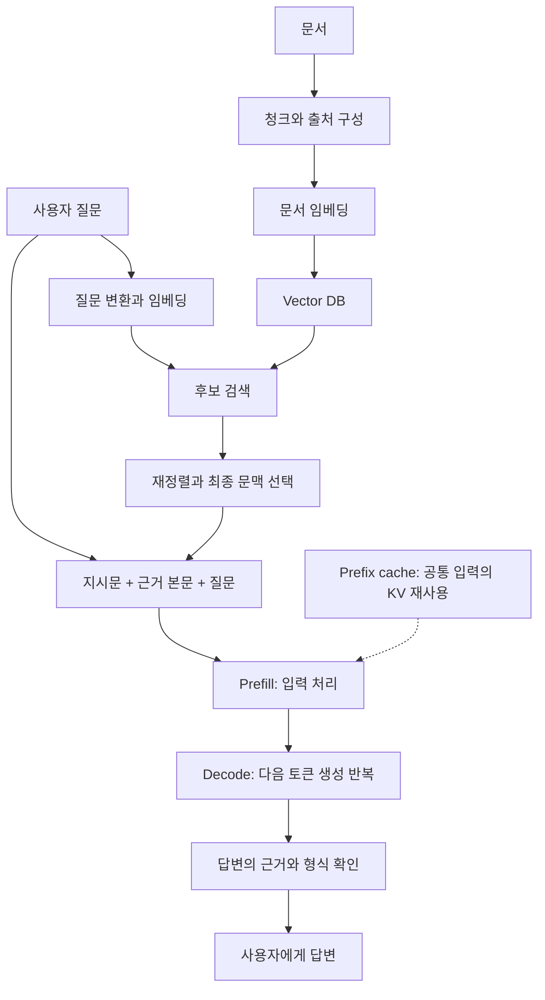

RAG 서비스를 개선할 때는 **답에 필요한 자료를 잘 찾는 일, 모델이 자료를 읽고 답하는 일, 여러 요청을 빠르게 처리하는 일**을 함께 살핍니다. 이 문서는 2026-11-16 그림의 용어를 지금까지 공부한 NLP·RAG·Vector DB·LLM 서빙 노트와 연결한 참고서입니다.

각 용어에서 사용하는 상황, 작동 방식, 작은 예시를 읽고 **학습 연결**로 기존 노트를 더 자세히 볼 수 있습니다. 이동평균·암호화·의미 기반 캐시처럼 그림의 표현을 이해하는 데 필요한 보충 설명은 해당 항목에 표시했습니다. 수치 예시는 원리를 설명하기 위한 계산이며, 실제 실험 기록은 문서 뒤에서 연결합니다.

## 그림과 용어의 연결

그림 위쪽은 입력을 표현으로 바꾸고 결과를 만드는 과정, 아래쪽은 RAG를 여러 사용자에게 제공할 때의 검색·메모리·속도 문제를 담고 있습니다.

| 그림의 표현 | 연결되는 용어 | 먼저 볼 항목 |
|---|---|---|
| 숲의 세부 정보와 전체 추세 | 표현 학습, 은닉 상태, 인코더·디코더 | [[#Representation learning과 Hidden state — 표현 학습과 은닉 상태\|표현 학습]] |
| 인코딩·디코딩, 해싱·암호화 | 문자 변환, 토큰 변환, 학습된 표현, 해시, 암호화 | [[#Encoding과 Tokenization — 인코딩과 토큰화\|인코딩]] |
| 파란 곡선과 빨간 이동평균선 | 평활화, 가중합, 학습 목적 | [[#Moving average — 이동평균과 평활화\|이동평균]] |
| cos sim | 내적, 벡터 길이, 코사인 유사도 | [[#Cosine similarity — 코사인 유사도\|코사인 유사도]] |
| Prompt → Vector DB → LLM → Decode | RAG, 검색기, 프롬프트, Prefill, Decode | [[#RAG — 검색 증강 생성\|RAG]] |
| 리랭킹·멀티 쿼리·쿼리 라우팅·맵 리듀스 | 후보 재정렬, 질문 변환, 경로 선택, 결과 통합 | [[#3. 질문과 검색 문맥을 바꾸는 개념\|질문과 문맥 처리]] |
| vLLM·KV cache·PagedAttention·Prefix | 캐시 저장, 블록 관리, 공통 입력 재사용 | [[#4. LLM 서빙과 캐시의 개념\|서빙과 캐시]] |
| 여러 프롬프트가 동시에 들어옴 | 동시 요청, 대기열, 연속 배칭 | [[#Continuous batching — 연속 배칭\|연속 배칭]] |
| 정밀도와 범위, Vector DB 양자화 | 수치 형식, 양자화 대상, 거리 오차 | [[#5. 양자화와 수치 표현의 개념\|양자화]] |
| 평균·표준편차·outlier | 지연 분포, 백분위수, 서비스 목표 | [[#6. 품질과 서빙 성능을 측정하는 개념\|측정 지표]] |
| 청크 5개 → 3개 → 메모리 여유 | 최종 문맥 선택, 입력 토큰, KV 용량 | [[#7. 청크 5개를 3개로 줄이는 예시\|품질과 용량의 연결]] |

전체 연결은 다음과 같습니다. 검색용 임베딩은 관련 본문을 찾는 데 사용하고, 생성 모델에는 선택한 **본문 텍스트**가 들어갑니다.



Streaming(스트리밍)을 사용하면 답변 조각을 생성 중에 전송합니다. 전체 답변 점검을 전송 전에 끝내는 구성은 완성된 답변을 보관했다가 전송하므로, 사용자에게 보이는 첫 응답 시점도 달라집니다.

---

## 1. 정보를 표현하고 문장을 생성하는 개념

### Encoding과 Tokenization — 인코딩과 토큰화

문장을 저장하거나 모델에 넣으려면 처리 단계에 맞는 표현으로 바꿔야 합니다. **Encoding(인코딩)**은 정보를 정해진 규칙에 따라 다른 표현으로 바꾸는 과정입니다. 무엇을 무엇으로 바꾸는지 함께 보면 뜻이 분명해집니다.

| 사용 위치 | 입력 → 출력 | 사용하는 목적 |
|---|---|---|
| UTF-8 문자 인코딩 | 문자 → 바이트 | 파일과 통신에서 글을 저장·전달 |
| Tokenizer(토크나이저)의 인코딩 | 문자열 → Token ID(토큰 ID) 목록 | 언어 모델이 처리할 입력 준비 |
| 신경망 인코더 | 입력 → 학습된 특징 벡터 | 분류·검색·생성에 필요한 정보 표현 |

**Tokenization(토큰화)**은 문자열을 처리 단위인 Token(토큰)으로 나누는 일입니다. 토큰 ID는 그 단위를 사전에서 가리키는 번호입니다. 실제 분할과 번호는 토크나이저마다 정해집니다. 모델은 이 번호로 임베딩 벡터를 가져와 계산을 시작합니다.

학습 연결: [[03-자연어처리-기초/01-01-텍스트-전처리와-토큰화|텍스트 전처리와 토큰화]] · [[06-데이터-엔지니어링/01-D41-문서-수집과-정제|D41의 문자 인코딩]]

### Decoding — 디코딩

모델의 출력이나 저장된 데이터를 사람이 읽을 수 있는 결과로 바꾸는 과정에서도 디코딩이라는 말을 씁니다. **바이트 디코딩**은 바이트를 문자로, **토크나이저 디코딩**은 토큰 ID 목록을 문자열로 바꿉니다.

**생성 모델의 디코딩**은 주어진 조건을 바탕으로 다음 출력의 후보를 계산하고 선택하는 과정입니다. 서빙에서 Decode 단계는 이 다음 토큰 생성을 반복하는 구간을 가리킵니다. 그 결과로 나온 ID를 토크나이저가 문자열로 변환하면 화면에 글이 표시됩니다.

학습 연결: [[03-자연어처리-기초/01-02-단어사전과-SentencePiece|SentencePiece의 인코딩·디코딩]] · [[#Decode — 답변 토큰 생성|서빙의 Decode]]

### Hashing과 Encryption — 해싱과 암호화

데이터가 같은지 확인할 때와 내용을 비밀로 보관할 때는 각각 다른 변환을 사용합니다. **Hashing(해싱)**은 입력에서 일정한 길이의 식별값을 계산합니다. 파일 변경 확인, 중복 자료 식별, 캐시 조회에 활용합니다. **Encryption(암호화)**은 키를 사용해 평문을 암호문으로 바꾸고, **Decryption(복호화)**은 해당 키 체계로 원문을 복구합니다.

| 용어 | 중심 목적 | 결과를 사용하는 방식 |
|---|---|---|
| Encoding | 표현 규칙 변환 | 대응 규칙으로 읽거나 다음 처리 단계에 전달 |
| Cryptographic hash(암호학적 해시) | 무결성·동일성 확인에 쓸 식별값 계산 | 입력에서 다시 계산한 해시와 비교 |
| Encryption | 내용을 키로 보호 | 키를 이용해 복호화 |
| Embedding | 의미·특징을 벡터로 표현 | 거리 계산이나 모델 연산에 사용 |

vLLM의 Prefix caching에서는 앞쪽 문맥과 현재 토큰 등으로 계산한 해시를 KV 블록의 식별에 사용합니다. 이 항목의 암호화 설명은 그림에 나온 용어를 구분하기 위한 보충입니다.

학습 연결: [[06-데이터-엔지니어링/01-D41-문서-수집과-정제|D41의 중복 자료 처리]] · [[08-LLM-서빙-심화/06-D58-KV-캐시와-서빙-용량#6. 같은 문서의 계산을 재사용하는 프리픽스 캐시|D58의 캐시 식별]]

### Representation learning과 Hidden state — 표현 학습과 은닉 상태

문장에서 감정을 분류하거나 다음 단어를 예측하려면 입력의 어떤 관계를 계산에 사용할지 정해야 합니다. **Representation learning(표현 학습)**은 그 작업에 유용한 특징 표현을 학습하는 것입니다. **Hidden state(은닉 상태)**는 특정 입력을 모델이 처리하면서 만든 중간 벡터입니다.

“차를 마셨다”와 “차를 주차했다”에서 `차`는 같은 토큰 임베딩으로 시작할 수 있지만, 주변 문맥을 계산한 뒤의 은닉 상태는 달라집니다. 그림의 “세부 정보에서 중요한 특징을 얻는다”는 설명은 이 표현 학습과 연결됩니다.

**Weight(가중치)**는 학습하면서 조정하는 계산 매개변수입니다. **Loss(손실)**는 모델의 예측과 학습 목표 사이의 차이를 나타내며, 학습은 손실을 줄이는 방향으로 가중치를 갱신합니다. 입력이 바뀌면 은닉 상태가 바뀌고, 학습을 진행하면 가중치가 바뀝니다.

학습 연결: [[04-LLM-기초/01-01-문맥-표현과-사전학습|문맥 표현과 사전학습]] · [[02-머신러닝과-딥러닝-기초/02-01-보충-손실과-학습-곡선|손실과 학습 곡선]]

### Embedding과 Latent representation — 임베딩과 잠재 표현

텍스트를 숫자로 계산하려면 벡터 표현이 필요합니다. **Embedding(임베딩)**은 단어·문장·문서 등의 대상을 벡터 공간의 한 위치로 표현합니다. 모델 내부의 **Latent representation(잠재 표현)**은 직접 관측한 글·픽셀에서 계산한 내부 특징을 가리키는 말입니다.

| 벡터 | 어디에서 쓰는가 | 크기를 읽는 방법 |
|---|---|---|
| 토큰 임베딩 | LLM 입력층 | 토큰마다 모델 차원의 벡터 하나 |
| 문장·문서 임베딩 | RAG 검색 | 검색 단위마다 벡터 하나를 사용하는 구성이 흔함 |
| 은닉 상태 | 모델 각 층의 문맥 계산 | 토큰 위치마다 문맥을 반영한 벡터 |

가령 RAG 임베딩이 1,024차원이면 문서 한 청크를 1,024개 숫자로 표현합니다. 생성 모델은 검색된 청크의 본문을 자신의 토크나이저와 입력 임베딩으로 다시 처리합니다. 이 항목의 잠재 표현은 인코더·디코더 설명을 잇는 보충 용어입니다.

학습 연결: [[03-자연어처리-기초/02-01-단어-벡터와-워드-임베딩|단어 벡터와 임베딩]] · [[05-LLM-활용/01-RAG의-원리와-LangChain#3. 표현이 다른 질문과 문서를 연결하는 임베딩|RAG의 문장 임베딩]]

### Encoder와 Decoder — 인코더와 디코더

번역처럼 입력과 출력의 역할이 나뉘는 작업에서는 **Encoder(인코더)**가 입력의 표현을 만들고, **Decoder(디코더)**가 그 표현과 이전 출력을 이용해 다음 출력을 만듭니다. Seq2seq(시퀀스 변환) 번역기에서 공부한 구조입니다.

기본 RNN Seq2seq는 마지막 상태로 입력 정보를 전달합니다. Attention을 사용하면 입력의 여러 위치를 참고하며 출력할 수 있습니다. Transformer 인코더는 각 입력 위치의 문맥 표현을 만들고, 인코더·디코더 구조의 디코더는 그 표현을 참조합니다.

GPT의 **Decoder-only(디코더 전용) 구조**는 프롬프트와 지금까지 생성한 토큰을 같은 토큰열에 두고 뒤를 이어 씁니다. RAG에서 쓰는 검색용 임베딩 모델과 답변용 GPT 계열 모델은 각각 독립된 역할을 맡을 수 있습니다.

학습 연결: [[03-자연어처리-기초/04-01-RNN과-Seq2seq와-Attention#5. Seq2seq의 인코더와 디코더|Seq2seq]] · [[03-자연어처리-기초/06-01-GPT와-다음-토큰-예측#2. GPT의 디코더 블록 구조|GPT 구조]]

### Attention과 Q·K·V — 어텐션과 질의·키·값

문장의 각 위치가 필요한 다른 위치의 정보를 가져오려면 참고할 비율을 계산해야 합니다. **Attention(어텐션)**은 그 비율로 정보 벡터를 가중합해 현재 위치의 표현에 반영합니다.

- **Query(질의), Q:** 현재 위치에서 참고할 정보를 찾는 비교 기준입니다.
- **Key(키), K:** 각 위치의 정보를 비교할 때 사용하는 표현입니다.
- **Value(값), V:** 정해진 비율로 실제 가져와 합치는 정보입니다.

Transformer의 기본 계산은 다음과 같습니다. $d_k$는 Key 벡터의 차원 수입니다.

$$
\operatorname{Attention}(Q,K,V)=\operatorname{softmax}\left(\frac{QK^{\mathsf T}}{\sqrt{d_k}}\right)V
$$

Q와 K의 내적으로 점수를 구하고, Softmax(소프트맥스)로 합이 1인 비율을 만든 뒤 V를 가중합합니다. 이때 RAG의 검색 질문과 Attention의 Q는 서로 다른 단계의 개념입니다. K·V를 생성 중에 재사용하는 저장 공간이 [[#KV cache — 키·값 캐시|KV cache]]입니다.

학습 연결: [[03-자연어처리-기초/05-01-Transformer의-구조와-원리#3. Query·Key·Value의 역할|Transformer의 Q·K·V]]

### Autoregressive generation — 자기회귀 생성

문장을 이어 쓰는 모델은 앞 문맥을 보고 다음 토큰의 확률을 계산합니다. **Autoregressive generation(자기회귀 생성)**은 선택한 토큰을 문맥 뒤에 붙여 같은 과정을 반복하는 생성 방식입니다.

프롬프트가 “오늘 점심은”이면 다음 토큰을 고르고, 그 토큰까지 포함해 다음 후보를 계산합니다. **Logit(로짓)**은 확률로 바꾸기 전 후보 점수입니다. **Greedy decoding(탐욕 디코딩)**은 가장 높은 후보를 선택하고, **Sampling(샘플링)**은 조정된 확률 분포에서 후보를 뽑습니다. Temperature(온도), top-k, top-p는 이 선택 분포에 영향을 줍니다.

학습에서는 정답 토큰으로 손실을 계산하고, 추론에서는 선택한 토큰을 이용해 문장을 늘립니다. 이 순차 생성 과정이 서빙의 Decode 시간과 연결됩니다.

학습 연결: [[03-자연어처리-기초/06-01-GPT와-다음-토큰-예측|GPT와 다음 토큰 예측]] · [[07-LLM-서빙-기초/03-D48-비동기와-스트리밍과-생성-제어|D48 생성 제어]]

### Moving average — 이동평균과 평활화

변동이 큰 수치에서 일정 구간의 흐름을 보려면 이웃한 값들을 평균낼 수 있습니다. **Moving average(이동평균)**는 창을 옮기며 평균을 구하는 방법이고, 급격한 변동을 완만하게 만드는 처리를 **Smoothing(평활화)**이라고 합니다.

예를 들어 `[2, 8, 2]`의 3개 평균은 4입니다. 빨간 선이 파란 선의 요철을 줄이는 그림은 이런 처리를 설명합니다. 창 크기는 사람이 정할 수 있고, 평균 규칙 자체는 정해져 있습니다.

딥러닝의 표현은 **분류·다음 토큰 예측·복원 등 주어진 학습 목표에 따라** 가중치가 조정되어 만들어집니다. Attention은 현재 입력에서 계산한 참고 비율을 사용합니다. 그림의 이동평균선은 세부 정보와 전체 경향을 함께 보는 보충 예시로 연결하면 좋습니다.

학습 연결: [[02-머신러닝과-딥러닝-기초/01-01-데이터-시각화|데이터 분포와 시각화]] · [[#Representation learning과 Hidden state — 표현 학습과 은닉 상태|표현 학습]]

---

## 2. RAG와 벡터 검색의 개념

### RAG — 검색 증강 생성

사내 규정이나 학습 노트에 근거해 답하려면 질문과 관련된 자료를 먼저 찾아야 합니다. **Retrieval-Augmented Generation, RAG(검색 증강 생성)**는 검색한 근거를 모델 입력에 넣어 답변 생성을 돕는 구성입니다.

문서 준비는 `추출 → 청킹 → 임베딩 → 저장`, 질문 처리는 `질문 → 검색 → 근거 선택 → 프롬프트 구성 → 생성`으로 나눕니다. 문서 임베딩은 여러 질문이 재사용하고, 각 요청에서는 질문에 필요한 근거를 선택합니다. 답변의 사실·수치·조건을 그 근거와 대조하면 어느 단계에서 개선이 필요한지 찾을 수 있습니다.

학습 연결: [[05-LLM-활용/01-RAG의-원리와-LangChain|RAG의 원리]] · [[07-LLM-서빙-기초/07-D52-학습노트-RAG-챗봇|D52 학습노트 RAG 챗봇]]

### Prompt·Task·Model·Data — 프롬프트·과업·모델·데이터

RAG 설정을 비교할 때 무엇을 바꿨는지 정하려면 네 요소를 먼저 적어 둡니다. **Task(과업)**는 수행할 일, **Model(모델)**은 계산에 사용하는 학습된 모델, **Data(데이터)**는 문서와 평가 질문, **Prompt(프롬프트)**는 이번 요청에 전달하는 지시·근거·질문입니다.

예를 들어 “연차 규정에 근거해 한도와 조건을 답하기”가 과업이고, 규정집과 평가 질문이 데이터입니다. 프롬프트에는 “근거를 인용해 답하라”는 지시, 찾은 조항, 사용자의 질문을 넣습니다. **Serving(서빙)**은 이 입력을 받아 답변을 제공하는 실행 체계입니다.

그림의 FIX는 비교 기준을 정하는 것과 연결됩니다. 데이터와 과업을 고정한 채 재정렬만 바꾸면 검색 설정에 따른 변화가 보입니다. 모델을 바꾸면 모델명·버전·생성 설정도 함께 기록합니다.

학습 연결: [[05-LLM-활용/01-RAG의-원리와-LangChain#4. 검색 결과를 모델이 읽을 입력으로 만드는 방법|질문·근거·작성 지시]] · [[05-LLM-활용/04-RAG의-평가|평가 조건]]

### Chunk와 Overlap — 청크와 겹침

긴 문서에서 필요한 부분을 찾기 위해 문서를 검색 단위로 나눕니다. 이 조각이 **Chunk(청크)**이고, 이웃한 조각에 일부 내용을 반복해서 넣는 것이 **Overlap(겹침)**입니다.

청크에는 질문에 답할 사실과 적용 조건이 함께 있어야 합니다. “최대 5일 이월”과 “부서장 승인 필요”가 갈라졌다면 답변에 조건이 빠질 수 있습니다. 제목·문단·조항을 기준으로 나누고, 경계의 조건을 유지하도록 크기와 겹침을 정합니다. 길이 단위는 글자 수 또는 토큰 수로 명시합니다.

학습 연결: [[05-LLM-활용/01-RAG의-원리와-LangChain#2. 문서를 검색하기 좋은 단위로 준비하는 방법|문서와 청크]]

### Cosine similarity — 코사인 유사도

질문과 문서의 임베딩 방향이 얼마나 비슷한지 비교할 때 사용합니다. **Cosine similarity(코사인 유사도)**는 두 벡터의 **Dot product(내적)**를 각 벡터의 **Norm(길이)**의 곱으로 나눈 값입니다. 두 벡터의 길이가 0보다 큰 경우에 계산합니다.

$$
a\cdot b=\sum_{i=1}^{d}a_i b_i,\qquad
\|a\|_2=\sqrt{\sum_{i=1}^{d}a_i^2},\qquad
\cos(a,b)=\frac{\sum_i a_i b_i}{\|a\|_2\|b\|_2}
$$

여기서 $d$는 벡터의 차원 수입니다. 그림의 `a1b1, a2b2, a3b3, ...`는 대응 원소끼리 곱하는 단계입니다. **그 곱을 모두 더하면 내적**, 벡터 길이로 나누면 코사인 유사도가 됩니다. 벡터를 길이 1로 만드는 **L2 normalization(L2 정규화)**을 먼저 적용했다면 내적이 곧 코사인 유사도입니다.

예를 들어 $a=(1,0)$, $b=(0.8,0.6)$은 길이가 각각 1이므로 유사도는 0.8입니다. 점수는 후보의 검색 순서를 정하는 데 쓰고, 최종 근거의 적합성은 본문의 사실·조건으로 평가합니다.

학습 연결: [[05-LLM-활용/01-RAG의-원리와-LangChain#3. 표현이 다른 질문과 문서를 연결하는 임베딩|임베딩과 코사인 유사도]] · [[06-데이터-엔지니어링/03-D43-벡터-검색과-검색-데이터-관리#1. 문장 벡터를 비교해 검색 결과를 고르는 과정|정규화와 내적]]

### Vector database와 Metadata — 벡터 데이터베이스와 메타데이터

벡터 검색으로 찾은 결과를 답변 근거로 사용하려면 그 벡터가 가리키는 본문과 출처를 알아야 합니다. **Vector database(벡터 데이터베이스)**는 벡터와 ID, 본문 또는 본문 위치, 부가 정보를 연결해 저장·검색·갱신합니다.

**Metadata(메타데이터)**는 문서명·페이지·부서·판본 같은 정보입니다. Qdrant에서는 벡터에 붙이는 부가 정보를 **Payload(페이로드)**라고 합니다. **Metadata filter(메타데이터 필터)**로 “현재 적용 중인 인사팀 규정”처럼 검색 범위를 지정할 수 있습니다.

질문과 문서는 대응하는 임베딩 모델과 입력 규칙을 사용합니다. 검색 결과의 ID로 본문을 조회하고, 본문과 출처를 생성 프롬프트에 넣습니다.

학습 연결: [[06-데이터-엔지니어링/03-D43-벡터-검색과-검색-데이터-관리|D43 벡터 검색과 데이터 관리]]

### ANN과 HNSW — 근사 최근접 탐색과 그래프 인덱스

문서가 많아지면 모든 벡터를 비교하는 비용이 커집니다. **Exact search(완전 탐색)**는 모든 대상 벡터와 거리를 계산하고, **Approximate Nearest Neighbor, ANN(근사 최근접 이웃 탐색)**은 가까운 후보를 효율적으로 찾는 구조를 사용합니다.

**HNSW**는 벡터들을 이웃 관계로 연결한 여러 층의 그래프입니다. 넓은 범위에서 출발해 가까운 이웃을 따라 탐색합니다. 검색 중 조사하는 후보 폭을 늘리면 계산량과 탐색 범위가 함께 늘어납니다. 최종 반환 개수 $k$는 그 후보에서 몇 개를 돌려줄지 정합니다.

학습 연결: [[06-데이터-엔지니어링/03-D43-벡터-검색과-검색-데이터-관리#2. 근사 탐색으로 비교할 후보를 줄이는 방법|ANN·HNSW·IVF]]

### BM25·Hybrid search·RRF — 단어 검색과 혼합 검색

오류 코드나 문서 번호를 찾을 때는 정확한 단어가 중요하고, 표현이 다른 질문을 연결할 때는 의미가 중요합니다. **BM25**는 단어 빈도·희소성·문서 길이를 이용해 점수를 계산합니다. **Dense retrieval(밀집 벡터 검색)**은 임베딩 벡터를 비교합니다.

**Hybrid search(혼합 검색)**는 두 검색의 후보를 결합합니다. **Reciprocal Rank Fusion, RRF(역순위 결합)**는 검색별 등수를 이용해 결과를 합치는 방법입니다. 같은 문서가 두 목록에서 높은 순위로 나오면 양쪽의 기여를 받습니다.

학습 연결: [[05-LLM-활용/02-RAG의-검색-개선#1. 정확한 단어 검색과 의미 검색을 함께 사용하는 이유|BM25와 혼합 검색]] · [[05-LLM-활용/02-RAG의-검색-개선#2. 여러 검색 결과의 순위를 합치는 RRF|RRF 계산]]

### Retriever와 Top-k — 검색기와 상위 후보 수

**Retriever(검색기)**는 질문에 맞는 문서 후보 목록을 반환합니다. **Top-k(상위 k개)**는 검색 점수 기준으로 반환할 개수입니다. 검색 질문 여러 개를 실행하면 각 질문에서 top-k 후보가 나오고, 합치는 과정에서 중복을 정리합니다.

처음 찾는 후보 10개, 재정렬 후 선택하는 3개, 주변 문맥을 더한 최종 입력은 각각 따로 셉니다. 그림의 “10개 중 n개”는 이 단계별 개수의 관계입니다. 생성 설정의 `top_k`는 다음 토큰의 후보 수를 정하는 값이므로, 설정을 기록할 때 검색용인지 생성용인지 표시합니다.

### Reranker와 Cross-encoder — 재정렬 모델과 교차 인코더

빠른 1차 검색으로 후보를 모은 다음 질문의 세부 조건에 더 잘 맞는 순서를 정합니다. **Reranking(재정렬)**은 후보의 관련성을 다시 평가하는 단계이고, 이를 수행하는 모델이 **Reranker(재정렬 모델)**입니다.

**Cross-encoder(교차 인코더)**는 질문과 후보 문서를 함께 입력받아 둘 사이의 관련성을 평가합니다. 질문과 문서를 각각 벡터화하는 **Bi-encoder(이중 인코더)** 검색과 연결해, 넓게 찾은 후보를 자세히 비교할 수 있습니다. 후보별 추가 계산 시간을 포함해 전체 응답 시간을 측정합니다.

학습 연결: [[05-LLM-활용/02-RAG의-검색-개선#3. 후보를 찾은 뒤 순서와 중복을 조정하는 방법|재정렬과 Cross-encoder]]

### MMR — 관련성과 다양성을 함께 보는 선택

상위 후보가 같은 내용을 반복하면 입력을 많이 사용하면서도 필요한 조건이 빠질 수 있습니다. **Maximal Marginal Relevance, MMR(최대 한계 관련성)**은 질문과의 관련성과 이미 선택한 문서와의 중복을 함께 고려합니다.

연차 이월 여부를 반복하는 청크 다섯 개보다 이월 한도·승인 조건·예외를 나눠 담은 청크가 답변에 유용할 수 있습니다. MMR은 이런 후보 다양성을 조절하는 선택 기준입니다.

학습 연결: [[05-LLM-활용/02-RAG의-검색-개선#3. 후보를 찾은 뒤 순서와 중복을 조정하는 방법|후보 중복과 MMR]]

### Context window와 Token budget — 문맥 창과 토큰 예산

모델에 지시문·질문·근거·대화 이력을 넣을 때는 이번 요청의 전체 길이를 계산합니다. **Context window(문맥 창)**는 모델과 실행 설정이 처리할 수 있는 토큰 범위입니다. 자기회귀 서빙에서는 입력과 생성할 출력의 총길이를 함께 봅니다.

**Token budget(토큰 예산)**은 그 공간을 어떻게 배분할지 정한 값입니다. 예를 들어 총 8,192토큰 중 출력에 최대 1,024토큰을 남기면 입력에 쓸 수 있는 예산은 최대 7,168토큰입니다. 여기에는 채팅 형식의 특수 토큰도 포함됩니다.

모델이 읽는 입력 전체를 **Context(문맥)**라고 부르고, RAG에서는 검색한 근거 부분만 좁게 가리키기도 합니다. 최종 길이는 실제 토크나이저로 확인합니다. 같은 청크 수라도 본문의 길이에 따라 토큰 사용량은 달라집니다.

학습 연결: [[05-LLM-활용/07-컨텍스트와-하네스와-루프|컨텍스트 구성]] · [[08-LLM-서빙-심화/05-D57-vLLM과-연속-배칭|요청 길이와 서빙 용량]]

---

## 3. 질문과 검색 문맥을 바꾸는 개념

### Query rewriting — 질문 재작성

사용자가 “그건 이월돼?”라고 물으면 앞 대화에서 무엇을 말했는지 연결해야 검색 대상을 알 수 있습니다. **Query rewriting(질문 재작성)**은 원래 의도를 유지하면서 생략된 대상과 조건을 풀어 쓰는 과정입니다.

예를 들어 “미사용 연차의 다음 해 이월 한도와 승인 조건”으로 바꾸어 검색합니다. 원래 질문도 남겨 두면 재작성 과정에서 중요한 조건이 유지됐는지 확인할 수 있습니다.

### Multi-query와 Query expansion — 다중 질문과 검색어 확장

질문과 문서가 다른 표현을 쓰는 문제를 줄이기 위해 검색 표현을 늘릴 수 있습니다. **Multi-query(다중 질문)**는 같은 의도를 여러 질문으로 만들어 각각 검색합니다. “연차 이월”, “미사용 휴가 사용 기한”, “이월 승인 조건”의 결과를 모으는 방식입니다.

**Query expansion(검색어 확장)**은 원래 검색어에 동의어·관련 용어를 추가하는 더 넓은 개념입니다. 여러 질의의 결과를 합칠 때는 문서 ID로 중복을 정리하고, RRF 같은 기준으로 순서를 정할 수 있습니다. 검색 횟수와 질문 생성 시간이 전체 비용에 포함됩니다. 검색어 확장의 명칭은 기존 다중 질문 개념과 연결한 보충입니다.

학습 연결: [[05-LLM-활용/02-RAG의-검색-개선#5. 질문을 검색하기 좋은 표현으로 바꾸는 방법|Multi-query와 RAG-Fusion]]

### Question decomposition과 HyDE — 질문 분해와 가상 문서 임베딩

서로 다른 자료를 비교하는 질문은 필요한 근거를 나누어 찾으면 다루기 쉽습니다. **Question decomposition(질문 분해)**은 “정규직과 계약직의 휴가 규정을 비교해 줘”를 각각의 규정 질문으로 나누는 방식입니다. 각 결과를 같은 비교 항목으로 맞춰 원래 질문에 답합니다.

**HyDE(Hypothetical Document Embeddings, 가상 문서 임베딩)**는 답이 실려 있을 법한 문서를 먼저 생성하고, 그 벡터로 실제 문서를 검색합니다. 생성한 문서는 검색 방향을 잡는 중간 입력이며, 최종 답변에는 검색으로 확보한 실제 근거를 사용합니다.

학습 연결: [[05-LLM-활용/02-RAG의-검색-개선#5. 질문을 검색하기 좋은 표현으로 바꾸는 방법|질문 분해와 HyDE]]

### Query routing — 질문별 처리 경로 선택

질문의 종류에 맞는 자료와 도구를 정하면 필요한 결과에 바로 접근할 수 있습니다. **Query routing(질문 라우팅)**은 질문을 분류해 검색 저장소·도구·모델·처리 흐름을 선택하는 것입니다.

“휴가 승인 기준”은 규정 검색으로, “이번 달 부서별 사용 일수 합계”는 구조화된 데이터 조회로 보낼 수 있습니다. 여러 검색 문장을 만드는 Multi-query는 표현을 늘리는 작업이고, Routing은 **어느 처리 경로를 사용할지** 정하는 작업입니다. 기존 Modular RAG(모듈형 RAG)의 검색 경로 설명을 그림의 용어에 연결한 항목입니다.

학습 연결: [[05-LLM-활용/02-RAG의-검색-개선#6. 여러 자료를 읽고 하나의 답으로 모으는 방법|자료 구조에 따른 경로와 Modular RAG]]

### Map-reduce·Stuff·Refine — 여러 자료를 답변으로 합치는 방식

관련 자료가 여러 개라면 모델에 넣는 순서와 합치는 방법을 정해야 합니다. 각 방식의 입력과 중간 결과는 다음과 같습니다.

| 용어 | 처리 방식 | 사용하는 상황 |
|---|---|---|
| Stuff(한 번에 넣기) | 선택한 자료를 한 프롬프트에 모음 | 자료가 입력 예산 안에 들어옴 |
| Map-reduce(부분 처리 후 통합) | 자료별 요약·부분 답변 생성 → 결과 통합 | 자료 전체가 길거나 여러 묶음으로 나뉨 |
| Refine(점진적 보완) | 첫 자료로 답변 생성 → 다음 자료로 보완 | 자료를 차례로 반영할 때 |
| Map-rerank(부분 답변 평가 후 선택) | 자료별 답변과 점수 생성 → 답변 선택 | 후보 답변 중 하나를 선택할 때 |

Map-reduce의 중간 요약에는 최종 답에 필요한 숫자·조건·출처를 남깁니다. 호출 횟수와 각 단계의 입력·출력 토큰을 합쳐 비용을 읽습니다. 실행을 병렬화했는지는 별도의 구현 설정입니다.

학습 연결: [[05-LLM-활용/02-RAG의-검색-개선#6. 여러 자료를 읽고 하나의 답으로 모으는 방법|여러 자료의 통합]]

### Contextual compression과 Parent-child retrieval — 문맥 압축과 부모·자식 검색

최종 입력에 필요한 근거를 효율적으로 담으려면 관련 부분을 선택하거나 필요한 주변 문맥을 복원합니다. **Contextual compression(문맥 압축)**은 질문에 필요한 부분을 추출·요약하고 중복을 정리해 전달할 토큰을 줄이는 접근입니다. 이 명칭은 기존 문맥 선택 원리와 연결한 보충입니다.

**Parent-child retrieval(부모·자식 검색)**은 작은 자식 청크로 검색하고, 그 청크가 속한 큰 부모 문맥을 반환합니다. 짧은 검색 단위의 일치와 충분한 설명 범위를 함께 얻습니다. 여러 자식이 같은 부모를 가리키면 부모 본문은 한 번만 넣습니다.

두 접근을 적용할 때는 최종 입력의 사실·예외 조건과 토큰 수를 함께 확인합니다. 최종 문맥이 실제로 얼마나 길어졌는지는 선택·중복 제거·주변 문맥 추가를 모두 마친 뒤 계산합니다.

학습 연결: [[05-LLM-활용/01-RAG의-원리와-LangChain#4. 검색 결과를 모델이 읽을 입력으로 만드는 방법|최종 입력 구성]] · [[05-LLM-활용/02-RAG의-검색-개선#4. 짧게 검색하고 충분한 문맥을 전달하는 방법|부모·자식 검색]]

---

## 4. LLM 서빙과 캐시의 개념

### Inference와 Serving engine — 추론과 서빙 엔진

학습된 모델로 입력의 결과를 계산하는 것이 **Inference(추론)**입니다. **Serving(서빙)**은 사용자의 요청을 받아 추론을 실행하고 결과를 돌려주는 전체 과정입니다. API, 대기열, 모델 실행, 스트리밍, 오류 처리 등이 연결됩니다.

**Serving engine(서빙 엔진)**은 모델 실행과 요청 스케줄링, KV 메모리, 배치 연산을 관리합니다. 지금까지 vLLM과 TensorRT-LLM을 공부했습니다. 같은 모델과 데이터로도 요청을 묶는 방법과 실행 커널에 따라 처리 시간과 메모리 사용이 달라집니다.

학습 연결: [[07-LLM-서빙-기초/01-D46-모델-서빙과-HTTP|D46 서빙과 HTTP]] · [[08-LLM-서빙-심화/07-D59-TensorRT-LLM과-서빙-벤치마킹|D59 서빙 엔진 비교]]

### Prefill — 입력 처리

첫 답변 토큰을 만들려면 모델이 프롬프트를 처리해야 합니다. **Prefill(입력 처리)**은 입력 토큰들의 표현과 각 층의 K·V를 계산하는 단계입니다. 이미 주어진 입력의 여러 위치를 행렬 연산으로 함께 처리할 수 있습니다.

RAG에서 근거 본문이 길어지면 처리할 입력 토큰과 저장할 KV가 늘어납니다. Prefill 결과를 바탕으로 첫 토큰을 선택하고, 이후에는 Decode를 반복합니다. 공통 입력의 KV를 재사용하면 해당 부분의 Prefill 계산을 줄일 수 있습니다.

학습 연결: [[08-LLM-서빙-심화/01-D53-GPU-메모리와-LLM-추론|D53의 입력 처리와 생성]]

### Decode — 답변 토큰 생성

첫 토큰이 나온 뒤에는 지금까지의 문맥을 바탕으로 다음 토큰을 계속 계산합니다. **Decode(디코드)**는 이 생성 반복 구간입니다. 기존 토큰의 K·V를 읽고 새로 처리하는 토큰의 K·V를 추가합니다.

출력 길이가 길수록 반복 횟수가 늘어납니다. 긴 입력의 KV도 생성 중에 계속 참고하므로, 입력 길이는 답변 시작 시점과 생성 중 계산에 함께 연결됩니다. Tokenizer decoding(토크나이저 디코딩)은 선택된 ID를 화면의 문자열로 바꾸는 별도 변환입니다.

학습 연결: [[08-LLM-서빙-심화/01-D53-GPU-메모리와-LLM-추론|D53의 생성 과정]] · [[#Autoregressive generation — 자기회귀 생성|자기회귀 생성]]

### KV cache — 키·값 캐시

생성 중에 이전 문맥의 K·V를 매번 다시 계산하면 같은 일이 반복됩니다. **KV cache(키·값 캐시)**는 이전 토큰의 K와 V를 저장해 다음 생성 스텝에서 재사용합니다. 토큰 이력이 길어지고 함께 처리하는 요청이 늘면 캐시 사용량도 커집니다.

모든 층의 KV를 한 GPU에 저장하고 각 층의 헤드 구성이 같은 기본 계산은 다음과 같습니다.

$$
M_{\mathrm{KV}}\approx 2\times L\times H_{\mathrm{KV}}\times d_h\times b\times T
$$

$L$은 층 수, $H_{\mathrm{KV}}$는 KV 헤드 수, $d_h$는 헤드 차원, $b$는 원소당 바이트, $T$는 저장한 토큰 수입니다. 2는 K와 V 두 종류를 셉니다. 여러 요청은 각각 필요한 KV를 합치고, 블록의 빈 공간과 공통 블록 공유를 반영해 실제 사용량을 계산합니다.

**가중치 메모리 + KV 메모리 + 활성값·작업 공간**을 나누면 어떤 설정이 공간을 줄이는지 알 수 있습니다. 요청 종료 후에도 엔진은 확보한 GPU 공간을 다음 요청을 위해 유지할 수 있습니다.

학습 연결: [[08-LLM-서빙-심화/05-D57-vLLM과-연속-배칭#4. 요청이 길어질수록 KV 캐시가 커지는 이유|D57의 KV 용량 계산]]

### PagedAttention — 블록 단위 KV 메모리 관리

답변 길이가 다른 요청에 KV 공간을 효율적으로 배정하려면 필요한 만큼 작은 단위로 할당하는 방법이 유용합니다. **PagedAttention**은 KV를 여러 블록에 저장하고, **Block table(블록 테이블)**로 토큰 순서와 실제 블록 위치를 연결해 Attention을 계산합니다.

예를 들어 블록당 16토큰을 담는 설정에서 35토큰은 블록 3개를 사용합니다. 물리 메모리의 블록들이 서로 떨어져 있어도 테이블을 통해 순서대로 참조할 수 있습니다. 이 예에서 마지막 블록에는 13토큰 분량의 빈칸이 남습니다. 블록 크기는 계산 예시의 가정입니다.

필요한 공간을 블록 단위로 배정하고 회수하면 큰 연속 공간을 요청마다 예약하는 부담과 메모리 낭비를 줄일 수 있습니다.

학습 연결: [[08-LLM-서빙-심화/05-D57-vLLM과-연속-배칭#5. PagedAttention의 블록 할당과 공유|D57의 블록 할당과 공유]]

### Prefix caching — 공통 접두부의 KV 재사용

여러 요청이 같은 시스템 지시문과 문서로 시작하면 공통 부분을 처리한 KV를 재사용할 수 있습니다. **Prefix caching(접두부 캐싱)**은 입력 시작 부분의 동일한 토큰열에 해당하는 KV 블록을 공유해 중복 Prefill 계산을 줄입니다.

```text
요청 A: [공통 지시문][같은 규정집][연차 신청 방법은?]
요청 B: [공통 지시문][같은 규정집][출장비 한도는?]
```

vLLM은 앞 블록의 해시, 현재 블록의 토큰 ID, 어댑터 등 추가 정보를 캐시 식별에 사용합니다. **일치 기준은 앞 문맥을 포함한 토큰과 실행 조건**입니다. 공통 부분을 재사용한 뒤 각 질문의 답변은 새로 생성합니다. [vLLM 공식 설명](https://docs.vllm.ai/en/latest/design/prefix_caching/)

학습 연결: [[08-LLM-서빙-심화/06-D58-KV-캐시와-서빙-용량#6. 같은 문서의 계산을 재사용하는 프리픽스 캐시|D58의 프리픽스 캐시와 적중률]]

### Semantic cache — 의미 기반 답변 캐시

이미 처리한 질문과 같은 뜻의 질문이 반복되면 이전 답변을 재사용하는 구성을 만들 수 있습니다. **Semantic cache(의미 기반 캐시)**는 질문 임베딩의 유사도와 재사용 조건으로 저장된 답변을 찾습니다. **Cache hit(캐시 적중)**이면 저장된 결과를 반환하고, 적합한 항목이 없으면 새 검색·생성을 수행합니다. 이 항목은 그림의 “cos sim이 비슷한 질문의 캐시”를 설명하기 위한 보충입니다. [Redis 공식 설명](https://redis.io/docs/latest/develop/use-cases/semantic-cache/)

| 구분 | 저장·재사용 대상 | 일치 기준 | 재사용 뒤의 처리 |
|---|---|---|---|
| KV cache | 이전 토큰의 K·V | 현재 생성의 토큰 이력 | 다음 토큰 계산 |
| Prefix cache | 공통 입력 앞부분의 K·V | 토큰열과 실행 조건 | 질문별 답변 생성 |
| Semantic answer cache | 이전 질문에 대한 답변 | 의미 유사도와 재사용 조건 | 저장 답변 반환 |

“1일차 아침 식단”과 “2일차 저녁 운동”은 날짜·시간·과업 조건을 각각 확인해야 합니다. 의미 기반 답변 캐시에서는 이런 조건, 사용자별 정보, 문서 판본을 재사용 판단에 포함합니다. Prefix cache에서는 앞의 공통 규칙을 재사용하더라도 각 요청의 질문 부분을 처리해 답변을 생성합니다.

학습 연결: [[#Prefix caching — 공통 접두부의 KV 재사용|Prefix caching]] · [[06-데이터-엔지니어링/03-D43-벡터-검색과-검색-데이터-관리#4. 부서와 권한 조건을 검색에 적용하는 방법|캐시의 권한·데이터 버전 조건]]

### Continuous batching — 연속 배칭

사용자마다 답변 길이가 다르면 일부 요청이 먼저 끝납니다. **Continuous batching(연속 배칭)**은 생성 스텝마다 실행할 요청 묶음을 조정하고, 완료된 요청이 빠진 자리에 새 요청을 넣는 방식입니다.

A·B·C를 함께 생성하다 A가 끝나면 B·C의 완료를 기다리는 동안 D를 받아 함께 진행할 수 있습니다. 서버 전체의 GPU 작업을 꾸준히 유지하는 데 사용합니다. 현재 스텝에 들어간 요청 수와 클라이언트가 보내 놓은 전체 요청 수는 별도로 셉니다.

학습 연결: [[08-LLM-서빙-심화/05-D57-vLLM과-연속-배칭|D57 vLLM과 연속 배칭]]

### Chunked prefill — 입력 계산을 나누는 프리필

답변을 생성 중인 요청들 사이에 긴 새 입력이 들어오면 그 입력의 계산을 여러 스텝으로 나눌 수 있습니다. **Chunked prefill(청크 분할 프리필)**은 긴 Prefill 작업을 나누어 Decode 요청과 함께 배치하는 방식입니다. vLLM의 해당 스케줄링은 Decode에 예산을 먼저 배정하고 남은 토큰 예산으로 Prefill을 진행합니다. [vLLM 공식 설명](https://docs.vllm.ai/en/latest/configuration/optimization/#chunked-prefill)

RAG의 청킹은 **검색할 문서 단위**를 나누고, Chunked prefill은 **이미 모델에 들어온 입력의 계산 작업**을 나눕니다. 검색 문서의 구분과 엔진의 계산 스케줄은 서로 다른 단계에서 결정됩니다.

학습 연결: [[08-LLM-서빙-심화/06-D58-KV-캐시와-서빙-용량#5. 긴 입력을 나누어 처리하는 청크 분할 프리필|D58 Chunked prefill]]

### Concurrency·Queue·Preemption — 동시 요청·대기열·선점

동시에 요청이 들어오면 실행 공간과 차례를 배정해야 합니다. **Concurrency(동시 요청 수)**는 동시에 진행 중인 요청 수, **Queue(대기열)**는 실행을 기다리는 요청 목록, **Scheduler(스케줄러)**는 어떤 작업을 다음 스텝에 넣을지 정하는 구성 요소입니다.

생성 도중 KV 공간이 부족하면 일부 실행 요청을 멈추고 자원을 회수할 수 있습니다. 이 동작이 **Preemption(선점)**입니다. 재개할 때 토큰 이력으로 KV를 다시 계산하면 그 시간도 지연에 포함됩니다.

| 설정·관측값 | 세는 대상 |
|---|---|
| 클라이언트 동시 요청 수 | 보냈지만 완료되지 않은 요청 |
| `max_num_seqs` | 한 스텝에 함께 실행할 시퀀스 수의 상한 |
| `max_num_batched_tokens` | 한 스텝에서 계산할 토큰 수의 예산 |
| `max_model_len` | 요청 하나의 입력·출력 총 토큰 길이 상한 |
| 대기 요청 수 | 엔진에서 차례를 기다리는 요청 |

학습 연결: [[08-LLM-서빙-심화/06-D58-KV-캐시와-서빙-용량|D58 동시성·대기·선점]]

---

## 5. 양자화와 수치 표현의 개념

### Quantization — 양자화

모델 가중치나 검색 벡터를 작은 공간에 담으려면 숫자를 더 적은 비트로 표현할 수 있습니다. **Quantization(양자화)**은 원래 수치를 제한된 대표값이나 코드로 대응시키는 과정입니다. 저장량과 데이터 이동량을 줄이는 데 사용합니다.

예를 들어 1.23과 1.24를 모두 1.2로 표현하면 두 값 사이의 차이는 사라집니다. 원래 값과 복원한 값의 차이가 **Quantization error(양자화 오차)**입니다. 그 오차가 검색 순위나 생성 답변에 어떤 변화를 주는지 평가합니다.

학습 연결: [[08-LLM-서빙-심화/02-D54-양자화의-원리#1. 양자화로 줄어드는 것과 생기는 오차|D54 양자화의 원리]]

### Dynamic range와 Precision — 표현 범위와 정밀도

수치 형식을 선택할 때는 큰 값까지 담는 범위와 가까운 값들을 구분하는 간격을 함께 봅니다. **Dynamic range(표현 범위)**는 표현 가능한 값의 범위, **Precision(정밀도)**는 그 안에서 숫자의 차이를 구분하는 세밀함입니다.

부동소수점에서 지수 비트는 범위에, 가수부 비트는 정밀도에 영향을 줍니다. FP16은 가수부 10비트, BF16은 7비트이며 BF16의 지수 범위가 더 넓습니다. 그림의 “범위를 본다”는 설명은 큰 활성값을 담을 수 있는지와 연결됩니다. 값이 집중된 구간을 얼마나 세밀하게 표현할지도 함께 판단합니다.

학습 연결: [[08-LLM-서빙-심화/02-D54-양자화의-원리#2. 숫자의 범위와 정밀도, 저장과 계산의 차이|FP16·BF16의 범위와 정밀도]]

### Scale·Zero-point·Dequantization — 스케일·영점·역양자화

정수 코드로 저장할 때는 한 칸이 원래 값의 얼마인지 정합니다. **Scale(스케일)**은 그 간격이고, **Zero-point(영점)**는 원래 값 0에 대응하는 코드입니다. 저장한 코드에서 근삿값을 구하는 과정이 **Dequantization(역양자화)**입니다.

$$
q=\operatorname{clip}\bigl(\operatorname{round}(x/s)+z,q_{\min},q_{\max}\bigr),\qquad
\hat{x}=(q-z)s
$$

$x$는 원래 값, $q$는 정수 코드, $s$는 스케일, $z$는 영점입니다. `round`는 반올림하고, **Clipping(범위 제한)**은 범위를 벗어난 값을 경계로 제한합니다. $s=0.1$, $z=0$이면 1.23은 12로 저장되고 1.2로 복원됩니다. 원래 값과의 오차는 0.03입니다.

학습 연결: [[08-LLM-서빙-심화/02-D54-양자화의-원리#3. 스케일과 영점으로 숫자를 저장하고 복원하는 방법|양자화와 역양자화 계산]]

### Calibration과 Outlier — 보정과 이상치

양자화 범위와 배율을 정하려면 실제 입력에서 어떤 값이 나오는지 살핍니다. **Calibration data(보정 데이터)**는 이 관찰에 사용하는 대표 입력입니다. **Activation(활성값)**은 모델이 입력을 처리하며 만든 중간값입니다.

**Outlier(이상치)**는 분포의 다른 값에서 크게 벗어난 값입니다. 대부분의 값이 −1~1인데 60이 하나 있으면, 전체 범위를 하나의 정수 간격에 맞출 때 작은 값 사이의 표현 간격이 넓어집니다. 채널별·그룹별 스케일을 사용하면 그 영향을 부분별로 다룰 수 있습니다.

보정 자료는 양자화 설정을 정하는 데 사용하고, 평가 자료는 변환된 모델의 품질을 확인하는 데 사용합니다. 그림에서 언급한 이상치는 이 **수치 분포의 큰 값**과 **서빙 지연의 느린 요청** 두 맥락에서 각각 읽습니다.

학습 연결: [[08-LLM-서빙-심화/02-D54-양자화의-원리#4. 이상치가 있는 가중치를 그룹으로 나누는 이유|이상치와 그룹 양자화]] · [[08-LLM-서빙-심화/04-D56-GPTQ와-AWQ#2. 양자화 전에 실제 입력과 활성값을 살피는 이유|보정 데이터와 활성값]]

### GPTQ와 AWQ — 입력을 고려한 가중치 양자화

**Post-training quantization, PTQ(학습 후 양자화)**는 학습이 끝난 모델을 저정밀도 표현으로 바꿉니다. GPTQ와 AWQ는 보정 입력을 이용해 이때 생기는 출력 오차를 줄이는 방법입니다.

**GPTQ**는 가중치를 양자화하며 생긴 오차를 아직 처리하지 않은 가중치에 반영해 보상합니다. **AWQ(Activation-aware Weight Quantization, 활성값을 고려한 가중치 양자화)**는 입력 활성값을 관찰해 중요한 채널의 스케일을 조정하고 가중치 오차의 영향을 줄입니다.

가중치 오차가 0.01일 때 입력 1과 곱하면 출력 차이가 0.01, 입력 100과 곱하면 1입니다. 실제 입력을 보는 이유가 여기에 있습니다. 양자화 파일을 실행할 때는 해당 표현을 처리하는 **Kernel(연산 커널)**과 GPU 환경까지 연결해 속도를 측정합니다.

학습 연결: [[08-LLM-서빙-심화/04-D56-GPTQ와-AWQ|D56 GPTQ와 AWQ]]

### Weight·KV·Vector quantization — 양자화 대상의 구분

“양자화한다”는 설정을 읽을 때는 **어느 숫자를 압축하는지** 먼저 확인합니다. 세 대상은 서로 다른 공간과 계산에 영향을 줍니다.

| 대상 | 압축하는 값 | 주로 줄이는 공간 | 함께 평가할 결과 |
|---|---|---|---|
| Weight quantization(가중치 양자화) | 학습된 모델의 가중치 | 모델 저장량·가중치 메모리 | 답변 품질, 추론 지연·처리량 |
| KV cache quantization(KV 캐시 양자화) | 요청 토큰의 K·V | 긴 문맥·동시 요청의 캐시 | 답변 품질, 캐시 용량, 토큰 지연 |
| Vector quantization(검색 벡터 양자화) | 문서·질문의 검색 표현 | 검색 벡터 저장·탐색 비용 | 검색 재현율, 순위, 검색 시간 |

가중치를 4비트로 저장하고 KV는 16비트로 유지할 수 있습니다. 검색 DB의 INT8 벡터도 생성 모델의 가중치와 별도로 관리합니다. 그림의 Vector DB 양자화는 검색 벡터를 다루는 항목입니다.

학습 연결: [[08-LLM-서빙-심화/02-D54-양자화의-원리|D54 가중치]] · [[08-LLM-서빙-심화/06-D58-KV-캐시와-서빙-용량|D58 KV 캐시]] · [[06-데이터-엔지니어링/03-D43-벡터-검색과-검색-데이터-관리#3. 벡터를 압축하고 원본으로 순위를 다시 계산하는 방법|D43 검색 벡터]]

### Oversampling과 Rescoring — 후보 확대와 재점수화

압축 벡터로 빠르게 후보를 고른 뒤 원래 벡터로 더 정확한 거리를 계산할 수 있습니다. **Oversampling(후보 확대)**은 최종 개수보다 많은 후보를 확보하고, **Rescoring(재점수화)**은 후보에 원본 벡터의 거리 계산을 적용합니다. Qdrant에서도 이 흐름을 사용할 수 있습니다. [Qdrant 공식 설명](https://qdrant.tech/documentation/manage-data/quantization/)

최종 10개가 필요할 때 압축 벡터로 40개를 찾고, 원본 벡터로 점수를 다시 계산해 10개를 고르는 예입니다. 원본 벡터 읽기와 재계산 시간이 추가되므로 압축 후보 탐색부터 재점수화까지 포함해 검색 지연을 측정합니다. Reranker의 Cross-encoder는 질문·문서 텍스트를 모델로 평가하고, 여기의 Rescoring은 벡터 거리를 다시 계산합니다.

학습 연결: [[06-데이터-엔지니어링/03-D43-벡터-검색과-검색-데이터-관리#3. 벡터를 압축하고 원본으로 순위를 다시 계산하는 방법|D43 후보 확대와 재점수화]]

---

## 6. 품질과 서빙 성능을 측정하는 개념

### Latency와 TTFT — 응답 지연과 첫 토큰 시간

사용자가 기다리는 시간을 줄이려면 요청이 어디에서 시간을 쓰는지 나누어 측정합니다. **Latency(지연 시간)**는 지정한 시작·종료 시점 사이의 시간입니다. **End-to-end latency(전체 응답 지연)**는 요청 시작부터 답변 완료까지, **Time To First Token, TTFT(첫 토큰까지의 시간)**는 요청 시작부터 첫 내용 토큰을 받기까지의 시간입니다.

RAG 앱의 TTFT에는 검색·재정렬·모델 대기·Prefill 등이 포함될 수 있습니다. 모델 서버만 측정한 TTFT에는 앱의 검색 시간이 빠질 수 있으므로 **측정 시작점과 종료점**을 함께 적습니다. 답변 전체를 점검한 뒤 전송한다면 사용자에게 보이는 첫 응답 시간에는 그 점검도 포함됩니다.

학습 연결: [[08-LLM-서빙-심화/06-D58-KV-캐시와-서빙-용량|D58 지연 지표]] · [[08-LLM-서빙-심화/07-D59-TensorRT-LLM과-서빙-벤치마킹|D59 측정 조건]]

### ITL과 TPOT — 토큰 간격과 평균 토큰 생성 시간

답변이 시작된 뒤 얼마나 매끄럽게 이어지는지 보려면 토큰 사이의 시간을 측정합니다. **Inter-Token Latency, ITL(토큰 간 지연)**은 연속 토큰 사이의 개별 간격입니다. **Time Per Output Token, TPOT(출력 토큰당 시간)**는 첫 토큰 이후 생성 구간의 평균 간격으로 계산할 수 있습니다.

출력 토큰 수 $N$이 2 이상일 때의 계산은 다음과 같습니다.

$$
\mathrm{TPOT}=\frac{t_{\mathrm{last}}-t_{\mathrm{first}}}{N-1}
$$

5토큰이 나오고 첫 토큰부터 마지막 토큰까지 0.4초가 걸렸다면 TPOT는 0.1초입니다. 개별 간격의 p99와 **요청마다 계산한 평균 TPOT들의 p99**는 집계 대상이 다릅니다. 스트리밍 이벤트 하나에 여러 토큰이 담기는 측정에서는 이벤트 시각과 토큰 수를 어떻게 연결했는지 확인합니다.

학습 연결: D59 실습의 TPOT 정의

### Throughput·TPS·QPS — 처리량과 초당 처리 수

서버가 일정 시간에 얼마나 많은 일을 끝냈는지 나타내는 값이 **Throughput(처리량)**입니다. **TPS(Tokens Per Second, 초당 토큰 수)**는 토큰, **QPS(Queries Per Second, 초당 질의 수)**와 **RPS(Requests Per Second, 초당 요청 수)**는 요청을 셉니다.

10초 동안 모든 요청이 합쳐 출력 2,000토큰을 만들었다면 서버 출력 처리량은 200토큰/초입니다. 특정 사용자 한 명의 생성 속도는 그 요청만의 시간과 토큰으로 계산합니다. 입력·출력을 합친 토큰 처리량인지 출력만 센 값인지도 표시합니다.

학습 연결: [[08-LLM-서빙-심화/06-D58-KV-캐시와-서빙-용량|D58 지연과 처리량]] · D59 서버 전체 처리량

### Mean·Standard deviation·Outlier — 평균·표준편차·이상치

여러 요청을 측정하면 빠른 요청과 느린 요청이 섞입니다. **Mean(평균)**은 값의 합을 개수로 나눈 대표값이고, **Standard deviation(표준편차)**은 평균 주변에 값들이 얼마나 퍼져 있는지 나타냅니다. 지연의 **Outlier(이상치)**는 다른 요청보다 유난히 오래 걸린 사례입니다.

`[0.2, 0.2, 0.2, 0.2, 4.2]초`의 평균은 1초입니다. 여기서 4.2초 요청이 긴 입력, 캐시 미적중, 대기, 선점 중 어느 상황과 겹쳤는지 보면 원인을 좁힐 수 있습니다. 같은 표본 전체의 퍼짐을 설명하는 계산이라면 표준편차의 분모를 $n$으로, 표본에서 모집단 분산을 추정하는 계산이라면 $n-1$로 정의해 기록합니다.

학습 연결: [[02-머신러닝과-딥러닝-기초/01-01-데이터-시각화|기술 통계와 분포]] · [[08-LLM-서빙-심화/06-D58-KV-캐시와-서빙-용량|지연의 원인과 대기·선점]]

### Percentile과 Tail latency — 백분위수와 느린 요청의 지연

느린 사용자 경험을 확인할 때는 정렬한 시간 분포의 특정 위치를 읽습니다. **Percentile(백분위수)**의 p50은 중앙값, p95는 약 95%, p99는 약 99%의 관측값이 그 이하에 놓이는 경계입니다. 계산 도구의 보간 규칙에 따라 경계값을 구합니다.

**Tail latency(꼬리 지연)**는 분포에서 느린 쪽 요청의 지연을 가리킵니다. p99 TTFT가 2초라면 느린 쪽 첫 응답이 어느 수준인지 읽을 수 있습니다. 표본 수와 입력·출력 길이, 동시 요청 수, 캐시 상태를 함께 기록하면 비교 조건이 분명해집니다.

학습 연결: [[08-LLM-서빙-심화/06-D58-KV-캐시와-서빙-용량#3. 응답 시간 목표를 만족하는 운영점|p99와 운영점]]

### Precision·Recall·MRR — 검색 품질 지표

검색 설정을 바꿨다면 답변에 필요한 근거가 얼마나 들어왔는지 확인합니다. 정답 근거가 A·B이고 검색 결과가 A·C·D라면 **Precision@3(정밀도)**은 가져온 세 개 중 관련된 하나의 비율 $1/3$, **Recall@3(재현율)**은 필요한 두 개 중 찾은 하나의 비율 $1/2$입니다.

**Hit@k(적중 여부)**는 관련 근거가 하나라도 있는지, **MRR(평균 역순위)**은 첫 관련 근거가 얼마나 앞에 나오는지 봅니다. 첫 관련 문서가 2위면 그 질문의 역순위는 $1/2$입니다.

**ANN Recall@k(근사 탐색 재현율)**는 완전 탐색의 상위 k개와 근사 탐색 결과가 얼마나 겹치는지 측정합니다. 정답 문서 기준 Recall은 답에 필요한 근거를, ANN Recall은 벡터 거리 기준 탐색의 일치를 평가합니다.

학습 연결: [[05-LLM-활용/04-RAG의-평가#2. 필요한 근거를 얼마나 찾았는지 측정하는 방법|검색 정밀도와 재현율]] · [[06-데이터-엔지니어링/03-D43-벡터-검색과-검색-데이터-관리#6. 검색 품질과 속도를 함께 평가하는 방법|ANN Recall]]

### Faithfulness·Relevance·Correctness — 근거 충실성·관련성·정확성

근거를 찾은 뒤에는 생성된 답변을 평가합니다. **Faithfulness(근거 충실성)**는 답변의 주장이 제공된 근거로 뒷받침되는지, **Answer relevance(답변 관련성)**는 사용자의 질문에 답했는지, **Correctness(정확성)**는 정답 기준과 사실·조건이 맞는지 봅니다.

“승인을 받아 최대 5일 이월”이 근거라면 답변의 한도와 승인 조건을 각각 확인합니다. **LLM-as-a-judge(LLM 평가자)**는 질문·근거·답변·채점 기준을 읽고 판단하는 방식입니다. 필수 JSON 필드나 숫자 일치처럼 명확한 항목은 코드 검사로 확인할 수 있습니다.

사용자 전송 전의 답변 점검을 시스템에 넣으면 점검의 호출 시간과 토큰 사용량도 서비스 비용에 포함됩니다. 답변을 만들어 내는 모델과 평가하는 모델의 역할을 구분해 기록합니다.

### SLO와 Operating point — 서비스 목표와 운영점

서버가 처리할 요청 수를 정하려면 사용자가 허용할 지연과 필요한 품질을 먼저 정합니다. **Service Level Objective, SLO(서비스 수준 목표)**는 “p99 TTFT 2초 이하”처럼 측정 가능한 목표입니다. **Operating point(운영점)**는 그 목표를 만족하도록 선택한 동시 요청 수와 실행 설정입니다.

동시 요청 수를 늘리며 처리량·TTFT·TPOT·오류·KV 사용량을 함께 측정합니다. 처리량 증가가 둔해지고 지연이 커지는 지점 근처를 **Knee(무릎 지점)**라고 합니다. 정한 지연 목표와 품질 조건을 충족하는 후보 중에서 필요한 처리량을 확보하는 설정을 고릅니다.

학습 연결: [[08-LLM-서빙-심화/06-D58-KV-캐시와-서빙-용량#3. 응답 시간 목표를 만족하는 운영점|D58 운영점]] · D59 실험의 SLO

---

## 7. 청크 5개를 3개로 줄이는 예시

그림 오른쪽의 “재정렬해서 5개 대신 3개를 넣는다”를 숫자로 연결해 보겠습니다. 목적은 **답변 근거를 유지하면서 입력 처리와 요청당 KV 사용량을 줄이는 것**입니다.

아래는 청크마다 400토큰, 지시문·질문·채팅 형식이 합쳐 300토큰, 출력이 200토큰인 가상 계산입니다. 같은 모델·KV 자료형을 사용하며, 캐시 공유와 블록 올림은 제외합니다.

| 항목 | 청크 5개 | 청크 3개 | 변화 |
|---|---:|---:|---:|
| 근거 본문 | 2,000토큰 | 1,200토큰 | 800토큰 감소 |
| 총 입력 | 2,300토큰 | 1,500토큰 | 약 34.8% 감소 |
| 출력까지 모두 포함한 토큰 예산 | 2,500토큰 | 1,700토큰 | 32% 감소 |
| 토큰당 KV 56KiB 가정의 저장 예산 | 약 136.7MiB | 약 93.0MiB | 약 43.8MiB 감소 |

56KiB는 기존 D57 노트의 28층·KV 헤드 4개·헤드 차원 128·16비트 KV 예시에서 나온 값입니다. 위 표는 입력·출력 전체 토큰을 캐시에 보관한다고 잡은 용량 예산이며, 실제 할당량은 처리된 토큰과 블록 단위를 반영합니다.

이 결과는 다음 관계를 보여 줍니다.

1. 재정렬·문맥 선택으로 필요한 청크를 골라 **최종 입력 토큰 수**를 줄입니다.
2. Prefill에서 처리할 입력과 생성 중 참고할 KV가 줄어듭니다.
3. 한 요청이 사용하는 KV 블록이 줄면 같은 KV 공간에 더 많은 요청의 문맥을 담을 여지가 생깁니다.
4. 최종 동시 처리 수는 GPU 계산량·대기·지연 목표까지 측정해 정합니다.

이번 계산에서 KV 용량만 기준으로 한 비율은 $2500/1700\approx1.47$입니다. 실제 운영점은 이 용량 여유를 바탕으로 부하를 올리며 확인합니다. 엔진이 미리 확보한 전체 GPU 메모리는 유지될 수 있고, 그 내부에서 요청에 배정할 **빈 KV 블록**이 늘어납니다.

재정렬 추가 비용과 입력 감소 효과는 다음처럼 한 흐름에서 비교합니다.

$$
T_{\mathrm{전체}}=T_{\mathrm{질문처리}}+T_{\mathrm{검색}}+T_{\mathrm{재정렬}}+T_{\mathrm{대기}}+T_{\mathrm{Prefill}}+T_{\mathrm{Decode}}+T_{\mathrm{답변점검}}
$$

이 식은 각 단계가 순차 실행되는 경우의 시간 분해입니다. 재정렬 시간이 추가되는 대신 짧아진 문맥으로 Prefill·Decode·대기 시간이 얼마나 달라졌는지 확인합니다. 같은 평가 질문에서 필요한 근거·정확성·첫 응답 지연·전체 응답 지연·처리량을 비교하면 그림의 **품질과 서빙을 함께 보는 선택**이 구체화됩니다.

학습 연결: [[08-LLM-서빙-심화/05-D57-vLLM과-연속-배칭|D57 메모리 계산]] · [[05-LLM-활용/04-RAG의-평가|RAG 품질 평가]]
