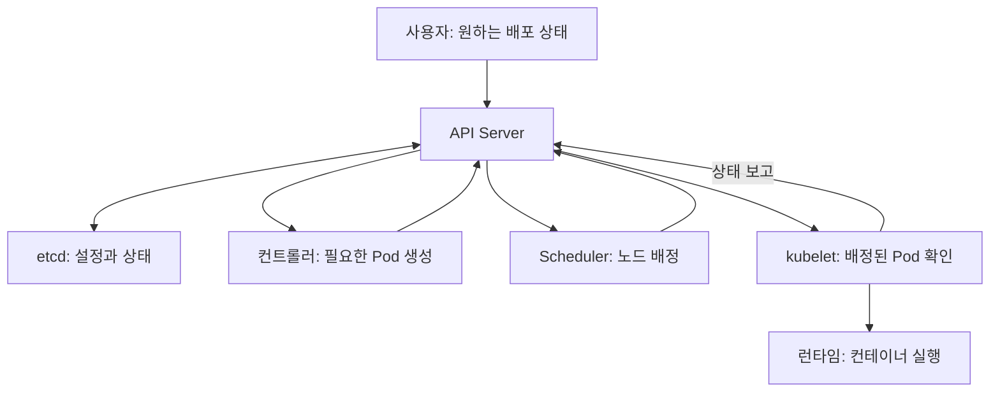

> 추상화·Docker·Kubernetes 자습 노트

**목차**

---

작성일: 2026년 11월 25일  
학습 범위: 코드와 추상화, 실행 환경, 이미지 빌드, 쿠버네티스 구조와 운영, Service와 DNS, 카나리 배포, ML 작업과 모델 저장

이 노트는 하나의 프로그램을 작성한 뒤 여러 서버에서 안정적으로 운영하기까지 필요한 개념을 순서대로 설명한다. 각 도구가 어떤 문제를 해결하는지 이해하고, 서로 다른 도구의 역할을 연결하는 것이 목표다.

---

## 먼저 전체 흐름 잡기

프로그램은 코드만으로 실행되지 않는다. 코드를 해석하거나 실행할 런타임, 필요한 라이브러리, 설정과 데이터가 함께 준비되어야 한다. 배포할 서버가 많아지면 실행 위치, 복제본 수, 통신, 장애 대응도 관리해야 한다.

이 과정을 다음 여섯 단계로 나누면 개념들이 연결된다.

| 단계 | 해결할 문제 | 주요 개념과 도구 |
|---|---|---|
| 기능 설계와 구현 | 어떤 기능을 어떤 방법으로 사용할 것인가? | 함수, 클래스, 추상화, 구현 |
| 실행 환경 준비 | 코드와 필요한 패키지를 어떻게 함께 준비할 것인가? | Python 가상환경, 컨테이너 |
| 배포 결과물 만들기 | 다른 실행 환경에 전달할 결과물을 어떻게 만들 것인가? | Dockerfile, 빌드, 이미지, 레지스트리 |
| 여러 서버에서 실행 | 어디에 몇 개를 실행하고 상태를 어떻게 유지할 것인가? | Kubernetes, Node, Pod, Deployment |
| 서비스 연결과 업데이트 | 요청을 어디로 보내고 새 버전을 어떻게 적용할 것인가? | Service, DNS, 롤링 업데이트, 카나리 |
| 모델 운영 | 학습 결과를 기록하고 어떤 모델을 서비스할 것인가? | MLflow, 파이프라인, 모델 저장소, 서빙 |

예를 들어 모델을 제공하는 API를 운영한다면, API 코드를 작성하고 실행 환경을 이미지로 만든다. 쿠버네티스는 그 이미지로 Pod를 실행하고 설정한 개수를 유지한다. 다른 애플리케이션은 Service 이름으로 접근한다. 모델이나 코드의 새 버전은 일부 요청으로 먼저 확인한 뒤 적용 범위를 늘릴 수 있다.

이 전체 흐름에서 **추상화는 사용 방법을 정리하고, 이미지는 실행 환경을 전달하며, 쿠버네티스는 실행 상태를 관리한다.** 실험 기록과 모델 버전, 업무별 작업 순서는 목적에 맞는 ML 도구로 관리한다.

---

## 1. 추상화는 기능을 일정한 방법으로 사용하게 한다

### 1.1. 추상화와 구현을 구분한다

**추상화는 필요한 기능과 사용 방법을 드러내고, 세부 처리 과정을 내부에서 다루도록 정리하는 것이다.** 그 기능이 실제로 동작하도록 코드를 작성하는 일은 **구현**이라고 한다.

함수를 사용하는 코드는 함수 이름, 받을 값, 돌려줄 결과를 알면 된다. 실제 계산 과정은 함수 안에서 관리한다. 이렇게 호출하는 쪽과 처리하는 쪽을 나누면, 내부 구현을 바꾸더라도 사용 방법을 유지할 수 있다. 다만 입력·출력과 약속한 동작까지 달라진다면 호출하는 코드도 함께 검토해야 한다.

이때 기능을 사용하는 방법과 규칙을 **인터페이스**라고 부른다. 함수의 이름과 인자, 반환값은 인터페이스를 이루는 중요한 부분이다.

### 1.2. 함수 이름만 정하고 본문을 비워 두는 경우

```python
def calculate_total(price, quantity):
    pass
```

이 코드는 함수 이름과 입력값을 정해 둔 상태다. 실제 합계를 계산하는 부분은 아직 작성하지 않았다. `pass`는 아무 작업도 수행하지 않고 넘어가는 문장이다. 위 함수를 호출하면 계산 결과 대신 `None`이 반환된다.

실제 계산을 구현하면 다음과 같이 바뀐다.

```python
def calculate_total(price, quantity):
    return price * quantity

print(calculate_total(1000, 3))  # 3000
```

본문을 비워 두는 것은 개발 과정에서 구현을 나중으로 미루는 방법이다. 추상화는 기능의 사용 방법과 내부 처리를 나누는 설계 개념이므로, 구현을 완성한 함수에도 적용된다. [Python: pass 문][py-pass]

### 1.3. 추상 메서드는 공통으로 제공할 기능을 정한다

클래스 안에 정의한 함수를 **메서드**라고 한다. 여러 클래스가 공통 기능을 제공하도록 만들 때는 **추상 메서드**를 사용할 수 있다.

```python
from abc import ABC, abstractmethod

class Calculator(ABC):
    @abstractmethod
    def calculate(self, a, b):
        pass

class Adder(Calculator):
    def calculate(self, a, b):
        return a + b

calculator = Adder()
print(calculator.calculate(3, 5))  # 8
```

`Calculator`는 `calculate(a, b)`라는 기능을 정한다. `Adder`는 이를 상속받아 덧셈을 구현한다. 호출하는 쪽은 `calculate(3, 5)`라는 사용 방법을 통해 기능을 이용한다. 메서드의 첫 인자인 `self`는 그 메서드를 호출한 객체를 가리킨다.

이 코드에서는 `ABC`와 `@abstractmethod`를 통해 추상 메서드가 남아 있는 클래스의 객체 생성을 제한한다. `Calculator()`로 객체를 만들면 `TypeError`가 발생하고, 메서드를 구현한 `Adder()`는 사용할 수 있다. `pass`는 여기서 본문을 채우는 자리표시자 역할을 한다.

추상 메서드의 본문에 공통 코드를 넣는 것도 가능하다. 또한 추상 메서드가 구현되었는지 확인하는 것과 계산 결과가 올바른지 검증하는 것은 별도의 문제다. [Python: abc][py-abc]

---

## 2. 코드 작성, 빌드, 실행은 서로 다른 단계다

### 2.1. 고수준 언어와 저수준 언어

고수준 언어는 사람이 프로그램의 기능과 처리 순서를 표현하기 쉽게 만든 언어다. Python, Java, C/C++은 어셈블리나 기계어보다 높은 수준에서 프로그램을 작성하게 한다. 저수준으로 갈수록 명령이 하드웨어의 동작 방식에 가까워진다.

사람이 작성한 코드는 언어와 실행 환경에 맞는 변환·실행 과정을 거친다. 예를 들어 널리 사용하는 Python 구현인 **CPython**은 소스 코드를 바이트코드로 변환한 뒤 인터프리터에서 실행한다. 언어가 사람이 읽기 쉬운 정도와, 코드를 실행하는 기술적 방식은 각각 구분해서 이해하면 된다. [Python 용어집][py-glossary]

### 2.2. 빌드는 실행·배포할 결과물을 준비하는 과정이다

프로젝트를 빌드할 때는 필요한 패키지를 설치하고, 소스 코드를 변환하고, 파일을 모아 배포할 결과물을 만든다. 프로젝트에 따라 이 중 일부만 수행할 수도 있다. 컴파일은 빌드에 포함될 수 있는 작업 중 하나다.

Docker에서는 Dockerfile에 적힌 절차를 따라 **컨테이너 이미지**를 만든다. Dockerfile의 `RUN`은 빌드 중 실행할 명령을 지정하고, `CMD`는 만들어진 이미지로 컨테이너를 시작할 때 사용할 기본 실행 명령을 지정한다. 둘은 실행되는 시점이 다르다. [Dockerfile 개념][dockerfile]

| 구분 | 주로 하는 일 | 얻는 결과 |
|---|---|---|
| 코드 작성 | 기능과 처리 과정을 구현한다. | 소스 코드 |
| 빌드와 패키징 | 의존성을 준비하고 배포할 파일을 구성한다. | 실행 파일, 패키지, 컨테이너 이미지 등 |
| 실행 | 준비한 코드와 환경으로 실제 작업을 수행한다. | 계산 결과, 파일, API 응답 등 |

Python 스크립트는 별도의 실행 파일을 만드는 과정을 생략하고 인터프리터로 바로 실행할 수 있다. 서비스를 배포할 때는 여기에 패키지 설치와 환경 준비, 이미지 생성 같은 절차가 추가된다.

---

## 3. 실행 환경을 맞추는 방법: 가상환경과 컨테이너

### 3.1. 코드가 같아도 환경이 달라지면 결과가 달라질 수 있다

프로그램은 Python 버전, 패키지 버전, 운영체제 라이브러리, 설정 파일 등의 영향을 받는다. 따라서 코드를 다른 서버에 전달할 때는 실행에 필요한 조건도 함께 관리해야 한다.

Python 가상환경과 컨테이너는 이 문제의 서로 다른 범위를 다룬다.

| 구분 | 주로 분리하는 범위 | 이해할 점 |
|---|---|---|
| Python 가상환경 `venv` | 프로젝트가 사용하는 Python 패키지 환경 | 기존 Python 설치를 바탕으로 만들며, 필요한 패키지를 환경별로 관리한다. |
| 컨테이너 | 애플리케이션의 파일시스템, 프로세스와 네트워크 등의 실행 환경 | 실행 환경을 이미지로 구성하며, 커널은 컨테이너를 실행하는 환경과 공유한다. |
| 가상 머신 VM | 운영체제를 포함한 머신 환경 | 별도의 게스트 운영체제와 커널을 실행한다. |

`venv`는 프로젝트마다 패키지 버전을 관리할 때 유용하다. 가상환경 디렉터리를 배포 대상에 그대로 옮기기보다는, 필요한 패키지 정보를 바탕으로 대상 환경에서 다시 만드는 것이 기본적인 사용 방식이다. 컨테이너 안에서 가상환경을 사용하는 구성도 가능하다. [Python: venv][py-venv] · [Docker: 컨테이너 개념][docker-container]

### 3.2. 컨테이너가 줄여 주는 차이와 남는 조건

이미지에 코드와 의존성을 함께 담으면 개발·테스트·운영 환경의 차이를 줄일 수 있다. 다만 실행 플랫폼은 이미지와 호환되어야 한다. 예를 들어 `linux/amd64`와 `linux/arm64`는 CPU 아키텍처가 다른 플랫폼이다. 필요하면 플랫폼별 이미지를 준비해 함께 배포한다.

GPU를 사용하는 프로그램은 GPU 장치 접근과 드라이버·런타임 조건도 맞아야 한다. 실행에 필요한 메모리와 저장공간, 외부 네트워크 접근 역시 배포 환경에서 준비해야 한다. [Docker: 멀티 플랫폼 빌드][docker-platform] · [Kubernetes: GPU 스케줄링][k8s-gpu]

---

## 4. 이미지, 컨테이너, 저장 데이터를 나누어 관리한다

### 4.1. 이미지는 배포할 내용이고, 컨테이너는 실행 단위다

**이미지(Image)**는 애플리케이션을 실행할 파일과 기본 설정을 담은 배포 단위다. **컨테이너(Container)**는 그 이미지를 바탕으로 생성한 실행 단위다. 같은 이미지에서 여러 컨테이너를 만들 수 있다.

이미지의 내용은 고정되어 있다. 컨테이너를 생성하면 일반적으로 그 위에 컨테이너별 쓰기 영역이 추가된다. 실행 중 생성하거나 수정한 파일은 기본적으로 이 쓰기 영역에 기록된다. 볼륨 등을 연결한 경로에 저장하면 해당 저장소에 기록되며, 원본 이미지의 내용은 유지된다. [Docker: 이미지와 컨테이너][docker-container] · [Docker: 저장 구조][docker-storage]

이 구분은 재배포와 장애 대응에서 중요하다. 실행 중인 컨테이너 안에서 임시로 파일을 수정해도, 원본 이미지로 새로 만든 컨테이너에는 그 변경이 들어 있지 않다. 지속적으로 적용할 코드나 패키지 변경은 새 이미지에 반영해 배포한다.

이미지는 **레지스트리(Registry)**에 저장하고 배포할 서버에서 내려받을 수 있다. 태그는 이미지에 붙이는 이름이며, 운영 정책에 따라 같은 태그가 다른 이미지를 가리킬 수 있다. 정확히 같은 이미지를 지정해야 할 때는 내용으로 계산한 식별자인 **다이제스트(Digest)**를 사용한다. [Docker: 개요][docker-overview] · [Docker: 이미지 다이제스트][docker-digest]

### 4.2. 무엇이 바뀌었는지에 따라 반영 방법이 달라진다

| 변경 대상 | 일반적인 반영 방법 |
|---|---|
| 이미지에 포함한 애플리케이션 코드 | 코드를 반영한 새 이미지를 빌드하고 배포한다. |
| 이미지에 포함한 패키지·런타임·기본 파일 | 변경할 패키지·런타임·파일을 반영해 새 이미지를 만든다. |
| 실행할 때 전달하는 환경변수·명령 인자 | 같은 이미지에 새 실행 설정을 전달한다. 보통 컨테이너나 Pod를 다시 생성한다. |
| 외부에서 마운트한 설정 파일 | 파일을 갱신하고, 애플리케이션이 설정을 다시 읽는 방식에 맞춰 반영한다. |
| 서비스가 저장하는 데이터 | 볼륨이나 외부 저장소에서 관리한다. |

환경변수와 외부 설정을 사용하면 같은 이미지를 개발용·운영용 설정으로 각각 실행할 수 있다. 설정의 반영 시점은 전달 방식과 프로그램이 설정을 읽는 방식에 따라 달라진다. [Docker: 실행 설정][docker-run]

### 4.3. 보존할 데이터는 컨테이너의 생명주기와 분리한다

컨테이너별 쓰기 영역은 해당 컨테이너에 속한다. 컨테이너를 중지했다 다시 시작하면 일반적으로 남아 있지만, 컨테이너를 삭제하면 함께 삭제된다. 계속 보관해야 하는 데이터는 볼륨이나 외부 저장소에 둔다.

이 원칙을 적용하면 실행 환경을 새로 만들어도 필요한 데이터를 다시 연결할 수 있다. 모델 파일, 학습 결과, 사용자 데이터의 보존 기간을 컨테이너 교체 주기와 따로 관리하는 것이다. [Docker: 볼륨][docker-volumes]

---

## 5. 멀티 스테이지 빌드는 만드는 환경과 실행하는 환경을 나눈다

프로그램을 만드는 동안에는 컴파일러, 헤더 파일, 개발용 패키지와 임시 다운로드 파일이 필요할 수 있다. 하지만 완성한 프로그램을 실행할 때 필요한 항목은 더 적을 수 있다.

**멀티 스테이지 빌드(Multi-stage build)**는 하나의 Dockerfile에서 빌드 단계를 나누고, 최종 이미지에는 실행에 필요한 것만 담는 방식이다.

| 단계 | 포함할 수 있는 항목 | 목적 |
|---|---|---|
| 빌드 단계 | 컴파일러, 헤더, 개발 의존성, 소스 코드, 중간 결과물 | 실행할 결과물을 만든다. |
| 최종 이미지 구성 단계 | 런타임, 실행 의존성, 애플리케이션 코드 또는 빌드 산출물 | 서비스 실행에 필요한 파일과 기본 설정을 최종 이미지에 담는다. |

Dockerfile에서 `FROM`을 여러 번 사용하면 단계가 나뉜다. 뒤 단계는 `COPY --from`으로 앞 단계의 필요한 결과물을 가져올 수 있다. 빌드할 최종 단계를 선택할 수 있으며, 일반적인 빌드는 마지막 단계를 결과 이미지로 만든다. [Docker: 멀티 스테이지 빌드][docker-multistage]

이렇게 구성하면 빌드 도구와 임시 파일을 최종 이미지에서 제외할 수 있다. 이미지가 작아지면 저장·전송할 양을 줄일 수 있고, 실행 환경에 포함된 패키지를 관리하기도 쉬워진다. 실제로 줄어드는 정도는 각 단계에 무엇을 넣고 복사했는지에 따라 달라진다.

Python 애플리케이션이라면 최종 이미지에도 보통 Python 런타임과 실행에 필요한 패키지가 남는다. 네이티브 라이브러리에 의존하는 패키지는 실행 단계에서도 해당 라이브러리를 사용할 수 있어야 한다.

빌드 단계의 수와 운영 중인 컨테이너의 수는 각각 결정한다. 멀티 스테이지는 **이미지를 만드는 절차를 나누는 방법**이고, 만들어진 이미지를 몇 개 실행할지는 배포 설정에서 정한다.

---

## 6. 쿠버네티스는 원하는 실행 상태를 계속 유지한다

### 6.1. 여러 서버에 배포하면 관리할 일이 늘어난다

컨테이너가 하나라면 사람이 실행하고 상태를 확인할 수 있다. 서버와 컨테이너가 많아지면 다음 문제를 함께 해결해야 한다.

- 새로 실행할 작업을 어느 서버에 배치할지 결정한다.
- 필요한 복제본 수를 유지한다.
- 중단된 컨테이너나 사용할 수 없는 Pod에 대응한다.
- 요청을 처리할 수 있는 Pod로 통신을 연결한다.
- 새 버전을 적용하면서 기존 서비스를 유지한다.

**Kubernetes, 쿠버네티스는 이런 컨테이너 기반 작업을 배치하고 운영하는 플랫폼**이다. 코드와 이미지를 준비하는 과정은 빌드 도구나 CI 작업으로 구성하고, 쿠버네티스에는 실행할 이미지와 운영 조건을 전달한다. [Kubernetes 개요][k8s-overview]

### 6.2. 선언적 관리는 원하는 상태를 먼저 적는 방식이다

사용자는 “이 이미지로 Pod를 3개 유지한다”처럼 목표 상태를 설정한다. 쿠버네티스의 여러 구성요소는 현재 상태를 확인하면서 그 목표에 가까워지도록 조정한다. 이를 **선언적 관리**라고 한다.

예를 들어 `replicas: 3`은 원하는 복제본 수가 3개라는 설정이다. 관련 컨트롤러는 필요한 Pod를 생성하거나 정리해 그 수를 맞춘다. 실행할 자원이나 이미지가 준비되지 않았다면 일부 Pod는 대기하거나 실행에 실패할 수 있다. 목표 상태를 적는 것과 실제로 그 상태에 도달하는 데 필요한 조건을 갖추는 일을 함께 생각해야 한다. [Kubernetes: 컨트롤러][k8s-controllers] · [ReplicaSet][k8s-replicaset]

### 6.3. Pod 수를 늘리는 것과 서버를 늘리는 것은 다르다

Pod를 늘리면 기존 노드의 자원을 더 사용한다. 여유 자원이 부족하면 새 Pod를 배치하지 못할 수 있다. 새 머신이 필요할 때는 **노드 자동 확장 도구(Node autoscaler)**가 클라우드 자원 등과 연동해 노드를 준비하도록 구성할 수 있다.

워크로드 자동 확장은 Pod 수나 할당 자원을 조절하고, 노드 자동 확장은 실행할 머신 자원을 조절한다. 자동 확장에는 판단 지표, 자원 요청량, 배치 제약과 최대 규모 같은 설정이 필요하다. [워크로드 자동 확장][k8s-autoscaling] · [노드 자동 확장][k8s-node-autoscaling]

---

## 7. 클러스터, 노드, Pod와 관리 구성요소

### 7.1. 실행 단위의 크기를 구분한다

| 개념 | 의미 | 관계 |
|---|---|---|
| 클러스터 Cluster | 쿠버네티스의 관리·실행 구성요소가 함께 동작하는 전체 시스템 | 컨트롤 플레인과 노드들을 포함한다. |
| 노드 Node | 작업을 실행할 CPU·메모리 등의 자원을 제공하는 머신 | 물리 서버나 가상 머신일 수 있다. |
| Pod | 함께 배치하고 관리하는 최소 실행 단위 | 한 노드에서 실행되며 하나 이상의 컨테이너를 포함한다. |
| 컨테이너 Container | 애플리케이션 프로세스가 실행되는 단위 | 이미지와 실행 설정을 바탕으로 생성된다. |

한 노드에는 여러 Pod를 실행할 수 있다. 같은 Pod 안의 컨테이너는 같은 노드에 함께 배치되고 네트워크 공간 등을 공유한다. 애플리케이션의 복제본을 여러 개 운영할 때는 보통 Pod를 여러 개 만든다. [Nodes][k8s-nodes] · [Pods][k8s-pods]

### 7.2. 컨트롤 플레인은 클러스터 전체 상태를 관리한다

**컨트롤 플레인(Control Plane)**은 클러스터를 관리하는 프로그램들의 묶음이다. 이 프로그램들도 실제 머신에서 실행된다. 운영 규모에 따라 전용 머신에 나누어 배치하고, 작은 실습 환경에서는 다른 작업과 같은 머신에서 실행할 수 있다.

| 구성요소 | 담당하는 일 |
|---|---|
| API Server | 클러스터의 설정과 상태를 등록·조회·변경하는 API를 제공한다. |
| etcd | 쿠버네티스 객체의 설정과 상태를 저장한다. |
| Scheduler | 아직 노드가 정해지지 않은 Pod를 배치할 노드를 선택한다. |
| Controller Manager | 실제 상태를 원하는 상태에 맞추는 여러 컨트롤러를 실행한다. |
| Cloud Controller Manager | 클라우드 제공자 API와 연결해 노드 정보나 로드밸런서 등의 연동을 처리한다. 환경에 따라 사용한다. |

API Server는 관리 요청을 처리하는 중심이고, etcd는 그 관리 정보를 보존하는 저장소다. 모델 가중치나 애플리케이션의 업무 데이터는 목적에 맞는 별도 저장소에 보관한다. [클러스터 아키텍처][k8s-architecture]

### 7.3. 각 노드에는 실행을 담당하는 프로그램이 있다

| 구성요소 | 담당하는 일 |
|---|---|
| kubelet | 해당 노드에 배정된 Pod를 확인하고, 컨테이너의 실행 상태를 관리한다. |
| 컨테이너 런타임 | 이미지를 준비하고 실제 컨테이너의 실행과 종료를 처리한다. `containerd`, `CRI-O` 등이 있다. |
| kube-proxy | 일반적인 Service 통신이 대상 Pod에 전달되도록 네트워크 규칙을 관리한다. |

kubelet은 컨테이너 런타임과 정해진 인터페이스로 통신한다. 쿠버네티스가 사용할 수 있는 런타임을 연결하면, kubelet은 그 런타임을 통해 컨테이너를 관리한다. 네트워크 구성에 따라 kube-proxy의 역할을 다른 프로그램이 대신 제공하기도 한다. [쿠버네티스 구성요소][k8s-components] · [컨테이너 런타임 인터페이스][k8s-cri]

여기서 **컨트롤러는 필요한 상태를 만들고, 스케줄러는 실행 위치를 정하며, kubelet과 런타임은 해당 노드에서 실행을 담당한다.** 이 역할 구분을 알면 배포와 복구 과정을 따라갈 수 있다.

---

## 8. 배포 요청은 어떻게 실제 실행으로 이어지는가

### 8.1. Deployment로 배포 상태를 정의한다

**Deployment**는 사용할 이미지, Pod의 설정, 유지할 복제본 수와 업데이트 방식 등을 선언하는 쿠버네티스 객체다. Deployment는 **ReplicaSet**을 관리하고, ReplicaSet은 필요한 Pod 복제본을 유지한다.

모델 API의 Pod를 3개 유지하도록 설정했다고 가정하면 다음 과정이 이어진다.

1. **설정을 등록한다.** 사용자가 `kubectl` 등의 도구로 Deployment 설정을 API Server에 전달한다.
2. **원하는 상태를 저장한다.** API Server가 요청을 처리하고, 설정은 etcd에 보존된다.
3. **실행할 Pod를 준비한다.** 관련 컨트롤러가 ReplicaSet과 필요한 Pod 객체를 만든다.
4. **실행 위치를 정한다.** Scheduler가 자원 요청량과 배치 조건을 확인해 각 Pod에 노드를 배정한다.
5. **컨테이너를 시작한다.** 해당 노드의 kubelet이 배정된 Pod를 확인하고 런타임을 통해 실행한다.
6. **상태를 확인한다.** 노드와 Pod의 상태가 보고되고, 관리 구성요소가 다음 조정에 사용한다.

각 구성요소는 API Server에 등록된 정보를 읽고 갱신하면서 동작한다. 역할을 나눈 구성요소들이 공통된 상태 정보를 통해 협력하는 구조다. [Deployments][k8s-deployments] · [노드와 컨트롤 플레인의 통신][k8s-communication]



이 도식은 관리 정보가 공유되는 관계를 단순화한 것이다. kubelet은 API를 통해 자신에게 배정된 Pod 정보를 확인하고, 런타임을 통해 필요한 실행 상태를 유지한다.

### 8.2. 실행 중이라는 것과 요청을 받을 준비가 된 것은 다르다

모델 API는 프로세스가 시작된 뒤에도 모델 파일을 내려받고 가중치를 메모리에 올리는 시간이 필요할 수 있다. 이때 요청을 받기 시작하면 초기화가 끝나지 않아 실패할 수 있다. 쿠버네티스에서는 애플리케이션의 상태를 확인하는 **프로브(Probe)**를 설정할 수 있다.

| 프로브 | 확인하는 상태 | 실패했을 때의 대표 동작 |
|---|---|---|
| Startup | 초기화가 완료되었는가? | 정한 허용 범위를 넘으면 컨테이너를 재시작한다. 성공 전에는 다른 프로브의 시작을 늦춘다. |
| Readiness | 지금 요청을 처리할 준비가 되었는가? | 일반적인 Service의 요청 전달 대상에서 제외한다. |
| Liveness | 실행을 계속 유지할 수 있는 상태인가? | 설정한 실패 기준에 따라 컨테이너를 재시작한다. |

어떤 경로나 명령으로 확인할지, 얼마나 기다릴지, 몇 번 실패하면 조치할지는 사용자가 정한다. 긴 초기화 시간이 필요한 모델 서버에는 그 시간을 고려한 설정이 필요하다. [Liveness·Readiness·Startup 프로브][k8s-probes]

### 8.3. 자동 복구가 처리하는 범위

컨테이너가 종료되면 kubelet이 재시작 정책에 따라 같은 Pod 안에서 다시 실행할 수 있다. Deployment 등 컨트롤러가 관리하는 Pod가 삭제되거나 노드 장애로 대체가 필요하면, 해당 컨트롤러가 새 Pod를 준비하고 스케줄러가 배치한다. 이 과정에는 장애 감지 시간과 사용 가능한 자원이 필요하다.

이러한 자가 복구는 **실행 상태를 복원하는 기능**이다. 코드 버그나 잘못된 모델 예측의 원인을 고치는 작업은 개발과 모델 개선 과정에서 수행한다. 같은 문제가 들어 있는 이미지를 다시 실행하면 오류가 반복될 수 있으므로, 상태 확인과 원인 분석을 함께 해야 한다. [Kubernetes 자가 복구][k8s-self-healing]

---

## 9. Service와 DNS로 애플리케이션을 연결한다

### 9.1. Service는 바뀌는 Pod들을 일정한 접속 지점으로 묶는다

Pod는 배포와 복구 과정에서 생성·삭제되며, 교체된 Pod의 IP 주소는 달라질 수 있다. 호출하는 애플리케이션이 개별 Pod의 주소를 직접 관리하면 이런 변경을 계속 추적해야 한다.

**Service**는 여러 Pod에 접근할 접속 지점을 정의한다. 일반적인 **ClusterIP Service**는 클러스터 안에서 사용하는 IP 주소를 제공한다. Service가 유지되는 동안 이 주소를 통해 접근하고, 연결할 Pod 목록은 현재 상태에 맞춰 갱신된다.

Service는 보통 라벨 조건인 **셀렉터(Selector)**로 대상 Pod를 정한다. 대상의 주소와 준비 상태는 EndpointSlice 등에 반영되며, 서비스 네트워크는 이 정보를 사용해 요청을 전달한다. [Service][k8s-service] · [EndpointSlice][k8s-endpoints]

### 9.2. DNS는 서비스 이름에 맞는 주소를 찾는다

**DNS(Domain Name System)**는 이름에 해당하는 주소를 찾는 시스템이다. 쿠버네티스의 클러스터 DNS를 사용하면 다른 서비스를 IP 대신 이름으로 찾을 수 있다.

같은 네임스페이스에 `model-api`라는 일반적인 ClusterIP Service가 있다고 가정하자. 네임스페이스는 쿠버네티스 자원을 이름과 범위에 따라 나누어 관리하는 단위다.

1. 호출하는 앱이 `model-api`의 주소를 DNS에 조회한다.
2. DNS가 해당 Service의 IP 주소를 알려 준다.
3. 앱이 그 주소와 서비스 포트로 요청을 보낸다.
4. 서비스 네트워크가 대상 Pod로 요청을 전달한다.

DNS 조회와 애플리케이션 요청은 이렇게 역할이 나뉜다. DNS는 접속할 주소를 알려 주고, 실제 요청은 그 주소를 사용해 전달된다.

서비스의 전체 이름은 기본 클러스터 도메인을 사용하는 환경에서 `model-api.default.svc.cluster.local`처럼 표현할 수 있다. 같은 네임스페이스에서는 보통 `model-api`처럼 짧은 이름을 사용한다. 클러스터 도메인과 DNS 설정에 따라 실제 이름은 달라질 수 있다. [Service와 Pod의 DNS][k8s-dns]

Pod가 교체되어도 Service가 유지되면 호출하는 앱은 같은 서비스 이름을 사용할 수 있다. 일반적인 Service에서는 이름이 Service IP로 연결되고, 서비스 네트워크가 현재 Pod들로 연결한다. **Headless Service**처럼 DNS가 Pod IP들을 직접 알려 주는 구성도 있다.

### 9.3. 애드온은 필요한 기능을 추가하는 구성요소다

**애드온(Add-on)**은 쿠버네티스에 기능을 추가하거나 보완하는 구성요소다. 클러스터 DNS, 모니터링, 로그 수집 등이 여기에 포함된다.

클러스터 DNS를 제공하는 대표적인 프로그램이 **CoreDNS**다. 대부분의 지원 환경에서는 DNS 애드온을 기본으로 활성화한다. 애드온이라는 분류와 실제 운영에서 그 기능이 얼마나 중요한지는 따로 이해해야 한다. [구성요소와 애드온][k8s-components] · [클러스터 DNS 설정][k8s-coredns]

### 9.4. 관리 API와 애플리케이션 API를 구분한다

| 구분 | 요청의 목적 | 대표적인 대상 |
|---|---|---|
| 쿠버네티스 관리 통신 | Pod 생성, 배포 설정 변경, 상태 조회 | Kubernetes API Server |
| 애플리케이션 통신 | 예측 요청, 웹페이지 조회, 업무 데이터 처리 | Service 등으로 연결한 애플리케이션 Pod |

모델 API에 예측을 요청하는 통신과, 그 모델 API의 Pod를 3개로 늘리는 관리 요청은 서로 다른 경로와 목적을 가진다. [노드와 컨트롤 플레인의 통신][k8s-communication]

---

## 10. 같은 버전 확대, A/B 테스트, 카나리 배포를 구분한다

여러 Pod를 실행하고 요청을 나누어 보내는 기술은 여러 목적으로 활용된다. 무엇을 판단하려는지에 따라 운영 방법이 달라진다.

| 구분 | 주된 목적 | 운영 방식 |
|---|---|---|
| 같은 버전의 복제본 확대 | 더 많은 요청을 처리하고 가용성을 높인다. | 같은 애플리케이션·모델의 Pod를 여러 개 실행한다. |
| 롤링 업데이트 | 기존 버전을 새 버전으로 점진적으로 교체한다. | 새 Pod를 준비하면서 기존 Pod를 차례로 줄인다. |
| A/B 테스트 | 두 버전이나 모델 중 어떤 결과가 더 좋은지 비교한다. | 사용자나 요청을 나누어 보내고 정한 지표로 비교한다. |
| 카나리 배포 | 새 버전을 운영 환경에서 확인하며 적용 범위를 늘린다. | 일부 요청을 먼저 적용하고 검증 결과에 따라 확대하거나 복귀한다. |

이 방식들은 함께 사용할 수도 있다. A/B 테스트는 비교할 지표와 실험 조건이 중요하고, 카나리는 새 버전을 더 넓게 적용할지 판단할 운영 기준이 중요하다. [Deployment 업데이트][k8s-deployments] · [모델 A/B 테스트][model-ab] · [카나리 개념][argo-concepts]

### 10.1. 카나리 배포의 실제 흐름

다음 비율은 개념을 설명하기 위한 예시다. 서비스의 특성과 검증에 필요한 요청량에 따라 비율과 대기 시간을 정한다.

| 단계 | 기존 버전 요청 비율 | 새 버전 요청 비율 | 확인할 내용 |
|---|---:|---:|---|
| 배포 전 | 100% | 0% | 기존 버전의 기준 상태 |
| 소규모 적용 | 95% | 5% | 초기 오류, 응답 지연, 기능 동작 |
| 확대 검증 | 50% | 50% | 더 많은 부하에서의 안정성과 결과 품질 |
| 전환 완료 | 0% | 100% | 전체 요청을 처리하는 상태 |

각 단계에서 기준을 만족하면 새 버전의 비중을 늘린다. 문제가 나타나면 적용 확대를 멈추고 기존 버전으로 요청을 돌린다. 이전 버전이나 상태로 되돌리는 작업을 **롤백(Rollback)**이라고 한다. [Argo Rollouts: 카나리][argo-canary]

### 10.2. 무엇을 확인해야 하는가

기본적으로 오류율과 응답 시간, 자원 사용량을 확인한다. 모델 서비스라면 정답 여부나 업무 품질 지표도 함께 봐야 한다. 평균 응답 시간이 비슷하더라도 일부 요청만 크게 느려질 수 있다. 요청의 95%·99%가 해당 시간 이내에 응답했음을 나타내는 p95·p99도 함께 확인하면, 일부 요청의 큰 지연을 파악하는 데 도움이 된다.

두 버전을 비교할 때는 요청의 종류와 사용자 조건을 함께 살펴야 한다. 또한 요청이 너무 적으면 드문 오류를 발견하기 어렵다. 지표 기준과 관찰할 요청량·시간을 정한 뒤 확대 여부를 판단하는 것이 좋다. 이 부분은 서비스별로 정해야 하는 운영 설계다.

Pod 개수의 비율만으로 요청 비율을 추정하는 구성도 있지만, 연결 유지나 요청 분배 방식 등에 따라 실제 비율은 달라질 수 있다. 요청의 일정 비율을 명시해 제어하려면 이를 지원하는 트래픽 분배 구성을 사용한다. Argo Rollouts 같은 도구는 트래픽 관리 도구 및 지표 수집 시스템과 연동해 단계별 확대·분석·중단을 구성할 수 있다. [Argo Rollouts: 아키텍처][argo-architecture] · [분석 기능][argo-analysis]

---

## 11. 모델 파일의 저장과 모델 실행을 따로 생각한다

### 11.1. 모델을 서빙하려면 코드, 실행 환경, 모델 파일이 필요하다

학습된 모델을 서비스하려면 요청을 받고 결과를 반환하는 코드, 모델을 실행할 라이브러리와 런타임, 사용할 모델 파일을 준비해야 한다. 모델 파일에는 가중치뿐 아니라 구성 파일이나 토크나이저처럼 함께 필요한 파일이 포함될 수 있다.

모델 파일을 실행 환경에 제공하는 방법은 여러 가지다.

| 방식 | 동작 | 함께 검토할 점 |
|---|---|---|
| 이미지에 포함 | 모델 파일을 이미지의 일부로 배포한다. | 이미지 크기, 전송 시간, 모델 변경 시 이미지 재빌드 |
| 외부 저장소에서 다운로드 | 시작 단계 등에서 필요한 버전을 내려받는다. | 다운로드 시간, 접근 권한, 저장소 가용성, 버전 지정 |
| 볼륨으로 연결 | Pod가 사용할 저장공간을 마운트한다. | 접근 모드, 처리 속도, 여러 노드에서의 사용 조건 |

모델 크기는 선택에 영향을 주지만, 업데이트 빈도와 공유 방식, 시작 시간, 인프라 조건도 중요하다. KServe 같은 모델 서빙 도구는 여러 저장소의 파일을 내려받거나 볼륨을 연결하는 기능을 제공한다. [KServe: 모델 저장][kserve-storage]

### 11.2. PVC는 사용할 저장공간을 요청하는 객체다

쿠버네티스에서는 **PersistentVolume(PV)**으로 저장공간 자원을 표현하고, **PersistentVolumeClaim(PVC)**으로 애플리케이션이 사용할 저장공간을 요청할 수 있다. Pod는 연결된 볼륨에서 파일을 읽는다. 실제 저장 장치는 로컬 디스크, 네트워크 저장소, 클라우드 저장소 등으로 달라질 수 있다.

외부 저장소 연결에 필요한 드라이버나 구성요소를 추가하는 경우도 있다. 사용하는 저장소와 접근 방식에 맞춰 연결 방법을 정한다. [Kubernetes: Persistent Volumes][k8s-pv]

### 11.3. 저장 위치와 실행 메모리는 서로 다른 문제다

외부 저장소는 모델 파일을 보관하고 전달하는 역할을 한다. 추론을 수행할 때는 서빙 프로그램이 선택한 실행 방식에 따라 RAM과 GPU 메모리를 사용한다. 모델 가중치, 연산 중간값, 요청 처리에 필요한 메모리는 별도로 고려해야 한다.

따라서 모델 파일을 외부에 보관하는 설계와, 해당 모델을 어떤 CPU·GPU·메모리 구성으로 실행할지는 함께 검토하되 각각 결정한다. 여러 Pod에서 같은 모델을 실행하면 모델을 읽고 메모리에 올리는 작업도 각 실행 프로세스의 구성에 따라 이루어진다.

### 11.4. 코드 버전과 모델 버전을 함께 남긴다

서빙 동작은 코드, 패키지, 모델과 설정의 조합에 영향을 받는다. 운영 기록에는 이미지 식별자, 모델 버전 또는 파일 식별자, 주요 실행 설정을 함께 남기는 것이 좋다. 그래야 결과가 달라졌을 때 어느 조합에서 발생했는지 확인하고 이전 상태로 되돌릴 수 있다.

이것은 모델을 이미지에 포함하든 외부에서 가져오든 적용할 수 있는 운영 원칙이다. 변경할 때마다 어떤 조합을 배포했는지 명확하게 기록한다.

---

## 12. ML 작업의 흐름과 실행 인프라를 연결한다

### 12.1. 데이터 수집, 학습, 평가, 서빙은 각각의 작업이다

ML 시스템에는 데이터 수집과 전처리, 학습, 평가, 모델 등록, 배포 같은 작업이 있다. 각 작업은 입력을 받아 처리하고 다음 단계에서 사용할 결과물을 만든다. 이렇게 작업과 의존 관계를 연결한 흐름을 **파이프라인(Pipeline)**이라고 한다.

학습한 모델 파일이나 평가 결과처럼 단계가 만들어 내는 파일·결과물을 **아티팩트(Artifact)**라고 부른다. 어떤 데이터와 코드로 생성했는지 함께 기록하면 결과를 비교하거나 다시 실행하기 쉬워진다. [TFX 파이프라인 이해][tfx-pipelines]

### 12.2. 각 도구의 주된 역할

| 도구 | 먼저 이해할 역할 | 운영에서 연결되는 부분 |
|---|---|---|
| Docker | 애플리케이션의 실행 환경을 이미지로 구성한다. | 학습 코드나 서빙 코드를 배포할 형태로 만든다. |
| Kubernetes | 컨테이너를 배치하고 원하는 실행 상태를 유지한다. | 학습 작업과 서빙 Pod가 실행될 자원을 관리한다. |
| MLflow | 실험 조건·결과와 모델 버전을 기록하고 관리한다. | 어떤 실행에서 만들어진 모델을 배포할지 추적한다. |
| Kubeflow | Kubernetes에서 ML을 운영하는 여러 구성요소를 제공한다. | Pipelines로 작업 흐름을, Trainer로 학습 작업을 구성할 수 있다. |
| Airflow | 여러 작업의 순서, 의존 관계와 실행을 관리한다. | 데이터 처리와 학습 코드 등을 일정과 조건에 맞춰 실행한다. |
| TFX | 데이터 검증·변환·학습·평가·배포 등의 ML 구성요소를 연결한다. | 단계별 결과물을 연결한 ML 파이프라인을 만든다. |

이 표는 각 도구의 역할을 학습용으로 압축한 것이다. 실제 기능은 겹칠 수 있고, 필요한 도구를 조합해 사용한다. 예를 들어 TFX로 정의한 파이프라인을 Airflow나 Kubeflow Pipelines 같은 실행 환경에서 운영할 수 있다.

MLflow에는 모델 서빙 기능도 있다. 다만 모델을 등록하는 작업, 배포할 모델을 선택하는 작업, 실제 서빙 프로세스를 실행하는 작업은 각각 구분해서 이해해야 한다. [MLflow Tracking][mlflow-tracking] · [Model Registry][mlflow-registry] · [Model Serving][mlflow-serving]

Kubeflow의 구성요소는 독립적으로 사용하거나 함께 배치할 수 있다. Airflow에서는 작업을 Task로, 의존 관계를 DAG로 정의한다. DAG는 작업 간 선후 관계를 표현한 방향 그래프이며, 순환 의존 관계가 없는 구조다. [Kubeflow 소개][kubeflow-intro] · [Kubeflow Pipelines][kubeflow-pipelines] · [Airflow 개요][airflow-overview]

### 12.3. 분산 학습은 작업 배치와 학습 통신이 함께 필요하다

여러 GPU나 노드로 하나의 학습을 수행하려면 학습 프로세스를 배치하고, 각 프로세스가 계산 결과를 주고받도록 구성해야 한다. 쿠버네티스와 Kubeflow Trainer 같은 도구는 작업의 실행과 자원 관리를 돕는다.

학습 프로세스 간 동기화는 분산 학습 프레임워크가 담당한다. 예를 들어 PyTorch의 DDP는 모델 복제본들이 계산한 기울기를 동기화한다. 입력 데이터를 각 프로세스에 어떻게 나눌지도 별도로 구성해야 한다.

따라서 컨테이너 복제본을 늘리는 작업과 하나의 분산 학습을 만드는 작업은 목적과 설정이 다르다. **같은 모델로 여러 요청을 처리하는 서빙 확대**와 **하나의 모델 학습을 여러 자원으로 나누어 수행하는 분산 학습**을 구분한다. [Kubeflow Trainer][kubeflow-trainer] · [PyTorch DDP][pytorch-ddp]

---

## 13. 하나의 모델 API를 운영하는 과정으로 연결하기

다음은 앞에서 배운 개념을 연결한 설계 예시다. 실제 배포 결과나 성능 측정값을 나타내지는 않는다.

### 준비

요청을 받아 예측 결과를 반환하는 코드를 작성한다. 코드가 사용할 모델 버전과 필요한 라이브러리를 정하고, 실행할 때 전달할 설정을 구분한다. 학습 조건과 평가 결과는 실험 관리 도구에 기록한다.

### 이미지 만들기

빌드 단계에서는 필요한 패키지와 산출물을 준비한다. 최종 이미지에는 실행에 필요한 런타임·라이브러리·코드를 담는다. 모델 파일은 이미지에 포함하거나 외부 저장소에서 특정 버전을 가져오도록 설계한다. 만든 이미지의 식별자를 남긴다.

### 실행과 접근

Deployment에 이미지와 자원 요청량, 복제본 수, 상태 확인 방법을 설정한다. 컨트롤러가 필요한 Pod를 준비하고 스케줄러가 노드를 선택하면, kubelet과 런타임이 컨테이너를 실행한다. 모델 초기화를 마치고 준비 상태가 확인된 Pod가 요청을 받도록 구성한다.

Service를 만들어 Pod에 접근하게 하고, 클러스터 안의 호출 앱은 서비스 이름으로 주소를 찾는다. Pod가 교체되어도 Service를 유지하면 같은 이름으로 요청할 수 있다.

### 새 버전 적용

새 코드나 모델을 평가한 뒤 새 버전 Pod를 준비한다. 일부 요청을 새 버전에 보내고 오류율·지연·결과 품질을 확인한다. 기준을 만족하면 범위를 늘리고, 문제가 생기면 이전 버전으로 요청을 돌린다. 배포한 이미지·모델·설정 조합을 기록한다.

이 과정을 직접 설명할 수 있으면, 추상화부터 이미지 빌드, 쿠버네티스 운영과 모델 배포까지 하나의 흐름으로 이해한 것이다.

---

## 14. 자가 점검

먼저 아래 질문에 답하고, 뒤의 해설과 비교한다. 용어의 정의를 외우는 것보다 **누가 무엇을 처리하고, 어떤 조건이 필요한지** 설명하는 데 집중한다.

### 질문

1. `pass`만 있는 함수는 호출했을 때 무엇을 하는가? 추상 메서드는 어떤 기능을 추가하는가?
2. 추상화와 구현은 각각 무엇인가? 구현이 완성된 함수에도 추상화가 적용되는가?
3. 코드 작성, 빌드, 실행은 각각 어떤 결과를 만드는가?
4. Python 가상환경과 컨테이너는 어떤 범위를 주로 관리하는가?
5. 이미지의 내용이 고정되어 있어도 컨테이너에서 파일을 만들 수 있는 이유는 무엇인가?
6. 멀티 스테이지 빌드의 최종 이미지에 남길 항목은 무엇을 기준으로 정하는가?
7. 코드 변경과 환경변수 변경은 보통 어떤 방식으로 배포에 반영하는가?
8. Node, Pod, Container는 어떻게 연결되는가?
9. Deployment에 복제본 수를 3개로 설정하면 컨트롤러·스케줄러·kubelet은 각각 무엇을 하는가?
10. 컨테이너가 종료된 경우와 노드 전체를 사용할 수 없는 경우의 대응은 어떻게 다른가?
11. DNS 조회와 실제 서비스 요청 전달은 각각 누가 무엇을 하는가?
12. Pod가 교체되어도 같은 서비스 이름을 사용할 수 있는 이유는 무엇인가?
13. 롤링 업데이트, A/B 테스트, 카나리 배포는 어떤 판단 목적이 다른가?
14. 모델을 외부 저장소에 보관하는 것과 GPU 메모리에 올리는 것은 어떤 차이가 있는가?
15. MLflow, Airflow, Kubernetes는 운영 과정에서 각각 무엇을 주로 담당하는가?
16. 여러 학습 컨테이너를 하나의 분산 학습으로 동작시키려면 어떤 설정이 추가로 필요한가?

### 해설

**1. 함수 본문과 추상 메서드**  
`pass`는 아무 작업도 하지 않는다. 해당 일반 함수는 별도 반환값이 없어 `None`을 반환한다. `ABC`와 `@abstractmethod`를 사용하면 추상 메서드가 남아 있는 클래스의 객체 생성을 제한할 수 있다.

**2. 추상화와 구현**  
추상화는 기능의 사용 방법을 드러내고 세부 처리를 내부에 모아 두는 설계다. 구현은 기능이 실제로 동작하도록 코드를 작성하는 일이다. 완성한 함수를 이름과 인자로 사용하는 것도 추상화를 활용하는 것이다.

**3. 작성·빌드·실행**  
코드 작성은 소스 코드를 만든다. 빌드와 패키징은 실행 파일이나 이미지 같은 결과물을 준비한다. 실행은 준비한 프로그램으로 계산을 수행하고 응답이나 파일 등의 결과를 만든다.

**4. 환경의 범위**  
Python 가상환경은 프로젝트별 Python 의존성을 관리한다. 컨테이너는 파일시스템과 프로세스·네트워크 등 애플리케이션 실행 환경을 더 넓게 구성한다. 실행 플랫폼과 자원 조건도 함께 맞춰야 한다.

**5. 이미지와 쓰기 영역**  
원본 이미지 위에 컨테이너별 쓰기 영역이 추가되기 때문이다. 계속 적용할 코드 변경은 새 이미지에 반영하고, 보존할 데이터는 볼륨이나 외부 저장소에서 관리한다.

**6. 최종 이미지 구성**  
운영 시 실행에 필요한지를 기준으로 정한다. 런타임과 실행 라이브러리, 애플리케이션 또는 빌드 결과물을 남기고, 실행에 필요하지 않은 빌드 도구와 임시 파일은 제외할 수 있다.

**7. 변경 반영**  
이미지에 넣은 코드가 바뀌면 새 이미지를 만든다. 실행 시 전달하는 환경변수는 같은 이미지에 새 설정으로 전달할 수 있으며, 보통 컨테이너나 Pod를 새로 생성해 반영한다.

**8. 실행 단위**  
Node는 자원을 제공하는 머신이다. 한 Node에서 여러 Pod를 실행할 수 있고, 각 Pod에는 하나 이상의 컨테이너가 들어간다. 한 Pod의 컨테이너는 같은 Node에 함께 배치된다.

**9. 복제본 3개의 실행**  
관련 컨트롤러가 ReplicaSet과 Pod를 관리해 목표 수를 유지한다. 스케줄러는 새 Pod를 배치할 노드를 정한다. 해당 노드의 kubelet과 런타임이 실행을 담당한다. 자원이 부족하면 일부 Pod는 대기할 수 있다.

**10. 장애 대응**  
컨테이너 종료는 재시작 정책에 따라 같은 Pod 안에서 처리할 수 있다. 다른 노드에서 실행해야 하는 장애라면, Deployment 등 컨트롤러가 관리하는 작업은 새 Pod를 만들어 다시 배치한다. 원인이 코드에 있다면 코드 수정이 별도로 필요하다.

**11. 조회와 전달**  
DNS는 서비스 이름에 맞는 IP를 알려 준다. 앱은 그 주소로 실제 요청을 보내고, 일반적인 Service의 네트워크 구성이 대상 Pod로 요청을 전달한다.

**12. 이름을 유지하는 이유**  
일반적인 Service에서는 이름이 Service의 IP로 연결되고, 현재 Pod 목록이 따로 갱신되기 때문이다. Service를 유지하면 호출하는 앱이 개별 Pod의 새 IP를 직접 따라갈 필요가 줄어든다.

**13. 업데이트·실험·검증**  
롤링 업데이트는 Pod를 점진적으로 교체하는 방식이다. A/B 테스트는 어느 버전의 결과가 좋은지 비교한다. 카나리는 새 버전의 적용 범위를 넓힐지 운영 지표와 결과를 바탕으로 판단한다.

**14. 저장과 메모리**  
외부 저장소는 모델 파일을 보관·전달한다. 추론 프로세스는 실행 방식에 맞는 RAM·GPU 메모리를 사용한다. 저장소 연결과 실행 자원 확보를 각각 설계해야 한다.

**15. 도구의 역할**  
MLflow는 실험과 모델 버전의 기록·관리를 돕는다. Airflow는 작업의 선후 관계와 실행을 관리한다. Kubernetes는 실행할 컨테이너를 배치하고 원하는 상태를 유지한다. 필요한 기능에 따라 도구를 조합한다.

**16. 분산 학습의 추가 조건**  
프로세스별 데이터 분할, 참여 프로세스의 연결, 통신과 동기화 등의 구성이 필요하다. Kubernetes의 작업 배치와 분산 학습 프레임워크의 계산·동기화가 함께 동작해야 한다.

---

## 주요 개념 색인

용어를 다시 찾을 때는 아래 링크로 해당 설명에 바로 이동한다.

| 찾을 개념 | 설명 위치 |
|---|---|
| 추상화·인터페이스·구현 | [[#1.1. 추상화와 구현을 구분한다\|1.1 추상화와 구현]] |
| pass·추상 메서드 | [[#1.2. 함수 이름만 정하고 본문을 비워 두는 경우\|1.2 pass]] · [[#1.3. 추상 메서드는 공통으로 제공할 기능을 정한다\|1.3 추상 메서드]] |
| 코드 작성·빌드·실행 | [[#2. 코드 작성, 빌드, 실행은 서로 다른 단계다\|2절 작성·빌드·실행]] |
| venv·컨테이너·VM | [[#3. 실행 환경을 맞추는 방법: 가상환경과 컨테이너\|3절 실행 환경]] |
| 이미지·레지스트리·다이제스트 | [[#4.1. 이미지는 배포할 내용이고, 컨테이너는 실행 단위다\|4.1 이미지와 컨테이너]] |
| 설정 변경·볼륨·데이터 보존 | [[#4.2. 무엇이 바뀌었는지에 따라 반영 방법이 달라진다\|4.2 변경 반영]] · [[#4.3. 보존할 데이터는 컨테이너의 생명주기와 분리한다\|4.3 데이터 보존]] |
| 멀티 스테이지 빌드 | [[#5. 멀티 스테이지 빌드는 만드는 환경과 실행하는 환경을 나눈다\|5절 빌드 단계 분리]] |
| 선언적 관리·자동 확장 | [[#6.2. 선언적 관리는 원하는 상태를 먼저 적는 방식이다\|6.2 목표 상태]] · [[#6.3. Pod 수를 늘리는 것과 서버를 늘리는 것은 다르다\|6.3 Pod·노드 확장]] |
| Cluster·Node·Pod·Container | [[#7.1. 실행 단위의 크기를 구분한다\|7.1 실행 단위]] |
| 컨트롤 플레인·kubelet·런타임 | [[#7.2. 컨트롤 플레인은 클러스터 전체 상태를 관리한다\|7.2 관리 구성요소]] · [[#7.3. 각 노드에는 실행을 담당하는 프로그램이 있다\|7.3 노드 구성요소]] |
| Deployment·ReplicaSet·Scheduler | [[#8.1. Deployment로 배포 상태를 정의한다\|8.1 배포부터 실행까지]] |
| Startup·Readiness·Liveness·자동 복구 | [[#8.2. 실행 중이라는 것과 요청을 받을 준비가 된 것은 다르다\|8.2 프로브]] · [[#8.3. 자동 복구가 처리하는 범위\|8.3 자동 복구]] |
| Service·Selector·EndpointSlice·DNS | [[#9.1. Service는 바뀌는 Pod들을 일정한 접속 지점으로 묶는다\|9.1 Service]] · [[#9.2. DNS는 서비스 이름에 맞는 주소를 찾는다\|9.2 DNS]] |
| CoreDNS·애드온·관리 API | [[#9.3. 애드온은 필요한 기능을 추가하는 구성요소다\|9.3 애드온]] · [[#9.4. 관리 API와 애플리케이션 API를 구분한다\|9.4 통신 경로]] |
| 롤링 업데이트·A/B 테스트·카나리·롤백 | [[#10. 같은 버전 확대, A/B 테스트, 카나리 배포를 구분한다\|10절 업데이트·검증]] |
| 모델 저장·PV·PVC·GPU 메모리·버전 | [[#11. 모델 파일의 저장과 모델 실행을 따로 생각한다\|11절 모델 저장과 실행]] |
| MLflow·Kubeflow·Airflow·TFX·DDP | [[#12.2. 각 도구의 주된 역할\|12.2 도구별 역할]] · [[#12.3. 분산 학습은 작업 배치와 학습 통신이 함께 필요하다\|12.3 분산 학습]] |

## 관련 문서

- <https://docs.python.org/3/library/abc.html>
- <https://docs.docker.com/get-started/docker-overview/>
- <https://kubernetes.io/docs/concepts/overview/>
